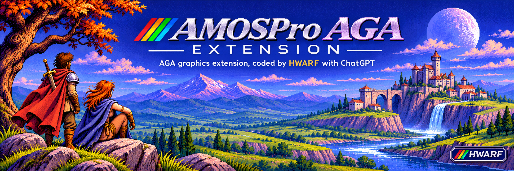

# AMOSPro AGA Extension

[English](README.md) | **Français**

**AMOSPro AGA Extension** étend les capacités d'**AMOS Professional** sur Commodore Amiga AGA : gestion des écrans et des palettes, chargement IFF/ILBM, double buffering, primitives Blitter et Copper, clavier et souris.

Projet conçu et développé par **HWARF**, avec l'assistance de **ChatGPT (OpenAI)** pour la programmation, les tests et la documentation.




*Illustration générée avec ChatGPT : visuel de présentation, pas une capture de l'extension.*

**Licences distinctes :** le code et la documentation technique sont sous [MIT](LICENSE). **Les illustrations, logos, dessins et scans ne sont pas sous MIT** et ne sont pas librement réutilisables : lire la [licence des éléments graphiques](ASSETS_LICENSE.md).

**Pour commencer :** [Notice d'installation](INSTALL.fr.md) · [Six exemples AMOS simples](examples/README.fr.md).

## Bibliothèques et tests

- **Bibliothèque courante :** [`dist/AMOSPro_AGA.Lib`](dist/AMOSPro_AGA.Lib) — **R27 0.9.3 M12 Blitters Safe, 14 252 octets**, SHA256 `d4b838abede4a8fa489f920f7b1633b501639bab86d00f9070dbaea89ece9409`. **Gate A CPU/CI 68000 PASS (396 cas)** ([CI complète réussie](https://github.com/anthea176/AMOSPro-AGA-Extension/actions/runs/42995303489)) ; **Gate B AMOS interprété/WinUAE R27 NON TESTÉE**. R27 sécurise automatiquement Copy/Fill/Clear avec un contrôle Safe non bloquant, **sans nouvelle commande AMOS**. **R26 0.9.2** reste la [dernière archive validée sous WinUAE](dist/experimental/AMOSPro_AGA_M11_v0.9.2_TEXT_R26.Lib) sur les deux scénarios texte/40 swaps. R25/R24 et `LAST_GOOD` R10 intacts.
- **Dernier repli :** `dist/AMOSPro_AGA_LAST_GOOD.Lib` — **R10, conservée sans modification**.
- **Tests M6 validés :** [`R15 Clear`](tests/passed/M6_R15_BLIT_CLEAR_01.asc), [`R14 Fill`](tests/passed/M6_R14_BLIT_FILL_01.asc), [`R13 Copy`](tests/passed/M6_R13_BLIT_COPY_01.asc). **Tests M7 validés :** [`R16 Clear`](tests/passed/M7_R16_COPPER_CLEAR_01.asc), [`R17 On/Off`](tests/passed/M7_R17_COPPER_ON_OFF_01.asc), [`R18 raster`](tests/passed/M7_R18_COPPER_RASTER_01.asc). **Test R23 archivé** : [`M8_R23_IDCMP_QUICK_01.asc`](tests/passed/M8_R23_IDCMP_QUICK_01.asc).
- **Unique test R27 courant (WinUAE NON TESTÉ) :** [`M12_R27_SAFE_BLIT_01.asc`](tests/current/M12_R27_SAFE_BLIT_01.asc), 40 images vert/rouge alternées avec Copy/Fill/Clear appelées à tour de rôle en premier après le swap, **sans sonde `Aga Text`**. Les tests R26 [texte](tests/passed/M11_R26_AGA_TEXT_01.asc) et [Safe/Disp 40 swaps](tests/passed/M11_R26_SAFE_SWAP_02.asc) restent validés, archivés à l'identique. Un seul `.asc` actif dans `tests/current/`. Compiler, matériel réel, FPS et stress exhaustif non validés.
- **Versions précédentes :** `dist/experimental/` ; anciennes versions stables : `archive/`.

Pour un essai, utiliser la bibliothèque correspondant au test. Les fichiers présents sur GitHub ne remplacent pas automatiquement les copies installées dans AMOS/WinUAE.

## Commandes AMOS principales

**API de la bibliothèque courante R27 0.9.3** (M5 IFF, M6 Blitter, M7 Copper et M8 souris X/Y/boutons/transitions) — tableau **exhaustif des 31 commandes AMOS nommées exportées par la bibliothèque AP20**, y compris les deux commandes de diagnostic historiques. Il donne la syntaxe exacte, l'ordre des paramètres et les valeurs de retour. Les coordonnées/dimensions graphiques sont exprimées en pixels, origine `(0,0)` en haut à gauche ; `largeur` et `hauteur` sont des **dimensions**, pas des coordonnées de fin.

| Commande | Syntaxe exacte | Paramètres et comportement |
|---|---|---|
| `Aga Probe` | `Aga Probe` | Instruction historique sans paramètre, réservée au diagnostic ; pas une API de jeu recommandée. |
| `Aga Detect` | `_AGA=Aga Detect` | Sans argument ; résultat non nul si AGA est présent (ne pas supposer que TRUE vaut toujours `1`). |
| `Aga Demo` | `_D=Aga Demo` | Fonction historique sans paramètre, réservée au diagnostic ; pas de contrat de retour pour un jeu. |
| `Aga Screen Open` | `_OK=Aga Screen Open(largeur,hauteur,nbCouleurs,modeID)` | Dimensions en pixels ; **nombre de couleurs**, pas nombre de bitplanes (`2,4,8,16,32,64,128,256` en mode indexé) ; identifiant vidéo AmigaOS, par exemple `$00021000` en PAL LowRes. Retour `1`/`0`. |
| `Aga Screen Close` | `Aga Screen Close` | Sans argument ; ferme l'écran AGA et libère les ressources. |
| `Aga Screen Pattern` | `Aga Screen Pattern` | Sans argument ; dessine le motif de diagnostic. |
| `Aga Double Buffer` | `_DB=Aga Double Buffer` | Sans argument ; active les deux buffers. Retour `1`/`0`. |
| `Aga Swap` | `_SW=Aga Swap` | Sans argument ; présente le back buffer préparé. Retour `1`/`0`. |
| `Aga Back Fill` | `Aga Back Fill couleur` | Instruction à **un argument** : index couleur appliqué à **tout** le back buffer, par exemple `255` sur un écran indexé 8 plans. |
| `Aga Pic Info` | `_V=Aga Pic Info(fichier$,champ)` | Chemin ILBM puis numéro de champ `0..7` (voir tableau suivant) ; renvoie une valeur ou `-1` en cas d'erreur. |
| `Aga Iff Load` | `_OK=Aga Iff Load(fichier$)` | Chemin IFF/ILBM ; charge pixels et palette sur l'écran/buffer compatible. Retour `1`/`0`. |
| `Aga Key` | `_K=Aga Key` | Sans argument ; lecture non bloquante. **R23 :** conserve les touches RAWKEY dans une FIFO de 16 éléments avec le dispatcher IDCMP, sans les perdre lors d'une lecture souris. |
| `Aga Wait Key` | `_K=Aga Wait Key` | Sans argument ; attend une touche de la fenêtre Intuition et renvoie un **code clavier**, pas forcément un ASCII. **R23 :** utilise le même dispatcher/FIFO ; Ctrl+C vérifié sous WinUAE : arrêt à `_WAITK=Aga Wait Key` et fermeture correcte de l'écran Intuition. |
| `Aga Wait Vbl` | `Aga Wait Vbl` | Sans argument ; attend une VBL (`WaitTOF`) ; ne fait rien si aucun écran n'est ouvert. |
| `Aga Blit Copy` (R13+, Safe R27) | `_OK=Aga Blit Copy(sourceX,sourceY,destX,destY,largeur,hauteur)` | Copie un rectangle dans le **même back buffer**. **R27 :** contrôle automatiquement `Safe` avant toute écriture DMA ; retour **0 sans copier** si l'ancien buffer affiché n'est pas encore réutilisable (ou paramètres/état invalides), **1** en cas de succès. Un `GetMsg` non bloquant, sans `ReplyMsg`. **Gate A CPU PASS, R27 WinUAE NON TESTÉE.** |
| `Aga Blit Fill` (R14+, Safe R27) | `_OK=Aga Blit Fill(x,y,largeur,hauteur,indexCouleur)` | Remplit le rectangle dans le back buffer avec l'index couleur en cinquième argument. **R27 :** même contrôle `Safe` non bloquant avant le premier DMA ; retour **0 sans dessin** si non prêt ou invalide. **Gate A CPU PASS ; WinUAE R27 NON TESTÉE.** |
| `Aga Blit Clear` (R15+, Safe R27) | `_OK=Aga Blit Clear(x,y,largeur,hauteur)` | Remet un rectangle à l'index palette **0** (pas forcément au noir RGB). **R27 :** hérite du contrôle `Safe` de Fill via son wrapper natif ; retour **0 sans effacement** si buffer non-Safe ou paramètres invalides. **Gate A CPU PASS ; WinUAE R27 NON TESTÉE.** |
| **`Aga Copper Clear`** (R16+) | `_OK=Aga Copper Clear` | Sans argument ; prépare une liste Copper vide, terminée, associée à l'écran AGA privé. Retour `1`/`0`. |
| **`Aga Copper Wait`** (R18+) | `_OK=Aga Copper Wait(v,h)` | **1 : `v`** = ligne verticale (`0..255`) ; **2 : `h`** = position horizontale (`0..222`). Les WAIT successifs doivent être strictement croissants. Retour `1`/`0`. |
| **`Aga Copper Move`** (R18+) | `_OK=Aga Copper Move(registre,rgb4)` | **1 : `registre`** = offset matériel couleur pair `$180..$1BE` (`COLOR00..COLOR31`) ; **2 : `rgb4`** = valeur **RGB sur 12 bits**, `$000..$FFF` (ex. `$F00` = rouge). Ce n'est **pas** un index de palette. Retour `1`/`0`. |
| **`Aga Copper End`** (R18+) | `_OK=Aga Copper End` | Sans argument ; finalise une liste non vide. Un deuxième appel ou un ajout après `End` est refusé. Retour `1`/`0`. |
| **`Aga Copper On`** (R17+) | `_OK=Aga Copper On` | Sans argument ; applique la liste à l'écran via Intuition. Une liste non vide doit avoir reçu `End`. Retour `1`/`0`. |
| **`Aga Copper Off`** (R17+) | `_OK=Aga Copper Off` | Sans argument ; retire la liste, restaure l'affichage et libère les ressources appartenant à l'extension. Appel répété accepté. Retour `1`/`0`. |
| **`Aga Mouse X`** (R19+) | `_MX=Aga Mouse X` | Sans argument ; position **horizontale** en pixels logiques de l'écran de l'extension (`0..largeur-1`), ou **`-1`** si hors écran / fermé. Non bloquant. |
| **`Aga Mouse Y`** (R19+) | `_MY=Aga Mouse Y` | Sans argument ; position **verticale** en pixels logiques (`0..hauteur-1`), ou **`-1`** si hors écran / fermé. Non bloquant. |
| **`Aga Mouse Buttons`** (R20+, corrigée R21) | `_B=Aga Mouse Buttons` | Sans argument ; **masque entier `0..7`** : `1`=gauche, `2`=droit, `4`=central, bits cumulables (`3`=gauche+droit), `0`=aucun ; **`-1`** si écran/fenêtre invalide ou `input.device` indisponible. Lecture instantanée non bloquante. |
| **`Aga Mouse Pressed`** (R22+, IDCMP depuis R23) | `_P=Aga Mouse Pressed` | Fonction entière sans paramètre ; masque `1` gauche, `2` droit, `4` central, cumulable. **R23 : événements IDCMP_MOUSEBUTTONS mémorisés** entre les lectures ; `0` si aucun, `-1` si écran/focus invalide. Chaque appel consomme les appuis observés, même si le bouton a été relâché avant l'appel. |
| **`Aga Mouse Released`** (R22+, IDCMP depuis R23) | `_R=Aga Mouse Released` | Fonction entière sans paramètre ; masque `1/2/4`, cumulable. **R23 : relâchements IDCMP mis en mémoire** jusqu'à lecture, indépendamment de `Pressed`. Même un clic complet entre deux lectures peut fournir `Pressed=Released=1`. |
| **`Aga Hotspot Hit`** (M9 R24) | `_HIT=Aga Hotspot Hit(_PX,_PY,_X,_Y,_W,_H)` | **Teste si un point est dans une zone rectangulaire (6 entiers)** : `PX,PY` = point testé (ex. souris) ; `X,Y` = **coin supérieur gauche** ; `W,H` = **largeur et hauteur en pixels, PAS les coordonnées du coin opposé**. Retour **1 dedans**, **0 dehors** ; bords droit/bas exclus. **Ne détecte pas le clic** et ne dessine ni n'enregistre la zone ; utiliser `Aga Mouse Pressed` pour un bouton. [Exemple détaillé](#hotspots--zones-rectangulaires-m9-r24). |
| **`Aga Rect Overlap`** (M10 R25) | `_C=Aga Rect Overlap(_AX,_AY,_AW,_AH,_BX,_BY,_BW,_BH)` | **Fonction entière à 8 paramètres** : origine X/Y et largeur/hauteur W/H des rectangles A et B en pixels logiques. Retour **1** si leurs surfaces se recouvrent, même sur un pixel ; **0** si rectangles séparés, contact bord/coin ou dimensions nulles/négatives. Origines négatives autorisées, calcul signé 32 bits protégé. Sans état graphique, souris ou physique. **R25 validée sous WinUAE sur le scénario archivé.** |
| **`Aga Text`** (M11 R26, inchangée R27) | `_OK=Aga Text(_X,_BASELINE_Y,_PEN,_TEXT$)` | Quatre paramètres : X en pixels, Y de la ligne de base, index couleur, chaîne AMOS (1 à 128 caractères). Rend une ligne sur le back buffer AGA Intuition avec RastPort temporaire, fonte système et fond `JAM1` transparent. Retour 1 si dessin, 0 si état/géométrie/chaîne invalides ou buffer non-`Safe`. **R26 Gates A+B PASS pour les scénarios archivés texte et 40 swaps.** R27 conserve tout le segment 68000 de `Aga Text` à l'octet près ; les nouveaux gardes concernent seulement Blit Copy/Fill/Clear. [Contrat R26](docs/M11_TEXT_R26.md) · [contrat R27](docs/M12_SAFE_BLITTER_R27.md). |

**Copper RGB4** est disponible depuis R18, **Mouse X/Y** depuis R19, **Mouse Buttons** depuis R20 et RMBTRAP depuis R21. **R22 a ajouté `Aga Mouse Pressed/Released` (PASS WinUAE) ; R23 change leur source vers IDCMP_MOUSEBUTTONS, avec Gate A CPU/CI PASS et Gate B WinUAE PASS sur son scénario.** Capture garantie des clics très courts, sprites et `Aga Set Colour` restent hors de ce périmètre.

### Blitters Safe (M12 R27 candidate — WinUAE non testée)

Les trois fonctions existantes `Aga Blit Clear`, `Aga Blit Fill` et `Aga Blit Copy` vérifient désormais chacune le signal `Safe`. Le retour `0` peut signifier un buffer non-Safe **ou** une autre erreur ; toute tentative de reprise doit être bornée et entrecoupée de VBL. [Test WinUAE de 40 swaps sans sonde `Aga Text`](tests/current/M12_R27_SAFE_BLIT_01.asc). L'ancienne instruction `Aga Back Fill` n'est **pas** couverte par cette protection. [Contrat technique](docs/M12_SAFE_BLITTER_R27.md).

### Texte AGA (M11 R26 — validée sous WinUAE sur son scénario graphique)

Après ouverture de l'écran AGA et du double buffering, `Aga Text` dessine dans le **BitMap arrière de l'extension** et non dans un écran AMOS natif. Y=96 est la **ligne de base** de la fonte ; l'index couleur 28 doit avoir été défini (par exemple via `examples/demo.iff`) :

```amos
_TX=Aga Text(40,96,28,"BONJOUR AGA")
If _TX=1
   _SW=Aga Swap
End If
```

Le résultat 0 peut indiquer que l'ancien buffer frontal n'a pas encore été déclaré `Safe`. Ne pas boucler indéfiniment ; la protection R26 ne sécurise pas rétroactivement les anciennes commandes Blitter. [Test WinUAE](tests/passed/M11_R26_AGA_TEXT_01.asc) · [contrat technique](docs/M11_TEXT_R26.md).

### Hotspots : zones rectangulaires (M9 R24)

`Aga Hotspot Hit(PX,PY,X,Y,W,H)` vérifie **si un point est situé dans un rectangle**. Ce n'est pas un test de collision entre deux rectangles. La fonction renvoie un **entier** (à affecter à une variable), pas un identifiant de bouton. Les deux premiers paramètres décrivent le **point**, les quatre suivants le rectangle.

| Paramètre | Signification | Exemple |
|---|---|---|
| `PX`, `PY` | Coordonnées X/Y du point testé (par exemple `Aga Mouse X/Y`) | `60,50` |
| `X`, `Y` | Coordonnées X/Y du **coin supérieur gauche** de la zone | `40,30` |
| `W`, `H` | **Largeur et hauteur** de la zone, pas le coin opposé | `80,40` |
| Résultat (`_HIT`) | `1` = dedans ; `0` = dehors ou paramètres invalides | `1` |

Pour le rectangle `(X=40,Y=30,W=80,H=40)`, les pixels compris dans la zone vont de **X=40 à 119** et de **Y=30 à 69**. À X=120 ou Y=70, le point est **dehors** : les bords droit et bas sont exclus. Les bords gauche et haut sont inclus.

```amos
_DEDANS=Aga Hotspot Hit(60,50,40,30,80,40)
_DEHORS=Aga Hotspot Hit(120,50,40,30,80,40)
' _DEDANS=1, _DEHORS=0
```

**Exemple : activer un bouton de menu seulement si l'on clique gauche à l'intérieur du rectangle** (avec un écran AGA déjà ouvert) :

```amos
_SELECTED=0
_PX=Aga Mouse X
_PY=Aga Mouse Y
_HIT=Aga Hotspot Hit(_PX,_PY,40,30,80,40)
_P=Aga Mouse Pressed
If _P>=0
   _LEFT=_P And 1
   If _LEFT<>0 and _HIT=1
      _SELECTED=10
   End If
End If
```

Ici, `10` est un **identifiant choisi par le programme**, pas une valeur fournie par `Aga Hotspot Hit`. Pour plusieurs zones qui se recouvrent, tester chaque rectangle et attribuer l'ID dans l'ordre de priorité voulu : **la dernière affectation correspondante gagne**, comme dans le [test R24 validé](tests/passed/M9_R24_HOTSPOT_HIT_01.asc).

**Limites :** `PX/PY` négatifs (dont la valeur `-1` renvoyée par `Aga Mouse X/Y`) et `W/H` nuls ou négatifs donnent 0. Les origines `X/Y` des rectangles peuvent être négatives. `Aga Hotspot Hit` ne lit pas la souris, ne consomme aucun événement, ne dessine pas la zone et fonctionne même sans écran AGA ouvert. Le clic se détecte séparément avec `Aga Mouse Pressed` ; les coordonnées de `Aga Mouse X/Y` sont celles **mesurées au moment de la lecture**, pas celles mémorisées à l'instant exact du clic. Voir le [contrat technique](docs/M9_HOTSPOT_R24.md).

### Détail : Souris AGA (R19–R23)

Les cinq fonctions `Aga Mouse X/Y/Buttons/Pressed/Released` sont **des fonctions entières sans argument**, à utiliser dans une affectation ou une expression. Sous AMOS, **ne pas écrire une fonction entière seule sur une ligne**.

```amos
_X=Aga Mouse X
_Y=Aga Mouse Y
_B=Aga Mouse Buttons
_P=Aga Mouse Pressed
_R=Aga Mouse Released

If _X>=0 and _Y>=0 and _B>=0
   _GAUCHE=_B And 1
   _DROIT=_B And 2
End If
```

- **Coordonnées X/Y :** origine `(0,0)` en haut à gauche, X dans `0..largeur-1`, Y dans `0..hauteur-1`. `-1` si fenêtre fermée, invalide ou coordonnée hors limites. Vérifier **les deux** coordonnées.
- **Boutons :** `0`=aucun ; `1`=gauche ; `2`=droit ; `4`=central ; valeurs combinables (par exemple `3`=gauche+droit). `-1` signifie que la lecture n'est pas possible (écran/fenêtre ou périphérique invalide). Vérifier `_B>=0` **avant** les opérations binaires.
- **R21 et clic droit :** `Aga Screen Open` active `WFLG_RMBTRAP`. Le clic droit ne déclenche plus les menus Intuition de la fenêtre AGA ; ce comportement a été validé sous WinUAE.
- **Nature de la lecture :** non bloquante ; `Aga Mouse Buttons` interroge un **instantané global** de `input.device/PeekQualifier()`, sans vider les événements clavier. Ne pas le confondre avec une file de clics propre à la fenêtre ; les appuis trop brefs entre deux lectures peuvent être manqués.
- **Transitions R23 :** `Aga Mouse Pressed` et `Aga Mouse Released` dépilent via un dispatcher central les événements `IDCMP_MOUSEBUTTONS` et mémorisent séparément les appuis/relâchements. Un clic DOWN+UP déjà reçu avant la lecture déclenche les deux masques. Chaque fonction efface uniquement son propre masque. Une FIFO de 16 événements clavier `RAWKEY` préserve `Aga Key` et `Aga Wait Key` ; si elle est pleine, le dispatcher arrête temporairement de dépiler les messages. **Deux clics identiques dans le même intervalle restent fusionnés dans le masque** (ce n'est pas un compteur). Préflight CPU et CI complète PASS (15 cas R23) ; Ctrl+C testé sous WinUAE (interruption propre et écran Intuition fermé) ; tests de focus et de stress encore à réaliser.

**Ancien calcul de fronts R21 côté AMOS**, conservé comme alternative :

```amos
_OLD=Aga Mouse Buttons
_NOW=Aga Mouse Buttons
If _OLD>=0 and _NOW>=0
   _PRESSED=_NOW And (7-_OLD)
   _RELEASED=_OLD And (7-_NOW)
End If
```

**R23 validée sur son scénario WinUAE :** [test exact archivé](tests/passed/M8_R23_IDCMP_QUICK_01.asc) sur la mire originale 320×256×8. Gate A CPU/CI PASS 15 cas (CI (archive CI privée, run #42899343161)), Gate B PASS : `RESULT=1`, `PRESSED=RELEASED=3`, `KEYS=64/64/-1`, `WAIT=16` (touche A AZERTY). **Ctrl+C** interrompt le programme à `_WAITK=Aga Wait Key` et ferme correctement l'écran Intuition (validation utilisateur).

### Détail : Copper AGA (R16–R18)

**Toutes les commandes `Aga Copper` ci-dessus sont des fonctions entières.** Toujours utiliser le résultat dans une affectation ou une expression : `_OK=Aga Copper Off` est valide, mais **`Aga Copper Off` seul provoque une erreur de syntaxe AMOS**, y compris dans une branche `If` jamais exécutée. **Retour `1` = succès, `0` = refus/échec.**

| Fonction | Paramètre 1 | Paramètre 2 | Remarques |
|---|---|---|---|
| `Clear` | — | — | Initialise la liste de l'écran AGA ; à exécuter avant les ajouts. |
| `Wait(v,h)` | `v` : ligne `0..255` | `h` : position `0..222` | Positions croissantes ; les positions invalides ou les retours en arrière donnent `0`. |
| `Move(registre,rgb4)` | `registre` : `$180` à `$1BE`, **pair** | `rgb4` : `$000` à `$FFF` | `$180` = `COLOR00`, `$182` = `COLOR01`… `$1BE` = `COLOR31`. Pas d'accès à DMA, BPLCON ou aux pointeurs bitplanes. |
| `End` | — | — | Scelle la liste non vide ; aucun nouvel ajout après. |
| `On` | — | — | Active la liste terminée ; toute modification après activation est refusée. |
| `Off` | — | — | Détache puis libère la liste de l'extension ; un second `Off` est accepté. |

Les valeurs de `Move` sont du **RGB4** : `$F00` = rouge, `$0F0` = vert, `$00F` = bleu, `$000` = noir. Contrairement à `Aga Blit Fill`, le second argument de `Move` n'est **pas** un numéro d'index couleur. Exemple : `Aga Copper Move($180,$F00)` modifie la valeur de **COLOR00** au moment du balayage défini par le dernier `Wait`.

**Séquence d'exemple**, à placer après un `Aga Screen Open` réussi, `Aga Double Buffer` et éventuellement un `Aga Iff Load` compatible. Elle reprend les appels validés dans le [test R18 complet](tests/passed/M7_R18_COPPER_RASTER_01.asc) :

```amos
_C=Aga Copper Clear
_W1=Aga Copper Wait(20,0)
_M1=Aga Copper Move($180,$F00)
_W2=Aga Copper Wait(80,0)
_M2=Aga Copper Move($180,$0F0)
_W3=Aga Copper Wait(140,0)
_M3=Aga Copper Move($180,$00F)
_W4=Aga Copper Wait(200,0)
_M4=Aga Copper Move($180,$000)
_E=Aga Copper End
_ON=Aga Copper On
_SW=Aga Swap
_K=Aga Wait Key
_OFF=Aga Copper Off
```

**Ordre à respecter :** `Clear` → couples `Wait`/`Move` → `End` → `On` → affichage/attente → `Off` → `Aga Screen Close`. Avec `COLOR00`, les bandes sont surtout visibles là où l'image utilise l'index de couleur 0 ; les pixels utilisant cet index dans l'image peuvent également changer de couleur. Le premier exemple RGB4 est limité à **62 instructions utiles + CEND**, avec capacité réservée, sans reprogrammation libre des registres AGA.

**Validation :** les tests R16, R17 et R18 ont passé AMOS interprété/WinUAE pour leurs scénarios ; le [test R18](tests/passed/M7_R18_COPPER_RASTER_01.asc) montre le raster, les rejets, `Off`, la réouverture et la fermeture. Cela **ne valide pas** le Compiler AMOS, le matériel réel, une exécution prolongée ni la palette AGA 24 bits complète. Détails : [M7 Copper R18](docs/M7_COPPER_R18.md) et [statut M7](docs/M7_STATUS.md).

### Détail : `Aga Blit Fill`, `Aga Blit Copy` et `Aga Blit Clear`

Ces trois fonctions réclament un écran ouvert via `Aga Screen Open`, puis un `Aga Double Buffer` réussi. Elles agissent **uniquement sur le back buffer** ; appeler `Aga Swap` pour rendre le dessin visible.

```amos
_OK=Aga Blit Fill(18,24,86,48,15)
```

| Argument | Nom | Valeur dans l'exemple |
|---:|---|---|
| 1 | `x` | `18` : coordonnée horizontale de départ |
| 2 | `y` | `24` : coordonnée verticale de départ |
| 3 | `largeur` | `86` pixels |
| 4 | `hauteur` | `48` pixels |
| 5 | `indexCouleur` | `15` : **numéro d'entrée dans la palette** |

Ce rectangle couvre `x=18..103` et `y=24..71` inclus : **ce n'est pas `x1,y1,x2,y2,couleur`**. L'index de couleur **n'est pas un RGB** : en mode indexé 4 plans, plage `0..15` ; en mode indexé 8 plans, plage `0..255` ; plus généralement `0..(2^profondeur-1)`. Les modes spéciaux HAM/EHB ne se manipulent pas comme une palette RGB indexée ordinaire.

```amos
_OK=Aga Blit Copy(18,24,150,24,86,48)
_OK=Aga Blit Clear(32,40,36,16)
```

- `Copy` : source `(18,24)`, destination `(150,24)`, dimensions `86 x 48`. `graphics.library/BltBitMap` gère les chevauchements.
- `Clear` : rectangle `(32,40)` de `36 x 16` pixels, mis à l'index `0`. C'est l'équivalent de `Aga Blit Fill(32,40,36,16,0)`.
- **Pas de clipping** : coordonnées négatives, dimensions nulles/négatives, rectangle dépassant les limites de l'écran ou couleur hors plage => retour `0` ; retour `1` en cas de succès.
- Les blits sont synchronisés avec `WaitBlit`. Si un appel système échoue après qu'un plan a été modifié, `0` ne garantit pas une opération atomique.
- `Aga Back Fill couleur` remplit **tout** le back buffer ; `Aga Blit Fill(...)` ne remplit qu'un rectangle.

### Séquence d'utilisation

Après vérification des retours de `Aga Screen Open` et `Aga Double Buffer`, charger éventuellement une IFF compatible avec `Aga Iff Load`, lancer les opérations Blitter, puis `Aga Swap`. Pour un exemple **exécutable complet avec contrôles d'erreur et fermeture**, voir les programmes déjà validés : [`Copy R13`](tests/passed/M6_R13_BLIT_COPY_01.asc), [`Fill R14`](tests/passed/M6_R14_BLIT_FILL_01.asc), [`Clear R15`](tests/passed/M6_R15_BLIT_CLEAR_01.asc).

**Portée de validation :** scénarios passés sous AMOS interprété/WinUAE ; compilation AMOS et vrai Amiga AGA toujours non testés pour M6.

### Lecture des caractéristiques ILBM

`Aga Pic Info(fichier$,champ)` expose les champs suivants :

| Champ | Valeur |
|---:|---|
| 0 | Largeur |
| 1 | Hauteur |
| 2 | Nombre de bitplanes |
| 3 | Nombre de couleurs dans CMAP |
| 4 | Compression : 0 (RAW), 1 (ByteRun1) |
| 5 | CAMG original |
| 6 | ModeID utilisable pour l'ouverture |
| 7 | Nombre de couleurs à demander à l'écran |

L'inventaire des images de référence est dans [`docs/ILBM_INVENTORY.md`](docs/ILBM_INVENTORY.md). Un chargement ILBM ne remplace pas l'obligation de créer un écran compatible avant `Aga Iff Load`.

### Séquence de test recommandée

Les tests M6 R14 Fill et R13 Copy sont [archivés](tests/passed/) après PASS WinUAE. Le test R15 Clear est également [archivé après PASS WinUAE](tests/passed/M6_R15_BLIT_CLEAR_01.asc) ; aucun test M6 actif. Le programme R12 [`R12_JEFF_A0_RETRY.asc`](tests/passed/R12_JEFF_A0_RETRY.asc) reste archivé ; son enchaînement historique était :

```text
Aga Pic Info → Aga Screen Open → Aga Double Buffer
→ Aga Iff Load → Aga Swap → Aga Wait Key
→ Aga Screen Close → Amos To Front
```

Sous AMOS, utiliser la syntaxe `If condition` / `End If` (sans `Then`) et fermer l'écran AGA avant de quitter le programme.

## Développement et intégrité

La racine de [`tools/`](tools/README.md) regroupe les builders, leurs dépendances, les tests CPU et les utilitaires d'intégrité. Les anciens outils sont conservés dans `tools/obsolete/` lorsqu'ils ne sont plus actifs.

- **Builder courant R23 :** [`build_m8_idcmp_r23.py`](tools/build_m8_idcmp_r23.py) depuis l'archive R22 figée ; [préflight CPU](tools/test_m8_idcmp_r23_preflight.py) **PASS 15 scénarios** ; la vérification de la nouvelle bibliothèque et sa validation WinUAE restent distinctes. R22 et R21 archivées.
- **Archives M8 :** [R20 boutons](docs/M8_MOUSE_BUTTONS_R20.md), [R19 X/Y](docs/M8_MOUSE_R19.md) et [R21 RMBTRAP](docs/M8_RMBTRAP_R21.md), avec leurs tests AMOS respectifs.
- **Vérification des binaires :** [`verify_artifacts.py`](tools/verify_artifacts.py), audit HUNK/AP20, SHA-256, reproductibilité et [CI GitHub Actions](.github/workflows/artifact-integrity.yml).
- **Concordance API / README EN/FR :** [`test_readme_api_coverage.py`](tools/test_readme_api_coverage.py) vérifie la présence de toutes les commandes AP20 dans les deux tableaux publics (anglais et français), ainsi que la version active. Le contrôle s'exécute en CI à chaque modification du README, des règles, des scripts de test ou du binaire.
- **Règle de développement :** [`EXTENSION_SOURCE_RULES.md`](EXTENSION_SOURCE_RULES.md) — **toute nouvelle instruction/fonction AMOS doit être inscrite dans le tableau principal du README**, avec la syntaxe, les paramètres dans le bon ordre, le retour, le statut et un exemple. La documentation fait partie du même incrément que la commande.
- **État et reprise :** [`docs/NEXT_SESSION.md`](docs/NEXT_SESSION.md), [statut M8](docs/M8_STATUS.md), [architecture](docs/ARCHITECTURE.md), [roadmap](docs/ROADMAP.md).

**Checkpoint : M12/R27 0.9.3 Blitters Safe candidate : Gate A CPU/CI 68000 PASS (396 cas), Gate B AMOS/WinUAE EN ATTENTE.** La bibliothèque AP20 de 14 252 octets garde les **31 commandes** de R26 et ne modifie que les segments 19 Copy, 20 Fill et le saut relatif de Clear 21. [Test unique sous WinUAE](tests/current/M12_R27_SAFE_BLIT_01.asc) : 40 swaps, contrôle de disponibilité automatique par chacun des Blitters à tour de rôle (14/13/13), **sans `Aga Text` sonde**. **R26 0.9.2 reste la dernière version validée sous WinUAE** sur [ses deux scénarios](tests/passed/M11_R26_SAFE_SWAP_02.asc). R25/R24 et `LAST_GOOD` R10 intactes ; Compiler, matériel, FPS et stress non validés. [Contrat M12](docs/M12_SAFE_BLITTER_R27.md).
