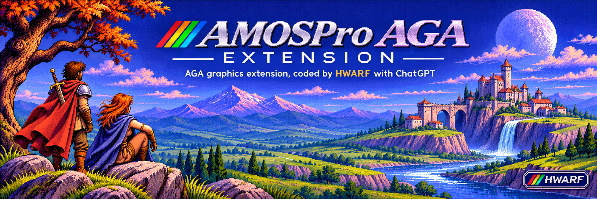

# AMOSPro AGA Extension

[English](README.md) | **Français**


**AMOSPro AGA Extension** étend les capacités d'**AMOS Professional** sur Commodore Amiga AGA : gestion des écrans et des palettes, chargement IFF/ILBM, double buffering, primitives Blitter et Copper, clavier et souris.

Projet conçu et développé par **HWARF**, avec l'assistance de **ChatGPT (OpenAI)** pour la programmation, les tests et la documentation.




*Illustration générée avec ChatGPT : visuel de présentation, pas une capture de l'extension.*

**Licences distinctes :** le code et la documentation technique sont sous [MIT](LICENSE). **Les illustrations, logos, dessins et scans ne sont pas sous MIT** et ne sont pas librement réutilisables : lire la [licence des éléments graphiques](ASSETS_LICENSE.md).

**Pour commencer :** [Notice d'installation](INSTALL.fr.md) · [Exemples AMOS](examples/README.fr.md).

## Bibliothèques et tests

**M19 S1-P1g — candidate de TEST active (MC68020+).** [Bibliothèque](dist/AMOSPro_AGA.Lib), **142 684 octets**, SHA256 `29788993d299c47d923ddce45ae2c9ae2cc3c98e510989a6975db3a3d10c6f66`, **102 commandes / 208 entrées AP20**. [Gate A](https://github.com/anthea176/AMOSPro-AGA-Extension/actions/runs/45470002173) ciblée AP20 PASS, code natif P1f strictement conservé ; requalification native complète en cours. WinUAE B, Compiler C, D physique non testées. [LAST_GOOD P2d-L2b](dist/AMOSPro_AGA_LAST_GOOD.Lib) protégée, 136 708 octets, SHA256 `a7ed96e92b460e842772aed77ac35a303d8f663aaa456821c323109446dd19dc`, 100 commandes / 203 AP20. [Qualification et limites](docs/releases/0.14.1_QUALIFICATION.md).

**Régression 2D conservée :** [T06_PATTERN_TARGET.asc](tests/current/T06_PATTERN_TARGET.asc) · [Protocole](tests/current/README.md). Correctif Pattern : back buffer et SafePort. Aucune ressource externe. Preuves Runtime L2b historiques. **Prochain test Runtime :** [Get AGA Sprite](tests/proto/agsp_capture/README.md), capture AGSP uniquement ; aucune DMA.

**Régression historique :** [P2 ALL IN ONE](tests/passed/M19_P2_ALL_IN_ONE.asc) validé sur P2d · [LIBRARY_TEST_HISTORY](docs/LIBRARY_TEST_HISTORY.fr.md) · [Installation](INSTALL.fr.md) · [Suivi](docs/NEXT_SESSION.md).
**Dernière release publique GitHub :** 0.14.0. **Prochaine cible : 0.14.1 — Stability & Bug Fixes (brouillons, non publiée).** [Notes GitHub](docs/releases/0.14.1_GITHUB_RELEASE.md) · [Notice Aminet](docs/releases/0.14.1/AMOSProAGA.readme) · [Checklist](docs/releases/0.14.1_RELEASE_CHECKLIST.md). Aucune nouvelle commande dans la 0.14.1 ; développement S1-P1g séparé pour 0.15.0.

## Commandes AMOS principales

**API de la bibliothèque courante M19 S1-P1g** — **102 commandes / 208 entrées AP20**, MC68020 minimum. Les deux commandes Sprite sont réservées aux tests, absentes de la 0.14.1.
| Commande | Syntaxe exacte | Paramètres et comportement |
|---|---|---|
| `Aga Detect` | `_AGA=Aga Detect` | Sans argument ; résultat non nul si AGA est présent (ne pas supposer que TRUE vaut toujours `1`). |
| `Aga Screen Open` | `_OK=Aga Screen Open(largeur,hauteur,nbCouleurs,modeID)` | Dimensions en pixels ; **nombre de couleurs**, pas nombre de bitplanes (`2,4,8,16,32,64,128,256` en mode indexé) ; identifiant vidéo AmigaOS, par exemple `$00021000` en PAL LowRes. Retour `1`/`0`. |
| `Aga Screen Close` | `Aga Screen Close` | Sans argument ; ferme l'écran AGA si les notifications Safe/Disp ont été acquittées ; ne libère pas les ports ni les buffers encore attendus. P0 Runtime : CLOSE_RETURNED 1 après 405 frames ; Compiler P0 non testé. |
| `Aga Double Buffer` | `_DB=Aga Double Buffer` | Sans argument ; active les deux buffers. Retour `1`/`0`. |
| `Aga Swap` | `_SW=Aga Swap` | Sans argument ; présente le back buffer préparé. Retour `1`/`0` ; en B7, refuse toute frame marquée DIRTY sans appeler `ChangeScreenBuffer`. P0 Runtime : SWAP_FAILS 0 sur 405 frames ; Compiler P0 non testé. |
| `Aga Pic Info` | `_V=Aga Pic Info(fichier$,champ)` | Chemin ILBM puis numéro de champ `0..7` (voir tableau suivant) ; renvoie une valeur ou `-1` en cas d'erreur. |
| `Aga Iff Load` | `_OK=Aga Iff Load(fichier$)` | Charge les pixels et la palette IFF/ILBM sur un écran AGA compatible. L2 vérifie Safe avant écriture ; retour 0 sans dessin si indisponible, 1 en cas de succès. Gate A PASS, B/C PASS rapportés pour SafePort ciblé. |
| `Aga Palette Load` | `_OK=Aga Palette Load(_FILE$)` | Importe uniquement le `CMAP` d'un **IFF standard FORM ILBM**, y compris les palettes PPaint/DPaint sans `BODY` ni `BMHD` ; ne modifie aucun pixel. Retour 1 succès, 0 en cas de refus. |
| `Aga Palette Set` | `_OK=Aga Palette Set(_PEN,_R,_G,_B)` | Définit un index de palette du `ColorMap` Intuition AGA avec R/V/B sur 8 bits (`0..255`) via `LoadRGB32` ; retour 1 ou 0, sans attente VBL. Les modes HAM, EHB et dual playfield ne sont pas pris en charge. |
| `Aga Palette Get` | `_RGB=Aga Palette Get(_PEN)` | Lit le `ColorMap` par `GetRGB32`. Renvoie le RGB24 empaqueté `$00RRGGBB` ou -1 en cas d'erreur ; noir = 0. Aucun pixel modifié. |
| `Aga Palette Save` | `_OK=Aga Palette Save(_FILE$)` | Sauvegarde le `ColorMap` indexé de l'écran AGA Intuition en IFF `FORM ILBM` avec `BMHD` et `CMAP`, **sans BODY**. Chaîne AMOS de 1 à 255 octets (chemin AmigaDOS). **Écrase le fichier existant** via `MODE_NEWFILE`. Résultat entier 1 si écriture/fermeture réussies, 0 si écran/fichier/mémoire/écriture invalides. 1 à 256 couleurs RGB24, sans modifier les pixels ; HAM/EHB/dual playfield refusés. Un échec après ouverture peut détruire l'ancien fichier. |
| `Aga Bank Palette Init` | `_OK=Aga Bank Palette Init(_B,_N)` | Initialise une banque DATA AMOS existante (numéro `_B` de 5 à 65535) au format AGAPAL v1 ; `_N` = 1..256 emplacements, banque de taille exacte `16+776×N` octets. Retour 1/0. N'altère pas la palette écran. |
| `Aga Bank Palette Capture` | `_OK=Aga Bank Palette Capture(_B,_INDEX)` | Capture les couleurs de l'écran AGA privé dans une banque AGAPAL v1, via son **numéro** et un indice d'emplacement 0-based. N'accepte pas les banques AGAPIC. Retour 1/0 sans fondu ni modification des autres emplacements. |
| `Aga Bank Palette Apply` | `_OK=Aga Bank Palette Apply(_B,_INDEX)` | Applique immédiatement soit une palette AGAPAL v1 non vide, soit **la palette RGB24 complète AGAPIC v2 à l'indice 0**. Pour v2, exige le même DisplayModeID que l'écran AGA, et les capacités couleur correctes ; AGAPIC v1 n'a pas de palette embarquée. Retour 1/0, sans attente VBL ni pixels modifiés. |
| `Aga Bank Palette Fade` | `_OK=Aga Bank Palette Fade(_B,_INDEX,_VBL)` | Fondu bloquant vers une palette AGAPAL v1 ou AGAPIC v2 (indice 0), `_VBL` de 1 à 255 ; une attente VBL et une mise à jour RGB32 par étape, palette finale exacte. Vérifie ModeID pour v2, ne modifie ni pixels ni banque. Retour 1/0. |
| `Aga Fade To Black` | `_OK=Aga Fade To Black(_VBL)` | Fondu bloquant vers le noir exact de tous les pens indexés logiques de l'écran AGA privé, sans banque. `_VBL` vaut 1..255 : un `WaitTOF` par étape, noir RGB32 exact à la fin. Durée ou écran invalides : retour 0 sans changement ; sinon 1. Pixels inchangés. |
| `Aga Fade To White` | `_OK=Aga Fade To White(_VBL)` | Fondu bloquant vers le blanc exact de tous les pens indexés logiques de l'écran AGA privé, sans banque. `_VBL` vaut 1..255 : un `WaitTOF` par étape, blanc RGB32 exact à la fin. Durée ou écran invalides : retour 0 sans changement ; sinon 1. Pixels inchangés. |
| `Aga Palette Cycle` | `_OK=Aga Palette Cycle(First,Last,Direction)` | **Une rotation par appel** des indices inclus `0<=First<Last<256` dans les pens logiques de l'écran AGA privé indexé et de sa ColorMap. `Direction=1` : dernière couleur RGB32 vers First, autres couleurs vers les indices croissants ; `-1` : sens inverse. Un seul `GetRGB32`, permutation de triplets **RGB32 complets** en mémoire temporaire, puis **un seul `LoadRGB32`** sur cette plage ; **aucun WaitTOF implicite**, aucune banque, aucun pixel ni dégradation des couleurs. Scratch Exec public `8+12*N` octets (max 3 080), libéré. Retour **1** succès, **0 sans modification** si indices, sens, écran, ColorMap ou allocation invalides. AMOS pilote la cadence avec `Aga Wait Vbl`. |
| `Aga Key` | `_K=Aga Key` | Sans argument ; lecture non bloquante. Conserve les touches RAWKEY dans une FIFO de 16 éléments avec le dispatcher IDCMP, sans les perdre lors d'une lecture souris. |
| `Aga Wait Key` | `_K=Aga Wait Key` | Attend une touche de la fenêtre Intuition et renvoie son code RAWKEY, pas nécessairement ASCII. Utilise le dispatcher clavier/souris commun ; interruption Ctrl+C gérée. |
| `Aga Wait Vbl` | `Aga Wait Vbl` | Sans argument ; attend une VBL (`WaitTOF`) ; ne fait rien si aucun écran n'est ouvert. |
| `Aga Blit Copy` | `_OK=Aga Blit Copy(sourceX,sourceY,destX,destY,largeur,hauteur)` | Copie un rectangle dans le **même back buffer**. Contrôle automatiquement `Safe` avant toute écriture DMA ; retour **0 sans copier** si l'ancien buffer affiché n'est pas encore réutilisable (ou paramètres/état invalides), **1** en cas de succès. Un `GetMsg` non bloquant, sans `ReplyMsg`. |
| `Aga Blit Fill` | `_OK=Aga Blit Fill(x,y,largeur,hauteur,indexCouleur)` | Remplit le rectangle dans le back buffer avec l'index couleur en cinquième argument. Même contrôle `Safe` non bloquant avant le premier DMA ; retour **0 sans dessin** si non prêt ou invalide. |
| `Aga Blit Clear` | `_OK=Aga Blit Clear(x,y,largeur,hauteur)` | Remet un rectangle à l'index palette **0** (pas forcément au noir RGB). Hérite du contrôle `Safe` de Fill via son wrapper natif ; retour **0 sans effacement** si buffer non-Safe ou paramètres invalides. |
| **`Aga Copper Clear`** | `_OK=Aga Copper Clear` | Sans argument ; prépare une liste Copper vide, terminée, associée à l'écran AGA privé. Retour `1`/`0`. |
| **`Aga Copper Wait`** | `_OK=Aga Copper Wait(v,h)` | **1 : `v`** = ligne verticale (`0..255`) ; **2 : `h`** = position horizontale (`0..222`). Les WAIT successifs doivent être strictement croissants. Retour `1`/`0`. |
| **`Aga Copper Move`** | `_OK=Aga Copper Move(registre,rgb4)` | **1 : `registre`** = offset matériel couleur pair `$180..$1BE` (`COLOR00..COLOR31`) ; **2 : `rgb4`** = valeur **RGB sur 12 bits**, `$000..$FFF` (ex. `$F00` = rouge). Ce n'est **pas** un index de palette. Retour `1`/`0`. |
| **`Aga Copper End`** | `_OK=Aga Copper End` | Sans argument ; finalise une liste non vide. Un deuxième appel ou un ajout après `End` est refusé. Retour `1`/`0`. |
| **`Aga Copper On`** | `_OK=Aga Copper On` | Sans argument ; applique la liste à l'écran via Intuition. Une liste non vide doit avoir reçu `End`. Retour `1`/`0`. |
| **`Aga Copper Off`** | `_OK=Aga Copper Off` | Sans argument ; retire la liste, restaure l'affichage et libère les ressources appartenant à l'extension. Appel répété accepté. Retour `1`/`0`. |
| **`Aga Mouse X`** | `_MX=Aga Mouse X` | Sans argument ; position **horizontale** en pixels logiques de l'écran de l'extension (`0..largeur-1`), ou **`-1`** si hors écran / fermé. Non bloquant. |
| **`Aga Mouse Y`** | `_MY=Aga Mouse Y` | Sans argument ; position **verticale** en pixels logiques (`0..hauteur-1`), ou **`-1`** si hors écran / fermé. Non bloquant. |
| **`Aga Mouse Buttons`** | `_B=Aga Mouse Buttons` | Sans argument ; **masque entier `0..7`** : `1`=gauche, `2`=droit, `4`=central, bits cumulables (`3`=gauche+droit), `0`=aucun ; **`-1`** si écran/fenêtre invalide ou `input.device` indisponible. Lecture instantanée non bloquante. |
| **`Aga Mouse Pressed`** | `_P=Aga Mouse Pressed` | Fonction entière sans paramètre ; masque `1` gauche, `2` droit, `4` central, cumulable. **Événements IDCMP_MOUSEBUTTONS mémorisés** entre les lectures ; `0` si aucun, `-1` si écran/focus invalide. Chaque appel consomme les appuis observés, même si le bouton a été relâché avant l'appel. |
| **`Aga Mouse Released`** | `_R=Aga Mouse Released` | Fonction entière sans paramètre ; masque `1/2/4`, cumulable. **Relâchements IDCMP mémorisés** jusqu'à lecture, indépendamment de `Pressed`. Même un clic complet entre deux lectures peut fournir `Pressed=Released=1`. |
| **`Aga Hotspot Hit`** | `_HIT=Aga Hotspot Hit(_PX,_PY,_X,_Y,_W,_H)` | Teste si le point `(PX,PY)` appartient au rectangle `(X,Y,W,H)` (origine en haut à gauche, largeur et hauteur en pixels). Retour 1 à l'intérieur, 0 à l'extérieur ; bords droit et bas exclus. Ne détecte pas un clic et ne dessine pas de zone. [Exemple](#hotspots--zones-rectangulaires-m9-r24). |
| **`Aga Rect Overlap`** | `_C=Aga Rect Overlap(_AX,_AY,_AW,_AH,_BX,_BY,_BW,_BH)` | **Fonction entière à 8 paramètres** : origine X/Y et largeur/hauteur W/H des rectangles A et B en pixels logiques. Retour **1** si leurs surfaces se recouvrent, même sur un pixel ; **0** si rectangles séparés, contact bord/coin ou dimensions nulles/négatives. Origines négatives autorisées, calcul signé 32 bits protégé. Sans état graphique, souris ou physique. |
| **`Aga Text`** | `_OK=Aga Text(_X,_BASELINE_Y,_PEN,_TEXT$)` | Dessine une ligne de texte à fond transparent (`JAM1`) dans le back buffer AGA : X en pixels, Y de la ligne de base, index couleur et chaîne AMOS de 1 à 128 caractères. Polices système/AmigaOS et BankFonts AMCAF. Retour 1 si tracée, 0 si état/arguments invalides ou buffer non-`Safe`. [Détails texte](docs/M11_TEXT_R26.md) · [Détails Safe](docs/M12_SAFE_BLITTER_R27.md). |
| **`Aga Font Select`** | `_OK=Aga Font Select(_FONT$,_YSIZE)` | Charge et sélectionne une fonte AmigaOS `.font` via `diskfont.library` (nom 1..127 caractères, hauteur demandée 1..255). Retour 1 si succès, 0 si refus sans effet. `_OK=Aga Font Select("",0)` restaure la fonte par défaut. Influence `Aga Text` sur l'écran AGA privé ; libération au remplacement/reset/Screen Close. |
| **`Aga Bank Font Select`** | `_OK=Aga Bank Font Select(Bank)` | Sélectionne une BankFont AMCAF par numéro de banque AMOS vivante (5..65535). Résout automatiquement adresse et longueur, puis conserve une copie privée en Chip RAM indépendante de la source. Retour 1 en cas de succès, 0 en cas de refus. |
| **`Aga Plot`** | `_OK=Aga Plot(X,Y,Pen)` | Écrit **un pixel** à `(X,Y)` dans le **back buffer AGA**. X/Y entre zéro et largeur/hauteur moins un, `Pen` indexé 0..2^Depth−1 (1 à 8 plans). `1` si `WritePixel` réussit, `0` sinon (paramètre invalide, écran absent ou buffer non-`Safe`). Pas de clipping hors écran, aucun swap/VBL implicite. |
| **`Aga Draw`** | `_OK=Aga Draw(X1,Y1,X2,Y2,Pen)` | Trace une **ligne d'un pixel** sur le **back buffer AGA**, extrémités incluses. Tracé rapide pour les coordonnées entièrement dans l'écran ; **clipping logiciel sécurisé** par Bresenham en dehors. Coordonnées signées 16 bits, `Pen` indexé selon la profondeur. `1` si au moins un pixel dessiné, `0` sinon. Pas de swap/VBL implicite. |
| **`Aga Box`** | `_OK=Aga Box(X1,Y1,X2,Y2,Pen)` | Dessine **le contour d'un rectangle** de 1 pixel d'épaisseur sur le **back buffer AGA**. Coordonnées des **deux coins inclusives**, dans n'importe quel ordre (pas largeur/hauteur). **Clipping sûr des quatre côtés originaux** sans ajouter de fausse bordure. Coordonnées signées 16 bits, `Pen` couleur indexée ; `1` si au moins un pixel dessiné, sinon `0`. Pas de swap/VBL implicite, pas de remplissage. |
| **`Aga Circle`** | `_OK=Aga Circle(CX,CY,Radius,Pen)` | Trace **un cercle de contour d'un pixel** centré sur `CX,CY` signés 16 bits, avec `Radius` entier 0..32767 et `Pen` indexé (0..2^Depth-1). Un rayon 0 trace un seul pixel ; rayon négatif/hors plage ou paramètres invalides retournent `0`. Symétrie entière à huit octants et `WritePixel` borné, sans bordure artificielle. Seulement sur le back buffer privé `Safe` ; pas de remplissage ni swap/VBL implicite. Retour `1` si au moins un pixel écrit, sinon `0`. |
| **`Aga Mouse Cursor`** | `_OK=Aga Mouse Cursor(Visible)` | Fonction entière : **`Visible=0` masque** le curseur uniquement dans la fenêtre Intuition de l'écran AGA privé ; **`Visible=1` restaure** le curseur normal. `1` si l'action est acceptée, même répétée, `0` si paramètre différent de 0/1, écran absent ou allocation impossible. La souris, les clics et le clavier restent actifs ; Workbench et autres fenêtres ne sont pas modifiés. 72 octets Chip alloués une seule fois au premier masquage ; `ClearPointer` avant `CloseWindow`, puis `FreeMem` et remise à zéro, y compris Ctrl+C. Aucun Swap/VBL implicite. |
| **`Aga Bank Image Draw`** | `_OK=Aga Bank Image Draw(Bank,X,Y,Mode)` | Dessine une image AGAPIC v1/RLE depuis un numéro de banque DATA AMOS vivante (5..65535), avec résolution automatique de l'adresse et de la longueur. **Nécessite un 68020 minimum.** Mode 0 opaque, mode 1 avec masque indépendant ; dessin CPU depuis Fast/Chip vers le back buffer Chip inactif, clipping sur quatre bords et `Safe` non bloquant. Retour 1/0. |
| **`Aga Image Region`** | `_OK=Aga Image Region(Bank,SrcX,SrcY,Width,Height,X,Y,Mode)` | Dessine le rectangle source `(SrcX,SrcY,Width,Height)` issu d'une banque DATA AGAPIC v1 numérotée dans le back buffer inactif à `(X,Y)`. **Nécessite un 68020 minimum.** Découpe source intégralement contenue dans l'image ; destination clippée sur quatre bords, même à X non aligné. Mode 0 opaque / 1 masqué, validation RLE et `Safe` ; retour 1 si appel valide (même hors écran), sinon 0. |
| **`Aga F Icon`** | `_OK=Aga F Icon(Bank,IconID,X,Y,Mode)` | Dessine au CPU une icône 16×16×8 plans (ID à partir de 1) depuis une banque DATA AMOS `FICON8  ` vers le back buffer AGA inactif. **Nécessite un 68020 minimum.** X/Y au pixel, clipping quatre bords, mode 0 opaque / mode 1 transparence de l'index zéro, `Safe` non bloquant. Retour 1/0 ; aucun Swap/VBL implicite, pas de compatibilité AGAPIC ou Icon AMOS classique. |
| **`Aga F Blit`** | `_OK=Aga F Blit(CacheBank,IconID,X,Y,Mode)` | Dessine au Blitter une icône 16×16×8 plans depuis un cache DATA AMOS `FICHIP8 ` déjà préparé et réellement en Chip RAM. Mode 0 opaque / 1 transparence index zéro, clipping au pixel, `Safe` et `WaitBlit`. Retour 1/0 ; `Aga F Chip Stage` requis après modification de la source, sans staging automatique ni Swap/VBL. [Détails du cache](docs/M18_FAST_ICON_CACHE.md). |
| **`Aga F Icon Bank Create`** | `_OK=Aga F Icon Bank Create(Bank,Count)` | Crée une banque DATA AMOS `FICON8  ` libre (5..65535) avec 4..4096 emplacements d'icônes vides 16×16×8 plans. Fast RAM prioritaire, repli Chip possible. Retour 1 si succès, 0 sans écraser une banque occupée. Save/Load/Erase natifs disponibles ; aucun cache Chip préparé automatiquement. |
| **`Aga F Icon Bank Put`** | `_OK=Aga F Icon Bank Put(DestBank,IconID,PixelBank,ByteOffset)` | Convertit 256 indices chunky 8 bits d'une autre banque DATA vivante (`PixelBank`, décalage depuis son `Start`) vers un emplacement `FICON8` existant (ID à partir de 1) dans `DestBank`. Index zéro transparent uniquement en mode masqué. Retour 1/0, conserve les autres emplacements et n'actualise pas un cache `FICHIP8` préparé. |
| **`Aga F Chip Bank Create`** | `_OK=Aga F Chip Bank Create(CacheBank,Count)` | Crée une banque cache DATA AMOS `FICHIP8 ` libre (5..65535) avec 4..4096 emplacements d'icônes vides 16×16×8 plans, allouée et vérifiée en Chip RAM. Format `12+289×Count` octets avec marqueurs de disponibilité. Retour 1/0 ; libération via `Erase`. Aucun staging automatique. |
| **`Aga F Chip Stage`** | `_OK=Aga F Chip Stage(SourceBank,CacheBank,IconID)` | Prépare une icône 16×16 (ID à partir de 1) depuis une banque source DATA `FICON8` (Fast ou Chip) dans le même emplacement d'un cache `FICHIP8` en Chip RAM réelle. Valide les banques et marque l'emplacement disponible seulement après la copie complète. Retour 1/0. Répéter après `Aga F Icon Bank Put` ou `Aga F Icon Capture`. |
| **`Aga F Icon Capture`** | `_OK=Aga F Icon Capture(Bank,IconID,X,Y)` | Capture un rectangle 16×16 entièrement à l'écran depuis le back buffer AGA inactif à 8 plans vers un emplacement d'icône `FICON8` existant (ID à partir de 1). **Nécessite un 68020 minimum** ; X peut être non aligné. Contrôle les bitplanes Chip, la géométrie, `Safe` et synchronise le DMA. Retour 1/0 ; réactualisation explicite d'un éventuel cache `FICHIP8`. |
| **`Aga C Block Capture`** | `_OK=Aga C Block Capture(Bank,X,Y,Width,Height,Method)` | Capture un rectangle planaire **non compressé dans une banque DATA AMOS en Chip RAM réelle** `AGACBLK `. Numéro libre 5..65535 : allocation ; même banque CBlock de mêmes dimensions/profondeur : recapture sans réallocation. Banque étrangère intacte. X et largeur alignés sur **8 pixels** avec Method 0 CPU octet ou 2 Blitter, **16 pixels** avec Method 1 CPU mot. Rectangle intégralement à l'écran, retour 1/0, aucun Swap/VBL implicite. |
| **`Aga C Block Draw`** | `_OK=Aga C Block Draw(Bank,X,Y,Method)` | Restitue le CBlock temporaire Chip en **opaque, index couleur 0 compris**, à X/Y. Method 0 CPU8, 1 CPU16, 2 Blitter ; X aligné sur 8/16 pixels, rectangle entièrement à l'écran (pas de clipping). Pas de DMA depuis la Fast, de changement de palette ni de Swap implicite ; retour 1/0. |
| **`Aga C Block Restore`** | `_OK=Aga C Block Restore(Bank,Method)` | Restitue le CBlock Chip à **sa dernière position capturée**. Method 0 CPU8, 1 CPU16, 2 Blitter ; retour 1/0. Utiliser `Erase Bank` AMOS pour libérer la banque temporaire ; pas de compression RLE ni de persistance automatique. |
| `Aga Bank Image Info` | `_VALEUR=Aga Bank Image Info(Bank,Champ)` |  lecture seule des métadonnées d’une banque DATA AGAPIC vivante (n° 5..65535). Champs 1 largeur, 2 hauteur, 3 profondeur, 4 nombre de couleurs embarquées, 5 DisplayModeID enregistré. En v1, champs 4/5 = 0 (absents) ; banque, format ou champ invalide = -1. ModeID U32 conservé à l’identique, palette non appliquée. |
| `Aga Bank Image Capture` | `_OK=Aga Bank Image Capture(Bank,X,Y,Width,Height,TransparentIndex,Version)` |  capture depuis le back buffer AGA inactif dans une nouvelle banque DATA libre, avec **Version=1 ou 2**. La v2 embarque RGB24 et le ModeID réel ; la v1 garde le format historique. TransparentIndex=-1 opaque ou index valide pour un masque indépendant. Retour 1/0, sans Swap ni application de palette implicites. |
| `Aga Bob Batch` | `_OK=Aga Bob Batch(DescriptorBank,Count)` | Dessine jusqu'à 256 Bobs dans l'ordre fourni, uniquement dans le back buffer AGA inactif et sécurisé. La banque DATA contient l'en-tête BOB1 et des descripteurs de 20 octets pour AGAPIC v1/v2 ou FICON8 ; modes opaque/masqué, coordonnées XY signées et clipping. Retour 1 si tous les dessins réussissent, sinon 0 ; aucun Swap ni Wait VBL interne. |
| **`Aga Cache Blit`** | `_OK=Aga Cache Blit(CacheBank,X,Y,Mode)` | Candidate R88, dessin par Blitter d'un cache AGPC planaire **16×16×8** présent en **Chip RAM réelle**, masque de visibilité indépendant de la couleur zéro. X/Y signés, clipping, Safe/WaitBlit. Mode 0 opaque, 1 masqué ; retour 1 en cas de succès ou 0 si refus. Aucun Swap/VBL implicite ; **Gate B/C R88 non testées**. |
| **`Aga Bob Bank`** | `Aga Bob Bank _BANK` | **Instruction sans retour.** Sélectionne/crée la banque AMOS DATA AGBO v1 numéro 5..65535 ; si elle est vide, aucune allocation Chip. Si elle contient des images et que l'écran AGA est ouvert, vérifie la banque et **prépare immédiatement les images en Chip RAM** avec cache identité/génération. Aucun dessin ni Swap implicite. En cas d'échec, refuse et rétablit la sélection précédente. P0 Gate A PASS ; sélection/réactivation exercée en Runtime ; Compiler P0 non testé. |
| **`Aga Bob Bank Free`** | `Aga Bob Bank Free _BANK` | **Instruction sans retour** pour banque 5..65535. Uniquement si aucune frame n'est en cours (`READY`/`DIRTY` refusés), désactive les Bobs utilisant cette banque, attend `WaitBlit` et libère son cache privé Chip et ses métadonnées. **Conserve la banque DATA AMOS et son contenu** pour `Save`/`Load` ; les autres banques Bobs restent actives. Répétable sans destruction. Après Free, resélectionner la banque avec `Aga Bob Bank _BANK` avant de créer de nouveaux Bobs. P0 Gate A PASS ; Runtime : 3 Free, 1 réactivation, 0 échec ; Compiler P0 non testé. |
| **`Get AGA Bob`** | `Get AGA Bob _I,_X1,_Y1,_X2,_Y2` | **Instruction sans valeur de retour, cinq entiers.** Identifiant image `_I` = 1..4096 ; coins du rectangle **inclusifs** (0,0 à 31,31 capture 32×32). Capture de 1..8 bitplanes planaires depuis le back buffer AGA privé et `Safe` vers la banque `AGBO` sélectionnée, avec synchronisation du Blitter ; ajoute/remplace une image en conservant les autres. Une nouvelle image n'a **aucun masque** : l'index couleur 0 reste opaque. Aucun dessin de Bob ni `Aga Swap` implicite ; `Save`/`Load` AMOS assurent la persistance. **P0b Gates A/B/C historiques PASS sur P0b ; non retestée séparément sur P0.** [Preuves P0b et ABK sauvegardé](docs/M19_P0B_GATES_BC_2026-11-16.md). |
| **`Make AGA Bob Mask`** | `Make AGA Bob Mask _I,_C` | **Instruction sans valeur de retour.** Pour une image `_I` existante (1..4096) dans la banque `AGBO` sélectionnée, crée/remplace un **masque de transparence 1 bit indépendant**. L'index de palette `_C` (0..2^profondeur-1) devient transparent (bit 0) ; les autres pixels restent visibles (bit 1). L'index couleur 0 n'est pas transparent par défaut. Les autres images sont conservées ; aucun dessin, staging DMA Chip ni Swap implicite. **P0b Gates A/B/C historiques PASS sur P0b ; non retestée séparément sur P0.** |
| **`No AGA Bob Mask`** | `No AGA Bob Mask _I` | **Instruction sans valeur de retour.** Retire le masque de l'image `_I` existante de la banque `AGBO` sélectionnée : tous les pixels redeviennent opaques, **index couleur 0 compris**. Les autres images restent inchangées ; aucun dessin, staging DMA Chip ni Swap implicite. **P0b Gates A/B/C historiques PASS sur P0b ; non retestée séparément sur P0.** |
| **`Aga Bob Blit`** | `_OK=Aga Bob Blit(_I,_X,_Y)` | **Fonction numérique, 3 entiers, renvoie 1/0.** Dessine immédiatement l'image `_I` de la banque AGBO sélectionnée en `_X,_Y` signés sur le back buffer AGA inactif et Safe. Prépare/réutilise pixels et masque indépendant en vraie Chip RAM, lance le Blitter puis WaitBlit. Aucun `Aga Swap` implicite ; exige `Aga Double Buffer`. **Gates A/B/C historiques PASS sur P0d/AP20 ; non requalifiée séparément sur P0.** |
| **`Aga Bob`** | `Aga Bob _N,_X,_Y,_I` | Enregistre un Bob persistant (ID `1..64`, X/Y signés, ID image) avec contrôle d'identité de la banque source. **Disponible dans la candidate P0 active**, mais sans affichage immédiat : `Aga Bob Draw` doit dessiner la frame et `Aga Swap` doit être appelé explicitement après succès. P0 Runtime : scénario Bobs persistants PASS (405/405 frames) ; Compiler P0 non testé. Aucun dessin ni Swap implicite. |
| **`Aga Bob Off`** | `Aga Bob Off _N` | Désactive le Bob persistant ID `1..64`. Désactivation du Bob persistant sans dessin ni Swap immédiats. **P0 Runtime : 50 appels Off dans le test 405 frames réussi ; Compiler P0 non testé.** |
| **`Aga Bob Draw`** | `_OK=Aga Bob Draw` | **Fonction numérique sans paramètre, retour 1/0.** Dessine tous les Bobs actifs (1..64) dans le back buffer AGA Safe, banques d'origine et masques indépendants, avec clipping et Blitter synchronisé. Aucune permutation implicite. Après échec, le verrou DIRTY interdit `Aga Swap` ; seule une fermeture réellement terminée libère le verrou. **B7-m2 Gates B/C historiques PASS sur son scénario 64 Bobs ; P0 Runtime : dessin via Update PASS ; Compiler P0 non testé.** |
| **`Aga Bob Clear`** | `_OK=Aga Bob Clear` | **Fonction numérique sans paramètre, retour 1/0.** Restaure le décor précédemment sauvegardé sur la page arrière physique Safe, sans toucher à la page affichée ni provoquer de Swap. Refuse une sauvegarde absente ou une page non sûre. P0 Runtime : CLEAR_OK 403, CLEAR_FAILS 0 ; Compiler P0 non testé. |
| **`Aga Bob Update`** | `_OK=Aga Bob Update` | **Fonction numérique sans paramètre, retour 1/0.** Prévalide les images des Bobs actifs, sauvegarde/restaure le décor de la page arrière physique puis dessine les Bobs en une transaction, sans Swap implicite. Exige au moins un premier `Aga Bob` SET réussi pour amorcer `End` ; un échec conserve DIRTY et bloque Swap. P0 Runtime : UPDATE_OK 405, UPDATE_FAILS 0 ; Compiler P0 non testé. |
| **`Aga Bob Priority`** | `_OK=Aga Bob Priority(Mode)` | 0 = ID croissant, 1 = Y logique puis ID croissants, 2 = ID décroissant, 3 = Y logique puis ID décroissants. Dessin du fond vers le premier plan. Le mode vaut 0 après ouverture réussie. Retour 1 si accepté, 0 si mode invalide ou écran AGA actif non détenu. Le réglage seul ne dessine rien. |
| **`Aga Limit Bob`** | `_OK=Aga Limit Bob(N,X,Y,W,H)` | Limite globale (N=0) ou par Bob (1..64). Origine signée, largeur et hauteur positives. Le rectangle [X,X+W) × [Y,Y+H) est intersecté avec l’écran et les autres limites applicables au prochain Update. Quatre zéros effacent la limite ciblée. Retour 1 si accepté, 0 en cas de refus. |
| **`Aga Del Bob`** | `_OK=Aga Del Bob(Bank,First,Last)` | Sur un écran AGA ouvert, supprime les images de la banque AGBO DATA dans l’intervalle inclusif. Les ID survivants restent stables. Les Bobs liés aux images supprimées sont désactivés. Renvoie 1 si l’édition aboutit, 0 en cas de refus. |
| **`Aga Ins Bob`** | `_OK=Aga Ins Bob(Bank,Image,W,H,Depth)` | Sur un écran AGA ouvert, insère à un ID libre une image transparente aux dimensions W × H et à 1–8 plans. Un ID occupé ou une frame prête/à restaurer entraîne un refus. Renvoie 1 si l’édition aboutit, 0 en cas de refus. |
| **`Aga Bob Col`** | `_C=Aga Bob Col(_A,_B,_MODE)` | Collision Bob–Bob native MC68020. ID 1..64 distincts et actifs sur un écran AGA détenu. Mode 0 : rectangles visibles clippés ; mode 1 : masques AGBO au pixel. Retour 1 contact, 0 aucun, -1 données/banque invalides. Aucun dessin ni Swap. Avec une orientation P2b, une variante peut être préparée en Chip. [ASC d’essai](https://github.com/anthea176/AMOSPro-AGA-Extension/blob/562f24343a379aa4fd69c28edb63219581f4d7c6/tests/current/M19_P2B_BOB_FLIP.asc). |
| **`Aga Bob Flip`** | `_OK=Aga Bob Flip(_N,_MODE)` | Oriente le Bob actif N (1..64). Mode 0 normal, 1 horizontal, 2 vertical, 3 combiné. Retour 1 sur succès, 0 sur refus. Le point X/Y reste fixe et le hotspot est transformé. Le mode du slot reste actif jusqu’au mode 0 ou à la fermeture. Le rendu et la collision utilisent la même variante Chip, préparée au premier usage. |
| **`Aga Bob Planes`** | `_OK=Aga Bob Planes(_N,_MASK)` | Sélectionne les plans de destination écrits par le Bob actif N (1–64). Les bits 0 à 7 sélectionnent les plans de même indice. 255 est la valeur par défaut, 0 préserve tous les plans. Le masque AGBO et les collisions sont indépendants. Retour 1 sur succès, 0 sur refus. |
| **`Aga Bob Auto Update`** | `_OK=Aga Bob Auto Update(_MODE)` | En double buffer AGA, 1 prépare les Bobs à chaque `Aga Swap` et 0 rétablit le mode manuel (défaut). Le réglage exige une page CLEAN. Une page READY est réutilisée au prochain Swap. Retour 1 sur succès, 0 sur refus. |
| **`Aga Sprite Bank`** | `Aga Sprite Bank _N` | Test S1-P1g uniquement. Sélectionne ou crée une banque DATA AMOS AGSP ; refuse les banques étrangères ou invalides. Aucune allocation DMA. Gate A AP20 PASS, Runtime/Compiler en attente. |
| **`Get AGA Sprite`** | `Get AGA Sprite _I,_X1,_Y1,_X2,_Y2,_TRANSPARENT` | Test S1-P1g uniquement. Capture le buffer AGA inactif Safe vers la banque AGSP sélectionnée ; bornes inclusives, largeur 16, hauteur 1..256, au maximum 3 couleurs opaques RGB24. Remplace l'ID sans effacer les autres images ; aucun affichage DMA. Gate A AP20 PASS, Runtime/Compiler en attente. |
| **`Aga X Bob`** | `_X=Aga X Bob(_N)` | Fonction numérique de lecture du X d'un Bob actif `N` (1..64) : coordonnée signée -32768..32767, ou **-32769** si Bob absent/OFF/inaccessible. Aucun dessin ni Swap. P1a Gate A seule ; tests Runtime/Compiler en attente. |
| **`Aga Y Bob`** | `_Y=Aga Y Bob(_N)` | Fonction numérique de lecture du Y d'un Bob actif `N` (1..64) : coordonnée signée -32768..32767, ou **-32769** si Bob absent/OFF/inaccessible. Aucun dessin ni Swap. P1a Gate A seule ; tests Runtime/Compiler en attente. |
| **`Aga I Bob`** | `_I=Aga I Bob(_N)` | Fonction numérique de lecture du numéro d'image 1..4096 d'un Bob actif `N` (1..64), ou **-32769** si Bob absent/OFF/inaccessible. Aucun dessin ni Swap. P1a Gate A seule ; tests Runtime/Compiler en attente. |

### C2P — graphismes chunky et import IFF (6 commandes)

**Prérequis C2P :** Amiga AGA avec **68020/68EC020 minimum**, écran indexé privé ouvert par `Aga Screen Open` en **320×256, 16/32/64/128/256 couleurs (4–8 plans)** et `Aga Double Buffer` activé. Réserver une **banque AMOS DATA/WORK vivante** (numéro **5..65535**, pas un pointeur `Start()`), d'au moins **81 920 octets** pour les pixels chunky 8 bits. Le contexte C2P utilise en plus un bitmap intermédiaire alloué en **Chip RAM** par la bibliothèque.

**Bibliothèque externe obligatoire :** télécharger [**c2p.library v1.9 sur Aminet**](https://aminet.net/package/dev/misc/c2plib) et copier le fichier `c2p.library` depuis le répertoire `libs/` de l'archive dans **`LIBS:`** sur l'Amiga (généralement `SYS:Libs/`). Les cinq fonctions `Aga C2P` l'utilisent ; **`Aga Iff To Chunky` fonctionne indépendamment**, sans cette bibliothèque ni écran AGA ouvert.

**Enchaînement type :** `Aga Iff To Chunky` (import facultatif) → `Aga Screen Open` → `Aga Double Buffer` → `Aga Palette Load` (si nécessaire) → `Aga C2P Open` → `Aga C2P Blit` / `Aga C2P Zoom` (facultatifs) → `Aga C2P Convert` → **`Aga Swap` explicite** → `Aga C2P Close`. `Aga Screen Close` libère également un contexte C2P actif. Aucune commande de dessin C2P ne change automatiquement la palette ni n'effectue de Swap.

| Commande | Syntaxe exacte | Paramètres et comportement |
|---|---|---|
| **`Aga Iff To Chunky`** | `_OK=Aga Iff To Chunky(File$,Bank)` | Décode un **ILBM indexé 320×256** (4–8 plans, RAW ou ByteRun1) dans une **banque DATA/WORK existante** d'au moins 81 920 octets. Refuse HAM/EHB, dual playfield, masques et fichiers invalides. Aucun changement d'écran ni de palette ; charger les couleurs séparément si nécessaire. Retour **1/0**. [Contrat de format](docs/C2P_R80_IFF_CHUNKY_CONTRACT_2026-11-14.md). |
| **`Aga C2P Open`** | `_OK=Aga C2P Open(Bank)` | Associe une banque DATA/WORK chunky existante (au moins 81 920 octets) à un contexte C2P et alloue son bitmap intermédiaire en Chip RAM. **Ne dessine rien.** Retour **1** si succès, **0** si invalide ou déjà ouvert ; nettoyage automatique à la fermeture de l'écran ou à la sortie AMOS. [Contrat](docs/C2P_R74_OPEN_2026-11-14.md). |
| **`Aga C2P Blit`** | `_OK=Aga C2P Blit(SrcBank,SrcPitch,SrcX,SrcY,W,H,DstX,DstY)` | Copie un rectangle chunky 8 bits **opaque** depuis une **autre banque DATA/WORK** vers la banque chunky C2P active. `SrcPitch` est le pas source en octets par ligne ; clipping destination sur 320×256. L'index 0 est opaque. Retour **1** si des pixels sont copiés, sinon **0**. Aucun Convert/Swap implicite. [Contrat](docs/C2P_R78_BLIT_CONTRACT_2026-11-14.md). |
| **`Aga C2P Zoom`** | `_OK=Aga C2P Zoom(SrcBank,SrcPitch,SrcX,SrcY,SrcW,SrcH,DstX,DstY,DstW,DstH)` | Agrandit ou réduit un rectangle chunky 8 bits opaque depuis une **autre banque DATA/WORK** vers la banque chunky active, par **plus proche voisin**. `SrcPitch` est le pas source en octets par ligne ; clipping destination sur quatre bords. Retour **1** si des pixels sont copiés, sinon **0**. Aucun Convert/Swap implicite. [Contrat](docs/C2P_R79_ZOOM_CONTRACT_2026-11-14.md). |
| **`Aga C2P Convert`** | `_OK=Aga C2P Convert` | Convertit la banque chunky **320×256** liée au contexte en planar via `c2p.library`, puis copie le bitmap intermédiaire dans le **back buffer AGA inactif et `Safe`**. Revérifie la banque et utilise `BltBitMap`/`WaitBlit`. Retour **1/0**, sans changer la palette ni effectuer de Swap implicite. [Contrat](docs/C2P_R75_CONVERT_CONTRACT_2026-11-14.md). |
| **`Aga C2P Close`** | `_OK=Aga C2P Close` | Libère explicitement le contexte C2P et son bitmap Chip après synchronisation du Blitter. Retour **1** si un contexte est fermé, **0** sinon (deuxième Close sans effet). Conserve l'écran, la palette et les banques AMOS ; un nouvel Open reste possible. [Contrat](docs/C2P_R77_CLOSE_CONTRACT_2026-11-14.md). |

### Diagnostic et accès bas niveau

Ces commandes restent disponibles pour le diagnostic, la compatibilité avec les anciens programmes ou la capture spécialisée d'images AGAPIC v1. **Privilégier les variantes par numéro de banque** du tableau principal. Pour capturer en v1/v2, utiliser `Aga Bank Image Capture(...,Version)`. `Aga Back Fill` reste une instruction historique, protégée par Safe dans L2.

| Commande | Syntaxe exacte | Paramètres et comportement |
|---|---|---|
| `Aga Probe` | `Aga Probe` | Instruction de diagnostic sans paramètre ; non destinée à une API de jeu. |
| `Aga Demo` | `_D=Aga Demo` | Fonction de diagnostic sans paramètre ni contrat de retour stable pour un jeu. |
| `Aga Screen Pattern` | `Aga Screen Pattern` | Mire de diagnostic et palette globale. L2b : en double buffer, dessin sur la page arrière après Safe (jusqu'à 3 VBL), sans Swap implicite ; refus silencieux si indisponible. Simple buffer inchangé. |
| `Aga Back Fill` | `Aga Back Fill couleur` | Remplit le back buffer entier, sans retour numérique. L2 acquiert Safe, avec au plus trois WaitTOF de reprise ; en cas de refus persistant, aucun dessin. Gate A PASS, B/C PASS rapportés pour SafePort ciblé. |
| `Aga Palette Bank Init` | `_OK=Aga Palette Bank Init(Start(_B),_N)` | Initialise une banque DATA AMOS existante, de taille exacte, à `Start(_B)` avec `_N=1..256` emplacements de palettes RGB24 vides (`16+776×_N` octets). Définit le nom natif `AGAPAL  ` ; une réinitialisation efface les palettes. Retour 1/0. Transmettre uniquement un pointeur de banque DATA réservée et vivante ; les adresses arbitraires/périmées sont dangereuses. Aucun changement d'écran. |
| `Aga Palette Bank Capture` | `_OK=Aga Palette Bank Capture(Start(_B),_INDEX)` | Capture les couleurs de la `ColorMap` indexée de l'écran AGA privé (1..256 couleurs) dans un emplacement AGAPAL (indice 0-based) d'une banque DATA initialisée à `Start(_B)`. Remplace uniquement cet emplacement, sans changer l'écran ni les autres palettes. Retour 1/0, sans VBL ni fondu. |
| `Aga Palette Bank Apply` | `_OK=Aga Palette Bank Apply(Start(_B),_INDEX)` | Applique une palette **non vide (1 à 256 couleurs)** de l'emplacement AGAPAL `_INDEX` (0..N-1) à la `ColorMap` de l'écran AGA Intuition privé actif via `LoadRGB32`, en RGB32, **immédiatement sans attente VBL**. Exige une banque DATA AMOS vivante via **`Start(_B)`**, un descripteur AGAPAL v1 valide et une capacité logique/ColorMap de l'écran suffisante : ne jamais transmettre un numéro brut ou une adresse périmée. Retour entier **1** réussite, **0** rejet sans changement d'écran. Seules les couleurs `0..compte-1` sont appliquées, les suivantes restent inchangées ; jamais de troncature ni d'écriture banque/bitmap. Palette vide, mode incompatible/écran fermé ou allocation temporaire impossible refusés. Tampon mémoire libéré. Aucun fondu ni cycling. |
| `Aga Fade To Bank` | `_OK=Aga Fade To Bank(Start(_B),_INDEX,_VBL)` | Fondu RGB24 bloquant de la palette AGA privée vers un emplacement AGAPAL non vide d'une banque DATA vivante (`Start(_B)`). `_VBL` vaut 1..255 : un `WaitTOF` et une application de couleurs par étape, palette cible exacte à la fin. Seuls les pens concernés changent ; banque et pixels intacts. Retour 1/0 ; la durée réelle peut dépasser le nombre de VBL demandé sur CPU lent. |
| **`Aga Image Draw`** | `_OK=Aga Image Draw(Start(_B),Length(_B),_X,_Y,_MODE)` | Forme bas niveau à pointeurs : dessine une image AGAPIC v1/RLE depuis `Start(_B),Length(_B)` d'une banque DATA vivante (Fast ou Chip) dans le back buffer AGA inactif en Chip, au CPU. **Nécessite un 68020 minimum.** De 1 à 8 plans, mode opaque/masqué, X non aligné, clipping, validation RLE et `Safe` non bloquant. Retour 1 pour un appel valide même hors écran, sinon 0. Préférer `Aga Bank Image Draw` avec un numéro de banque. |
| `Aga Image Capture` | `_OK=Aga Image Capture(Bank,X,Y,Width,Height,TransparentIndex)` | Crée une banque DATA AGAPIC libre (numéro 5..65535) par capture d'un rectangle entièrement contenu dans le back buffer AGA inactif, sans clipping. `TransparentIndex=-1` pour opaque ; un index couleur valide crée un masque séparé. Retour 1/0 ; pixels et palette inchangés, sans Swap implicite. Pour une capture au format AGAPIC v1/v2, privilégier `Aga Bank Image Capture(...,Version)`. |
| **`Aga Font Bank Select`** | `_OK=Aga Font Bank Select(_START,_LENGTH)` | Forme bas niveau à pointeurs : sélectionne une BankFont AMCAF fixe ou proportionnelle en passant `Start(Bank),Length(Bank)` d'une banque AMOS vivante. Copie privée en Chip RAM ; la source peut ensuite être effacée. Retour 1/0. Préférer `Aga Bank Font Select(Bank)` quand on dispose du numéro de banque. |

**Sécurité AGAPIC :** ne pas modifier une banque source pendant le dessin. Si les données RLE changent entre leur validation et le rendu, des pixels peuvent déjà être écrits même si la fonction renvoie 0.

### Exemples de commandes

**Exemple : masquer puis réafficher le curseur sur notre écran AGA** (après ouverture de l'écran privé) :

```amos
_HIDE=Aga Mouse Cursor(0)
If _HIDE=1
   _MX=Aga Mouse X
   _SHOW=Aga Mouse Cursor(1)
End If
```

**Exemple de cercle AGA** (après ouverture de l'écran et activation du double buffering) :

```amos
_OK=Aga Circle(160,128,48,3)
If _OK=1
   _SW=Aga Swap
End If
```

**Exemple AMOS : sauvegarder la palette active** une fois l'écran AGA Intuition ouvert :

```amos
_OK=Aga Palette Save("RAM:MENU_PALETTE.IFF")
If _OK=0
   Print "ERREUR SAUVEGARDE PALETTE"
End If
```

Le [test R29 archivé](tests/passed/M13_R29_PALETTE_SAVE_01.asc) sauvegarde, remplace puis recharge la palette sans pixel. Import de la palette 256 couleurs validé dans Personal Paint ; Deluxe Paint reste non testé ; [contrat R29](docs/M13_PALETTE_R29.md).

**Exemples de palettes :** les fonctions par numéro de banque ci-dessous appartiennent à la candidate R82 (**Gate A native PASS ; tests WinUAE et Compiler en attente**). Les tests R30–R33 cités concernent les anciennes formes à pointeur, pas ces wrappers R82.

**Initialiser une banque de palettes AGAPAL** (avec une banque DATA AMOS valide) :

```amos
Reserve As Data 10,6224
_OK=Aga Bank Palette Init(10,8)
If _OK=1
   Save "RAM:MENU_PALETTES.ABK",10
End If
```

Le fichier ABK est enregistré avec la commande **`Save` native AMOS**, pas avec `Aga Palette Save` qui génère un IFF. Les huit emplacements RGB24 sont initialement vides ; utiliser `Aga Bank Palette Capture` pour les remplir. [Test WinUAE R30](tests/passed/M13_R30_AGAPAL_BANK_INIT_01.asc). Aucune couleur écran modifiée.

**Capturer la palette de l'écran indexé actif dans l'emplacement AGAPAL 0** (après `Aga Screen Open` et l'initialisation de la banque) :

```amos
_CAPTURE=Aga Bank Palette Capture(10,0)
If _CAPTURE=1
   Save "RAM:MENU_PALETTES.ABK",10
End If
```

Le fichier ABK natif contient la palette RGB24 de l'écran, pas une image IFF ; la capture **n'applique aucune palette à l'écran**. [Test R31 WinUAE validé](tests/passed/M13_R31_AGAPAL_CAPTURE_01.asc).

**Appliquer la palette AGAPAL capturée (emplacement 0) à l'écran actif** (après ouverture, initialisation et capture) :

```amos
_OK=Aga Bank Palette Apply(10,0)
If _OK=1
   Print "Palette appliquee"
End If
```

Application immédiate : pour synchroniser une animation, appeler explicitement `Aga Wait Vbl`. [Test WinUAE R32](tests/passed/M13_R32_AGAPAL_APPLY_01.asc).

**Fondu progressif vers une palette AGAPAL capturée** (écran indexé et banque initialisés) :

```amos
_FADE=Aga Bank Palette Fade(10,0,25)
If _FADE=1
   Print "Fondu termine"
End If
```

La commande attend 25 VBL avec application de couleurs à chaque étape. Une durée nulle est rejetée : utiliser `Aga Bank Palette Apply` pour changer immédiatement de palette. Sur une configuration lente, une étape peut dépasser la durée d'une image. [Contrat R33](docs/M13_AGAPAL_FADE_R33.md) · [Test fonctionnel R33 archivé](tests/passed/M13_R33_AGAPAL_FADE_01.asc). Pour voir le fondu, utiliser la [démo de trois bandes sur 150 VBL](examples/fade_to_bank.asc) (écrase la banque 12 ; fondu visuel confirmé sous WinUAE).

**Copper RGB4** est disponible depuis R18, **Mouse X/Y** depuis R19, **Mouse Buttons** depuis R20 et RMBTRAP depuis R21. **R22 a ajouté `Aga Mouse Pressed/Released` (PASS WinUAE) ; R23 change leur source vers IDCMP_MOUSEBUTTONS, avec Gate A CPU/CI PASS et Gate B WinUAE PASS sur son scénario.** Capture garantie des clics très courts, sprites et `Aga Set Colour` restent hors de ce périmètre.

### Blitters Safe (M12 R27 — CPU/CI et scénario WinUAE PASS)

Les trois fonctions existantes `Aga Blit Clear`, `Aga Blit Fill` et `Aga Blit Copy` vérifient désormais chacune le signal `Safe`. Le retour `0` peut signifier un buffer non-Safe **ou** une autre erreur ; toute tentative de reprise doit être bornée et entrecoupée de VBL. [Test WinUAE archivé : 40 swaps sans sonde `Aga Text`](tests/passed/M12_R27_SAFE_BLIT_01.asc). L'ancienne instruction `Aga Back Fill` n'est **pas** couverte par cette protection. [Contrat technique](docs/M12_SAFE_BLITTER_R27.md).

### Texte AGA (M11 R26 — validée sous WinUAE sur son scénario graphique)

Après ouverture de l'écran AGA et du double buffering, `Aga Text` dessine dans le **BitMap arrière de l'extension** et non dans un écran AMOS natif. Y=96 est la **ligne de base** de la fonte ; l'index couleur 28 doit avoir été défini (par exemple via `examples/demo.iff`) :

```amos
_TX=Aga Text(40,96,28,"BONJOUR AGA")
If _TX=1
   _SW=Aga Swap
End If
```

Le résultat 0 peut indiquer que l'ancien buffer frontal n'a pas encore été déclaré `Safe`. Ne pas boucler indéfiniment ; la protection R26 ne sécurise pas rétroactivement les anciennes commandes Blitter. [Test WinUAE](tests/passed/M11_R26_AGA_TEXT_01.asc) · [contrat technique](docs/M11_TEXT_R26.md).

### Hotspots : zones rectangulaires (M9 R24)

`Aga Hotspot Hit(PX,PY,X,Y,W,H)` vérifie **si un point est situé dans un rectangle**. Ce n'est pas un test de collision entre deux rectangles. La fonction renvoie un **entier** (à affecter à une variable), pas un identifiant de bouton. Les deux premiers paramètres décrivent le **point**, les quatre suivants le rectangle.

| Paramètre | Signification | Exemple |
|---|---|---|
| `PX`, `PY` | Coordonnées X/Y du point testé (par exemple `Aga Mouse X/Y`) | `60,50` |
| `X`, `Y` | Coordonnées X/Y du **coin supérieur gauche** de la zone | `40,30` |
| `W`, `H` | **Largeur et hauteur** de la zone, pas le coin opposé | `80,40` |
| Résultat (`_HIT`) | `1` = dedans ; `0` = dehors ou paramètres invalides | `1` |

Pour le rectangle `(X=40,Y=30,W=80,H=40)`, les pixels compris dans la zone vont de **X=40 à 119** et de **Y=30 à 69**. À X=120 ou Y=70, le point est **dehors** : les bords droit et bas sont exclus. Les bords gauche et haut sont inclus.

```amos
_DEDANS=Aga Hotspot Hit(60,50,40,30,80,40)
_DEHORS=Aga Hotspot Hit(120,50,40,30,80,40)
' _DEDANS=1, _DEHORS=0
```

**Exemple : activer un bouton de menu seulement si l'on clique gauche à l'intérieur du rectangle** (avec un écran AGA déjà ouvert) :

```amos
_SELECTED=0
_PX=Aga Mouse X
_PY=Aga Mouse Y
_HIT=Aga Hotspot Hit(_PX,_PY,40,30,80,40)
_P=Aga Mouse Pressed
If _P>=0
   _LEFT=_P And 1
   If _LEFT<>0 and _HIT=1
      _SELECTED=10
   End If
End If
```

Ici, `10` est un **identifiant choisi par le programme**, pas une valeur fournie par `Aga Hotspot Hit`. Pour plusieurs zones qui se recouvrent, tester chaque rectangle et attribuer l'ID dans l'ordre de priorité voulu : **la dernière affectation correspondante gagne**, comme dans le [test R24 validé](tests/passed/M9_R24_HOTSPOT_HIT_01.asc).

**Limites :** `PX/PY` négatifs (dont la valeur `-1` renvoyée par `Aga Mouse X/Y`) et `W/H` nuls ou négatifs donnent 0. Les origines `X/Y` des rectangles peuvent être négatives. `Aga Hotspot Hit` ne lit pas la souris, ne consomme aucun événement, ne dessine pas la zone et fonctionne même sans écran AGA ouvert. Le clic se détecte séparément avec `Aga Mouse Pressed` ; les coordonnées de `Aga Mouse X/Y` sont celles **mesurées au moment de la lecture**, pas celles mémorisées à l'instant exact du clic. Voir le [contrat technique](docs/M9_HOTSPOT_R24.md).

### Détail : Souris AGA (R19–R23)

Les cinq fonctions `Aga Mouse X/Y/Buttons/Pressed/Released` sont **des fonctions entières sans argument**, à utiliser dans une affectation ou une expression. Sous AMOS, **ne pas écrire une fonction entière seule sur une ligne**.

```amos
_X=Aga Mouse X
_Y=Aga Mouse Y
_B=Aga Mouse Buttons
_P=Aga Mouse Pressed
_R=Aga Mouse Released

If _X>=0 and _Y>=0 and _B>=0
   _GAUCHE=_B And 1
   _DROIT=_B And 2
End If
```

- **Coordonnées X/Y :** origine `(0,0)` en haut à gauche, X dans `0..largeur-1`, Y dans `0..hauteur-1`. `-1` si fenêtre fermée, invalide ou coordonnée hors limites. Vérifier **les deux** coordonnées.
- **Boutons :** `0`=aucun ; `1`=gauche ; `2`=droit ; `4`=central ; valeurs combinables (par exemple `3`=gauche+droit). `-1` signifie que la lecture n'est pas possible (écran/fenêtre ou périphérique invalide). Vérifier `_B>=0` **avant** les opérations binaires.
- **R21 et clic droit :** `Aga Screen Open` active `WFLG_RMBTRAP`. Le clic droit ne déclenche plus les menus Intuition de la fenêtre AGA ; ce comportement a été validé sous WinUAE.
- **Nature de la lecture :** non bloquante ; `Aga Mouse Buttons` interroge un **instantané global** de `input.device/PeekQualifier()`, sans vider les événements clavier. Ne pas le confondre avec une file de clics propre à la fenêtre ; les appuis trop brefs entre deux lectures peuvent être manqués.
- **Transitions R23 :** `Aga Mouse Pressed` et `Aga Mouse Released` dépilent via un dispatcher central les événements `IDCMP_MOUSEBUTTONS` et mémorisent séparément les appuis/relâchements. Un clic DOWN+UP déjà reçu avant la lecture déclenche les deux masques. Chaque fonction efface uniquement son propre masque. Une FIFO de 16 événements clavier `RAWKEY` préserve `Aga Key` et `Aga Wait Key` ; si elle est pleine, le dispatcher arrête temporairement de dépiler les messages. **Deux clics identiques dans le même intervalle restent fusionnés dans le masque** (ce n'est pas un compteur). Préflight CPU et CI complète PASS (15 cas R23) ; Ctrl+C testé sous WinUAE (interruption propre et écran Intuition fermé) ; tests de focus et de stress encore à réaliser.

**Ancien calcul de fronts R21 côté AMOS**, conservé comme alternative :

```amos
_OLD=Aga Mouse Buttons
_NOW=Aga Mouse Buttons
If _OLD>=0 and _NOW>=0
   _PRESSED=_NOW And (7-_OLD)
   _RELEASED=_OLD And (7-_NOW)
End If
```

**R23 validée sur son scénario WinUAE :** [test exact archivé](tests/passed/M8_R23_IDCMP_QUICK_01.asc) sur la mire originale 320×256×8. Gate A CPU/CI PASS 15 cas (CI (archive CI privée, run #42899343161)), Gate B PASS : `RESULT=1`, `PRESSED=RELEASED=3`, `KEYS=64/64/-1`, `WAIT=16` (touche A AZERTY). **Ctrl+C** interrompt le programme à `_WAITK=Aga Wait Key` et ferme correctement l'écran Intuition (validation utilisateur).

### Détail : Copper AGA (R16–R18)

**Toutes les commandes `Aga Copper` ci-dessus sont des fonctions entières.** Toujours utiliser le résultat dans une affectation ou une expression : `_OK=Aga Copper Off` est valide, mais **`Aga Copper Off` seul provoque une erreur de syntaxe AMOS**, y compris dans une branche `If` jamais exécutée. **Retour `1` = succès, `0` = refus/échec.**

| Fonction | Paramètre 1 | Paramètre 2 | Remarques |
|---|---|---|---|
| `Clear` | — | — | Initialise la liste de l'écran AGA ; à exécuter avant les ajouts. |
| `Wait(v,h)` | `v` : ligne `0..255` | `h` : position `0..222` | Positions croissantes ; les positions invalides ou les retours en arrière donnent `0`. |
| `Move(registre,rgb4)` | `registre` : `$180` à `$1BE`, **pair** | `rgb4` : `$000` à `$FFF` | `$180` = `COLOR00`, `$182` = `COLOR01`… `$1BE` = `COLOR31`. Pas d'accès à DMA, BPLCON ou aux pointeurs bitplanes. |
| `End` | — | — | Scelle la liste non vide ; aucun nouvel ajout après. |
| `On` | — | — | Active la liste terminée ; toute modification après activation est refusée. |
| `Off` | — | — | Détache puis libère la liste de l'extension ; un second `Off` est accepté. |

Les valeurs de `Move` sont du **RGB4** : `$F00` = rouge, `$0F0` = vert, `$00F` = bleu, `$000` = noir. Contrairement à `Aga Blit Fill`, le second argument de `Move` n'est **pas** un numéro d'index couleur. Exemple : `Aga Copper Move($180,$F00)` modifie la valeur de **COLOR00** au moment du balayage défini par le dernier `Wait`.

**Séquence d'exemple**, à placer après un `Aga Screen Open` réussi, `Aga Double Buffer` et éventuellement un `Aga Iff Load` compatible. Elle reprend les appels validés dans le [test R18 complet](tests/passed/M7_R18_COPPER_RASTER_01.asc) :

```amos
_C=Aga Copper Clear
_W1=Aga Copper Wait(20,0)
_M1=Aga Copper Move($180,$F00)
_W2=Aga Copper Wait(80,0)
_M2=Aga Copper Move($180,$0F0)
_W3=Aga Copper Wait(140,0)
_M3=Aga Copper Move($180,$00F)
_W4=Aga Copper Wait(200,0)
_M4=Aga Copper Move($180,$000)
_E=Aga Copper End
_ON=Aga Copper On
_SW=Aga Swap
_K=Aga Wait Key
_OFF=Aga Copper Off
```

**Ordre à respecter :** `Clear` → couples `Wait`/`Move` → `End` → `On` → affichage/attente → `Off` → `Aga Screen Close`. Avec `COLOR00`, les bandes sont surtout visibles là où l'image utilise l'index de couleur 0 ; les pixels utilisant cet index dans l'image peuvent également changer de couleur. Le premier exemple RGB4 est limité à **62 instructions utiles + CEND**, avec capacité réservée, sans reprogrammation libre des registres AGA.

**Validation :** les tests R16, R17 et R18 ont passé AMOS interprété/WinUAE pour leurs scénarios ; le [test R18](tests/passed/M7_R18_COPPER_RASTER_01.asc) montre le raster, les rejets, `Off`, la réouverture et la fermeture. Cela **ne valide pas** le Compiler AMOS, le matériel réel, une exécution prolongée ni la palette AGA 24 bits complète. Détails : [M7 Copper R18](docs/M7_COPPER_R18.md) et [statut M7](docs/M7_STATUS.md).

### Détail : `Aga Blit Fill`, `Aga Blit Copy` et `Aga Blit Clear`

Ces trois fonctions réclament un écran ouvert via `Aga Screen Open`, puis un `Aga Double Buffer` réussi. Elles agissent **uniquement sur le back buffer** ; appeler `Aga Swap` pour rendre le dessin visible.

```amos
_OK=Aga Blit Fill(18,24,86,48,15)
```

| Argument | Nom | Valeur dans l'exemple |
|---:|---|---|
| 1 | `x` | `18` : coordonnée horizontale de départ |
| 2 | `y` | `24` : coordonnée verticale de départ |
| 3 | `largeur` | `86` pixels |
| 4 | `hauteur` | `48` pixels |
| 5 | `indexCouleur` | `15` : **numéro d'entrée dans la palette** |

Ce rectangle couvre `x=18..103` et `y=24..71` inclus : **ce n'est pas `x1,y1,x2,y2,couleur`**. L'index de couleur **n'est pas un RGB** : en mode indexé 4 plans, plage `0..15` ; en mode indexé 8 plans, plage `0..255` ; plus généralement `0..(2^profondeur-1)`. Les modes spéciaux HAM/EHB ne se manipulent pas comme une palette RGB indexée ordinaire.

```amos
_OK=Aga Blit Copy(18,24,150,24,86,48)
_OK=Aga Blit Clear(32,40,36,16)
```

- `Copy` : source `(18,24)`, destination `(150,24)`, dimensions `86 x 48`. `graphics.library/BltBitMap` gère les chevauchements.
- `Clear` : rectangle `(32,40)` de `36 x 16` pixels, mis à l'index `0`. C'est l'équivalent de `Aga Blit Fill(32,40,36,16,0)`.
- **Pas de clipping** : coordonnées négatives, dimensions nulles/négatives, rectangle dépassant les limites de l'écran ou couleur hors plage => retour `0` ; retour `1` en cas de succès.
- Les blits sont synchronisés avec `WaitBlit`. Si un appel système échoue après qu'un plan a été modifié, `0` ne garantit pas une opération atomique.
- `Aga Back Fill couleur` remplit **tout** le back buffer ; `Aga Blit Fill(...)` ne remplit qu'un rectangle.

### Séquence d'utilisation

Après vérification des retours de `Aga Screen Open` et `Aga Double Buffer`, charger éventuellement une IFF compatible avec `Aga Iff Load`, lancer les opérations Blitter, puis `Aga Swap`. Pour un exemple **exécutable complet avec contrôles d'erreur et fermeture**, voir les programmes déjà validés : [`Copy R13`](tests/passed/M6_R13_BLIT_COPY_01.asc), [`Fill R14`](tests/passed/M6_R14_BLIT_FILL_01.asc), [`Clear R15`](tests/passed/M6_R15_BLIT_CLEAR_01.asc).

**Portée de validation :** scénarios passés sous AMOS interprété/WinUAE ; compilation AMOS et vrai Amiga AGA toujours non testés pour M6.

### Lecture des caractéristiques ILBM

`Aga Pic Info(fichier$,champ)` expose les champs suivants :

| Champ | Valeur |
|---:|---|
| 0 | Largeur |
| 1 | Hauteur |
| 2 | Nombre de bitplanes |
| 3 | Nombre de couleurs dans CMAP |
| 4 | Compression : 0 (RAW), 1 (ByteRun1) |
| 5 | CAMG original |
| 6 | ModeID utilisable pour l'ouverture |
| 7 | Nombre de couleurs à demander à l'écran |

L'inventaire des images de référence est dans [`docs/ILBM_INVENTORY.md`](docs/ILBM_INVENTORY.md). Un chargement ILBM ne remplace pas l'obligation de créer un écran compatible avant `Aga Iff Load`.

### Séquence de test recommandée

Les tests M6 R14 Fill et R13 Copy sont [archivés](tests/passed/) après PASS WinUAE. Le test R15 Clear est également [archivé après PASS WinUAE](tests/passed/M6_R15_BLIT_CLEAR_01.asc) ; aucun test M6 actif. Le programme R12 [`R12_JEFF_A0_RETRY.asc`](tests/passed/R12_JEFF_A0_RETRY.asc) reste archivé ; son enchaînement historique était :

```text
Aga Pic Info → Aga Screen Open → Aga Double Buffer
→ Aga Iff Load → Aga Swap → Aga Wait Key
→ Aga Screen Close → Amos To Front
```

Sous AMOS, utiliser la syntaxe `If condition` / `End If` (sans `Then`) et fermer l'écran AGA avant de quitter le programme.

## Documentation et développement

- **Prise en main :** [installation](INSTALL.fr.md), [exemples AMOS](examples/README.fr.md), [tests validés](tests/passed/).
- **Rapports techniques :** [architecture](docs/ARCHITECTURE.md), [BankFont R38](docs/M14_FONT_BANK_R38.md), [historique et validations](docs/LIBRARY_TEST_HISTORY.fr.md), [feuille de route](docs/ROADMAP.md).
- **Développement :** [outils](tools/README.md), [intégrité des binaires](tools/verify_artifacts.py), [contrôle API bilingue](tools/test_readme_api_coverage.py), [CI](.github/workflows/artifact-integrity.yml), [règles techniques](EXTENSION_SOURCE_RULES.md).

## Limite volontaire : un seul écran AGA

**L'extension ne gère qu'un seul écran AGA ouvert à la fois.** `Aga Screen Open(...)` crée l'unique écran AGA géré par l'extension ; l'ouverture de plusieurs écrans AGA simultanés et le basculement entre eux ne sont pas pris en charge. Pour changer de résolution ou de mode vidéo, il faut d'abord fermer l'écran courant avec `Aga Screen Close`, puis en ouvrir un nouveau.

`Aga Double Buffer` et `Aga Swap` gèrent les **buffers avant et arrière de ce même écran**, et non deux écrans AGA distincts. Le multi-écran AGA est volontairement hors du périmètre du projet.
