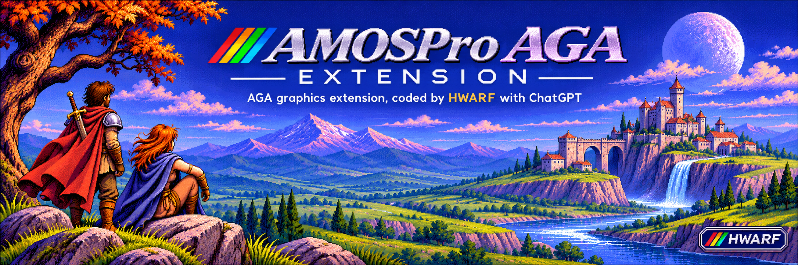

# AMOSPro AGA Extension

**English** | [Français](README.fr.md)


**AMOSPro AGA Extension** extends **AMOS Professional** on AGA-equipped Commodore Amiga computers, adding screen and palette support, IFF/ILBM loading, double buffering, Blitter and Copper operations, and keyboard and mouse input.

Designed and developed by **HWARF**, with assistance from **ChatGPT (OpenAI)** for programming, testing and documentation.




*Presentation illustration generated with ChatGPT. This is not an actual extension screenshot.*

**Separate licenses:** source code and technical documentation are under [MIT](LICENSE). **Artwork, logos, drawings and scans are not covered by MIT**, and are not freely reusable. See the [visual assets license](ASSETS_LICENSE.md).

**Get started:** [Installation guide](INSTALL.md) · [AMOS example programs](examples/README.md).

## Libraries and tests

**Latest promoted `LAST_GOOD`: R57 v0.13.2** — validated 32,980-byte [reference](dist/AMOSPro_AGA_LAST_GOOD.Lib), SHA256 `aee712c8fee75982c74421acc023fdaad733e3f390f3e143050765802c7925d0`; R57 Gates A CPU/CI, B interpreted WinUAE and C compiled WinUAE PASS, D physical NOT TESTED. This promotion was made separately by the author. **Current working candidate: R58 v0.13.3**, [`dist/AMOSPro_AGA.Lib`](dist/AMOSPro_AGA.Lib), **42,264 bytes**, SHA256 `c4c3a1306058f39e336653b63cd219b2e94f539a55da837a1f03f8edb3f9fc5b`. **53 commands, 62 AP20 entries, 40,038-byte Compiler unit.** The V2 bridge uses unsigned offsets, with legacy `Aga Probe` redirected to offset **40,000**; all 59 native R57 entries are unchanged. **R58 Gates A CPU/CI, B interpreted WinUAE and C freshly compiled WinUAE PASS** (two separate user test captures on 12 Nov 2026: the 40K probe, Open/Close/Blitter/Swap, `RESULT 1`, `CLOSE RETURNED`, no visible Guru; the compiled mode was explicitly confirmed by the author). **Gate D physical NOT TESTED**. R58 is not yet promoted; full pre-promotion regression and author approval remain required. [Active test](tests/current/M17_R58_COMPILER_BRIDGE_01.asc), [40K CPU proof](https://github.com/anthea176/AMOSPro-AGA-Extension/actions/runs/43302242028). `main` only; one candidate library.


**AGAPIC images in Fast RAM:** compressed images **can be stored in an AMOS DATA bank in Fast RAM**. `Aga Image Draw` reads and decompresses them with the **CPU** into the AGA back buffer in **Chip RAM**, without decompressing the full image into Chip RAM and without Blitter access to the source. AMOS controls the bank's actual placement; the test ABK's Fast/Chip location has not been measured. [AGAPIC format](docs/M16_AGAPIC_FORMAT_DESIGN.md).

**Past releases and test evidence:** [release history](docs/LIBRARY_TEST_HISTORY.md) · [Compiler Gate C PASS report](docs/GATE_C_R46_MONOLITH_CANDIDATE.md) · [exact compiled test source](tests/passed/R46_C1_COMPILER_ALL_IN_ONE.asc) · [historical native R46 archive](dist/experimental/AMOSPro_AGA_M16_v0.12.1_IMAGE_DRAW_R46.Lib).

**Installation:** [INSTALL.md](INSTALL.md). A GitHub update does not automatically replace the library installed in AMOS/WinUAE.

## Main AMOS commands

**Current library API R58 0.13.3** — **53 named AP20 commands**. The previous 51 public signatures (including six-argument `Aga Image Capture`) are unchanged. R53 capture and R54 bank-number helpers passed WinUAE interpreted and compiled tests on their respective scenarios.

| Command | Exact syntax | Parameters and behaviour |
|---|---|---|
| `Aga Probe` | `Aga Probe` | Legacy no-argument diagnostic instruction. Not recommended as a gameplay API. |
| `Aga Detect` | `_AGA=Aga Detect` | No arguments. Returns a nonzero value when AGA is available; do not assume TRUE is always exactly 1. |
| `Aga Demo` | `_D=Aga Demo` | Legacy no-argument diagnostic function; no stable gameplay return-value contract. |
| `Aga Screen Open` | `_OK=Aga Screen Open(largeur,hauteur,nbCouleurs,modeID)` | Pixel dimensions; `nbCouleurs` is a **colour count**, not a bitplane count (indexed modes: 2, 4, 8, 16, 32, 64, 128 or 256). Pass an AmigaOS ModeID, e.g. `$00021000` for PAL LowRes. Returns 1 on success, 0 on failure. |
| `Aga Screen Close` | `Aga Screen Close` | No arguments. Closes the AGA screen and releases the associated resources. |
| `Aga Screen Pattern` | `Aga Screen Pattern` | No arguments. Draws the built-in diagnostic pattern. |
| `Aga Double Buffer` | `_DB=Aga Double Buffer` | No arguments. Enables double buffering. Returns 1 on success or 0 on failure. |
| `Aga Swap` | `_SW=Aga Swap` | No arguments. Presents the prepared back buffer. Returns 1 on success or 0 on failure. |
| `Aga Back Fill` | `Aga Back Fill couleur` | **One argument:** palette colour index used to fill the **entire** back buffer; e.g. 255 on an 8-bitplane indexed screen. |
| `Aga Pic Info` | `_V=Aga Pic Info(fichier$,champ)` | ILBM file path and field index 0..7 (see reference table below). Returns the selected value, or -1 on error. |
| `Aga Iff Load` | `_OK=Aga Iff Load(fichier$)` | IFF/ILBM file path. Loads pixels and palette onto a compatible AGA screen/buffer. Returns 1 or 0. |
| `Aga Palette Load` | `_OK=Aga Palette Load(_FILE$)` | Read **standard IFF FORM ILBM** palette `CMAP` only, including palette-only PPaint/DPaint files without `BODY`/`BMHD`. Never copy pixels. Return 1 success or 0 invalid IFF/screen. |
| `Aga Palette Set` | `_OK=Aga Palette Set(_PEN,_R,_G,_B)` | Set one indexed palette entry of the private AGA Intuition screen using 8-bit R/G/B components (`0..255`), through `LoadRGB32`. Returns 1 or 0. No VBL wait. HAM/EHB/dual playfield modes are not supported. |
| `Aga Palette Get` | `_RGB=Aga Palette Get(_PEN)` | Read active `ColorMap` via `GetRGB32`. Packed RGB24 `$00RRGGBB`, or -1 when invalid; black = 0. No change to bitmap. |
| `Aga Palette Save` | `_OK=Aga Palette Save(_FILE$)` | Save the current indexed AGA screen `ColorMap` to an IFF `FORM ILBM` containing `BMHD`+`CMAP`, no `BODY`. Filename: AMOS string (1–255 bytes), ordinary AmigaDOS path. **Overwrites an existing file** (`MODE_NEWFILE`). Returns integer **1** on complete write/close, **0** for invalid screen/file/allocation/write. Reads 1–256 colors, RGB24, no bitmap changes; no HAM/EHB/dual playfield. A write error after overwrite may destroy the old file. |
| `Aga Palette Bank Init` | `_OK=Aga Palette Bank Init(Start(_B),_N)` | Initialize an **existing, exactly sized native AMOS DATA bank** at the address returned by `Start(_B)` (not a bank number). `_B` must be a live bank 5–65535; `_N` is 1–256 palette slots, size **16+776×_N bytes**. Writes native bank name `AGAPAL ` and internal AGAPAL v1 16-byte header, 8-byte index entries, 768 RGB24 bytes per slot (all initialized to zero, colors count 0). Return **1** on success, **0** on invalid count, bank type, capacity or rejected memory. Re-init erases previous slot contents. No allocations, screen changes, color cycling or fades. AMOS DATA uses Fast RAM preferentially, Chip fallback if required. **Pass only a real `Start(bank)` of a currently reserved DATA bank; arbitrary/stale addresses may crash.** on the archived 8-palette ABK Save/Load scenario. |
| `Aga Palette Bank Capture` | `_OK=Aga Palette Bank Capture(Start(_B),_INDEX)` | Copy the active private AGA Intuition screen `ColorMap` to AGAPAL RGB24 palette slot `_INDEX` (0-based, below initialized bank capacity). Bank `_B` must be a live native AMOS DATA bank previously initialized with `Aga Palette Bank Init`; pass **`Start(_B)`**, never the numeric bank ID or a stale pointer. Reads 1–256 colors through `GetRGB32`, stores 3 bytes/color and the actual color count, clears any unused bytes in the **selected** 768-byte slot, and overwrites that slot on repeat capture. Other slots and display/pixels remain unchanged. Return integer **1** success or **0** failure without bank changes. Rejects bad AGAPAL header/size/index, missing/incompatible screen, or temporary allocation failure. Temporary RAM is released. No implicit VBL, fade or cycling. for the archived capture/ABK scenario. |
| `Aga Palette Bank Apply` | `_OK=Aga Palette Bank Apply(Start(_B),_INDEX)` | Apply one **nonempty (1–256 colors)** AGAPAL RGB24 slot `_INDEX` (0-based) to the private active AGA Intuition screen `ColorMap` through `LoadRGB32` (RGB32 fractions, immediate, **no VBL**). Requires live DATA bank pointer `Start(_B)`, valid AGAPAL v1 descriptor/index and indexed screen with logical/ColorMap capacity at least the slot's color count; **never pass the bank number or stale pointer**. Return integer **1** success, **0** rejection before screen changes. Only pens `0..count-1` are updated; higher pens are preserved, no clipping, bank/bitmaps unchanged. Empty palettes, incompatible/closed screens and failed temporary allocation rejected. Temporary public memory freed. No fade or cycling. |
| `Aga Fade To Bank` | `_OK=Aga Fade To Bank(Start(_B),_INDEX,_VBL)` | **Blocking RGB24 fade** from the active private AGA indexed screen to one **nonempty AGAPAL DATA bank palette** `_INDEX`, using a real live `Start(_B)` pointer. `_VBL` must be an integer **1..255** (0 or invalid values return 0 without changes; use Aga Palette Bank Apply for instant update). One `graphics.library/WaitTOF` and one `LoadRGB32` for each VBL, starting from an initial `GetRGB32` snapshot, signed fixed-point interpolation, and an **exact target RGB24 last frame**. Only pens `0..count-1` updated; higher pens, bank contents and all bitmaps unchanged. Rejections/allocation failures occur before any VBL/screen change. One temporary Exec public memory block (max 10,760 bytes) freed afterward. Returns integer **1** on success, **0** on rejection. May take longer than `_VBL` nominal refresh periods on slow 68000 at high color count. |
| `Aga Fade To Black` | `_OK=Aga Fade To Black(_VBL)` | **Blocking, bank-independent RGB24 fade to exact black** for **all logical indexed pens** of the active private AGA Intuition screen (1–256 colors, 1–8 bitplanes, HAM/EHB/dual playfield rejected). Duration `_VBL` **1..255**; zero/negative/>255 rejected with integer **0** and no screen change. `GetRGB32` source snapshot when duration >1, signed 8.8 channel interpolation; each step waits one `graphics.library/WaitTOF` then applies `LoadRGB32`; **final frame forces every logical RGB32 component to 0**. No pixels, bank, files, or higher pens are changed; no AGAPAL bank argument. AllocVec public scratch `8+42*N` bytes (max 10,760) freed on exit. Returns **1** success. Slow 68000 may exceed the nominal refresh period. |
| `Aga Fade To White` | `_OK=Aga Fade To White(_VBL)` | **Blocking, bank-independent RGB24 fade to exact white** for every logical indexed pen of the active private AGA Intuition screen (1–256 colours, 1–8 bitplanes, HAM/EHB/dual playfield rejected). `_VBL` **1..255**; zero, negative, or >255 rejects **0** with no changes. Once-only `GetRGB32` source capture if duration >1, positive signed 8.8 linear channel interpolation, one `graphics.library/WaitTOF` and one `LoadRGB32` per requested step; **final frame forces all logical RGB32 components to `0xFFFFFFFF`** (white 255,255,255) exactly. No bank arguments, pixel or file writes, or upper-pen changes. Public Exec scratch `8+42*N` bytes (max 10,760) freed on return. Returns **1** on completion, **0** on rejection; timing may exceed requested refresh periods on 68000. |
| `Aga Palette Cycle` | `_OK=Aga Palette Cycle(First,Last,Direction)` | **One rotation per call** of the inclusive pen range `0<=First<Last<256`, bounded by the private indexed AGA screen and its ColorMap. `Direction=1`: last RGB32 triplet moves to First and the others shift to higher indices; `Direction=-1` reverses it. Each success reads the exact **full 32-bit RGB32** triplets once via `GetRGB32`, rotates them in private scratch, and writes exactly that range with **one `LoadRGB32`**; **no implicit WaitTOF**, no bank or pixel writes, no colour degradation. Temporary Exec public scratch `8+12*N` bytes, max 3,080, freed. Returns **1** on success, **0 without palette changes** on invalid range/direction/screen/ColorMap or allocation failure. Caller controls cadence with `Aga Wait Vbl`. |
| `Aga Key` | `_K=Aga Key` | No arguments; nonblocking keyboard read. preserves RAWKEY key-down events in a 16-item FIFO shared with the IDCMP mouse dispatcher. |
| `Aga Wait Key` | `_K=Aga Wait Key` | No arguments. Waits for an Intuition-window key and returns a **raw key code**, which need not be ASCII. Uses the shared dispatcher/FIFO; Ctrl+C break handling returned cleanly to AMOS with the Intuition screen closed under WinUAE. |
| `Aga Wait Vbl` | `Aga Wait Vbl` | No arguments. Waits for one vertical blank using `WaitTOF`. Does nothing if no AGA screen is open. |
| `Aga Blit Copy` | `_OK=Aga Blit Copy(sourceX,sourceY,destX,destY,largeur,hauteur)` | Copies a rectangle within the **same back buffer**. automatically checks `Safe` before DMA; returns **0 without copying** when the previous front buffer is not yet writable (or arguments/state are invalid), **1** after success. Single nonblocking `GetMsg`, no `ReplyMsg`. |
| `Aga Blit Fill` | `_OK=Aga Blit Fill(x,y,largeur,hauteur,indexCouleur)` | Fills the back-buffer rectangle with the fifth-argument palette index. same nonblocking `Safe` check before the first bitmap DMA; returns **0 without drawing** if not ready or invalid. |
| `Aga Blit Clear` | `_OK=Aga Blit Clear(x,y,largeur,hauteur)` | Sets a back-buffer rectangle to palette index **0** (not necessarily RGB black). inherits Fill's nonblocking `Safe` guard through its native wrapper; returns **0 without clearing** when unsafe/invalid. |
| **`Aga Copper Clear`** | `_OK=Aga Copper Clear` | No arguments. Creates an empty, terminated Copper list owned by the private AGA screen. Returns 1 or 0. |
| **`Aga Copper Wait`** | `_OK=Aga Copper Wait(v,h)` | First argument `v`: vertical position (0..255). Second argument `h`: horizontal position (0..222). Consecutive WAIT positions must strictly increase. Returns 1 or 0. |
| **`Aga Copper Move`** | `_OK=Aga Copper Move(registre,rgb4)` | First argument: even colour-register offset `$180..$1BE` (`COLOR00..COLOR31`). Second argument: **12-bit RGB4** value `$000..$FFF`, e.g. `$F00` = red. This is **not** a palette index. Returns 1 or 0. |
| **`Aga Copper End`** | `_OK=Aga Copper End` | No arguments. Seals a nonempty Copper list. Calling End twice, or appending after End, fails. Returns 1 or 0. |
| **`Aga Copper On`** | `_OK=Aga Copper On` | No arguments. Installs the list through Intuition. A nonempty list must have been finalized with End. Returns 1 or 0. |
| **`Aga Copper Off`** | `_OK=Aga Copper Off` | No arguments. Removes the list, restores the display and frees resources owned by the extension. Repeated calls are accepted. Returns 1 or 0. |
| **`Aga Mouse X`** | `_MX=Aga Mouse X` | No arguments. Horizontal position in logical screen pixels (0..width-1), or -1 if outside the screen / closed. Nonblocking. |
| **`Aga Mouse Y`** | `_MY=Aga Mouse Y` | No arguments. Vertical position in logical screen pixels (0..height-1), or -1 if outside the screen / closed. Nonblocking. |
| **`Aga Mouse Buttons`** | `_B=Aga Mouse Buttons` | No arguments. **Integer bitmask 0..7:** 1=left, 2=right, 4=middle; bits can be combined (3=left+right), 0=none. Returns -1 if the screen/window or `input.device` is unavailable. Nonblocking snapshot. |
| **`Aga Mouse Pressed`** | `_P=Aga Mouse Pressed` | No-argument integer function; bitmask 1=left, 2=right, 4=middle, combinable. stores `IDCMP_MOUSEBUTTONS` press events between reads; 0 if none, -1 for an invalid screen/focus. Each call consumes the pending presses, even after the button was released. |
| **`Aga Mouse Released`** | `_R=Aga Mouse Released` | No-argument integer function; combinable 1/2/4 bitmask. release events remain stored independently of Pressed. Even a complete click between polls can yield both Pressed=1 and Released=1. |
| **`Aga Hotspot Hit`** | `_HIT=Aga Hotspot Hit(_PX,_PY,_X,_Y,_W,_H)` | **Point-in-rectangle test (6 integer arguments)**: `PX,PY` = point to test (e.g. mouse position); `X,Y` = rectangle **top-left corner**; `W,H` = **width and height in pixels, NOT right/bottom coordinates**. Returns **1 inside**, **0 outside**, with the right and bottom edges excluded. Does **not** detect a click or draw/store a hotspot; combine with `Aga Mouse Pressed` for buttons. [Detailed example below](#rectangular-hotspots-m9-r24). |
| **`Aga Rect Overlap`** | `_C=Aga Rect Overlap(_AX,_AY,_AW,_AH,_BX,_BY,_BW,_BH)` | Stateless **8-argument integer function**: two rectangles, each with origin (X,Y) and width/height (W,H) in logical pixels. Returns **1** for positive-area overlap (even 1 pixel), **0** for disjoint rectangles, touching edges/corners, or nonpositive dimensions. Negative origins allowed; signed 32-bit overflow is rejected safely. No screen, physics or input state required. |
| **`Aga Text`** | `_OK=Aga Text(_X,_BASELINE_Y,_PEN,_TEXT$)` | Four arguments: X pixels, baseline Y, indexed pen, AMOS string (1..128 characters). Draws one line into the AGA Intuition back buffer with temporary RastPort, default system font, selected AmigaOS font or AMCAF BankFont, with transparent `JAM1`. Return 1 if rendered, 0 on invalid state/geometry/string or not-`Safe` buffer. [R26 contract](docs/M11_TEXT_R26.md) · [R27 contract](docs/M12_SAFE_BLITTER_R27.md). |
| **`Aga Font Select`** | `_OK=Aga Font Select(_FONT$,_YSIZE)` | Opens and selects an AmigaOS `.font` via `diskfont.library` (1..127-character name, requested height 1..255). Returns 1 on success, 0 on failure without changing the previous font. `_OK=Aga Font Select("",0)` restores the default font. Affects `Aga Text` on the private AGA screen, closes fonts on replacement/reset/Screen Close. |
| **`Aga Font Bank Select`** | `_OK=Aga Font Bank Select(_START,_LENGTH)` | Selects a fixed-width or proportional monochrome `BankFont` created by AMCAF `Make Bank Font`. `_START=Start(n)`, `_LENGTH=Length(n)` refer to a live AMOS bank. Returns 1 on success, 0 on rejection without changing the selected font. Uses private Chip RAM copy (even if the source bank resides in Fast), safe after `Erase n`; frees the copy on replacement/reset/Screen Close. |
| **`Aga Bank Font Select`** | `_OK=Aga Bank Font Select(Bank)` | one integer bank number (5..65535). Resolves the live AMOS bank using the corrected native bank manager and delegates to the existing `Aga Font Bank Select(Start(Bank),Length(Bank))`. The existing name, 2-argument form, private Chip font copy, lifetime and rejection behavior remain intact. Returns 1 on successful selection, otherwise 0. Tested successfully interpreted and compiled under WinUAE (R54 scenario). |
| **`Aga Plot`** | `_OK=Aga Plot(X,Y,Pen)` | Draws **one pixel** at `(X,Y)` in the private AGA **back buffer**. X/Y from zero through width/height minus one, indexed `Pen` from 0 to 2^Depth−1 (1–8 bitplanes). Returns `1` on successful `WritePixel`, otherwise `0` (invalid arguments/state or back buffer not `Safe`). No out-of-bounds clipping or implicit swap/VBL. |
| **`Aga Draw`** | `_OK=Aga Draw(X1,Y1,X2,Y2,Pen)` | Draws a **one-pixel line** into the private AGA **back buffer**, including both endpoints. Fast in-bounds line drawing; **bounds-checked Bresenham** for partly off-screen segments. Signed 16-bit coordinates, depth-indexed `Pen`. Returns `1` if at least one pixel was painted, otherwise `0`. No implicit swap/VBL. |
| **`Aga Box`** | `_OK=Aga Box(X1,Y1,X2,Y2,Pen)` | Draws a **one-pixel rectangle outline** on the private AGA **back buffer**. **Inclusive unordered corner coordinates**, not width/height. **Safe clipping of the four original edges** without inventing a border at the screen bounds. Signed 16-bit coordinates, indexed `Pen`; returns `1` if at least one pixel is painted, otherwise `0`. No implicit swap/VBL; not filled. |
| **`Aga Circle`** | `_OK=Aga Circle(CX,CY,Radius,Pen)` | Draws a **one-pixel circle outline** centred at signed-16 `CX,CY`, integer pixel `Radius` 0..32767 and indexed colour `Pen` (0..2^Depth-1). `Radius=0` paints one pixel; negative/excessive radius and invalid arguments return `0`. Eight-way integer symmetry and bounds-checked `WritePixel` clip the original contour without a fake edge. Only the private `Safe` back buffer; no filling or implicit swap/VBL. Returns `1` if at least one pixel was written, else `0`. |
| **`Aga Mouse Cursor`** | `_OK=Aga Mouse Cursor(Visible)` | Integer function: **`Visible=0` hides** the cursor only within the extension's private AGA Intuition window; **`Visible=1` restores** the normal cursor. Returns `1` when applied (including repeated requests), `0` for values other than 0/1, no owned window, or allocation failure. Mouse coordinates/buttons and keyboard remain active; Workbench and other windows are unaffected. One lazy 72-byte Chip RAM allocation, released after `ClearPointer` and `CloseWindow` on every owned-window teardown including Ctrl+C. No implicit swap/VBL. |
| **`Aga Image Draw`** | `_OK=Aga Image Draw(Start(_B),Length(_B),_X,_Y,_MODE)` | Draws a compressed **AGAPIC v1 image from an AMOS DATA bank, including one in Fast RAM**. The **CPU** reads and decompresses the source directly into the **AGA back buffer in Chip RAM**: no full-image decompression into Chip and no Blitter access to Fast RAM. Supports **1–8 bitplanes**, `_MODE=0` opaque (colour index 0 visible), `_MODE=1` independent transparency mask, unaligned X, four-edge clipping, nonblocking `Safe` and RLE validation before writing. Returns **1** for a valid call (even entirely offscreen), **0** for invalid parameters, bank or data without bitmap changes. Pass the current `Start(_B)` and `Length(_B)` of a live bank; AMOS decides whether it is actually allocated in Fast or Chip RAM. |
| **`Aga Bank Image Draw`** | `_OK=Aga Bank Image Draw(Bank,X,Y,Mode)` | four integers: live AMOS bank number 5..65535, destination X/Y and existing Mode 0 (opaque) or 1 (mask). Resolves Start/Length with `Bnk.GetAdr`, then delegates to the exact existing `Aga Image Draw` 68000 implementation. Same AGAPIC v1/RLE, Fast-readable source, clipping, buffer `Safe` validation and return 1/0. Invalid or missing bank rejected. Old five-argument function unchanged; Tested successfully interpreted and compiled under WinUAE (R54 scenario). |
| `Aga Image Capture` | `_OK=Aga Image Capture(Bank,X,Y,Width,Height,TransparentIndex)` | integer bank 5..65535 must be free; integer rectangle strictly inside the AGA back buffer, no clipping. Returns 1 on creation of a DATA AGAPIC bank, 0 on failure. Index -1 is opaque; 0..2^Depth-1 creates a separate mask. Pixels/palette unchanged, no implicit swap. WinUAE interpreted and compiled PASS (R53 scenario). |

**Example — hide and restore the private AGA cursor** (after opening the private screen):

```amos
_HIDE=Aga Mouse Cursor(0)
If _HIDE=1
   _MX=Aga Mouse X
   _SHOW=Aga Mouse Cursor(1)
End If
```

**Example — AGA circle** (after opening the private screen and enabling double buffering):

```amos
_OK=Aga Circle(160,128,48,3)
If _OK=1
   _SW=Aga Swap
End If
```

**Example: save the current AGA palette**, after opening the private AGA screen:

```amos
_OK=Aga Palette Save("RAM:MENU_PALETTE.IFF")
If _OK=0
   Print "PALETTE SAVE FAILED"
End If
```

Use [the archived R29 test](tests/passed/M13_R29_PALETTE_SAVE_01.asc) for save → overwrite → reload. The IFF contains colors but no pixels. Personal Paint 256-color palette import was confirmed by the user; Deluxe Paint remains untested; [R29 contract](docs/M13_PALETTE_R29.md).

**R30 native AMOS palette-bank initialization** (requires a live DATA bank):

```amos
Reserve As Data 10,6224
_OK=Aga Palette Bank Init(Start(10),8)
If _OK=1
   Save "RAM:MENU_PALETTES.ABK",10
End If
```

The resulting ABK is saved with **AMOS native `Save`**, not with IFF `Aga Palette Save`. There are eight empty indexed RGB24 slots until future (separately agreed) capture/import commands populate them. [R30 Gate B test](tests/passed/M13_R30_AGAPAL_BANK_INIT_01.asc). No automatic palette changes.

**R31: capture the current indexed screen palette into AGAPAL slot 0** (after `Aga Screen Open` and R30 bank initialization):

```amos
_CAPTURE=Aga Palette Bank Capture(Start(10),0)
If _CAPTURE=1
   Save "RAM:MENU_PALETTES.ABK",10
End If
```

This creates a native AMOS ABK with the RGB24 palette from the screen, not an IFF image. It does **not** apply the stored palette to the screen. [Validated R31 WinUAE test](tests/passed/M13_R31_AGAPAL_CAPTURE_01.asc).

**R32: apply the captured AGAPAL palette 1 to the current screen** (after screen open, bank initialization and capture):

```amos
_OK=Aga Palette Bank Apply(Start(10),1)
If _OK=1
   Print "Palette applied"
End If
```

The command is immediate and never waits for a VBL. Use `Aga Wait Vbl` explicitly when needed for animation timing. [R32 WinUAE test](tests/passed/M13_R32_AGAPAL_APPLY_01.asc).

**R33: blocking fade to a saved AGAPAL palette** (after an indexed screen and a valid bank have been set up):

```amos
_FADE=Aga Fade To Bank(Start(10),1,25)
If _FADE=1
   Print "Fade complete"
End If
```

This call waits for 25 VBLs and applies a new palette on each step. `_VBL=0` is rejected; use `Aga Palette Bank Apply` for an instant change. At 256 colors and slower 68000 configurations, each step is not guaranteed to fit within one refresh. [R33 Gate A contract](docs/M13_AGAPAL_FADE_R33.md) · [Archived R33 WinUAE test](tests/passed/M13_R33_AGAPAL_FADE_01.asc). For a visible fade, use the [150-VBL three-band demo](examples/fade_to_bank_r33.asc) (bank 12 overwritten; visible fade confirmed under WinUAE).

**Copper RGB4** has been available since R18, **Mouse X/Y** since R19, **Mouse Buttons** since R20 (with RMBTRAP in R21), and **Mouse Pressed/Released** since R22. **R23 uses IDCMP events to capture button transitions and protect RAWKEY input**. The quick-click, keyboard FIFO and Ctrl+C WinUAE scenarios passed; focus-switch and stress scenarios remain untested. Sprites, a `Aga Set Colour` command, and comprehensive input-stress validation are outside the current scope.

### Safe Blitters (M12 R27 — CPU/CI and WinUAE scenario PASS)

The three existing functions `Aga Blit Clear`, `Aga Blit Fill`, and `Aga Blit Copy` now check `Safe` independently. A return value of 0 can mean `Safe` has not arrived **or** another argument/state error; retry only with a bounded VBL wait. A dedicated [archived WinUAE test](tests/passed/M12_R27_SAFE_BLIT_01.asc) exercises **40 swaps with rotating first operations** and no `Aga Text` probe. The legacy `Aga Back Fill` instruction is **not covered** by the R27 protection. [Technical contract](docs/M12_SAFE_BLITTER_R27.md).

### AGA Text (M11 R26 — WinUAE validated on its visual scenario)

With the R26 library installed and the AGA screen/double buffer already open, the function draws on the **inactive AGA BitMap**, not on a native AMOS screen. Here Y=96 denotes the **font baseline**; the palette index 28 must already have been defined (e.g. by loading `examples/demo.iff`):

```amos
_TX=Aga Text(40,96,28,"HELLO AGA")
If _TX=1
   _SW=Aga Swap
End If
```

A result of 0 can mean that the previous front buffer has not yet received its `Safe` notification. Do not spin indefinitely. This R26 safety check does **not** automatically secure pre-existing Blitter commands. [WinUAE test](tests/passed/M11_R26_AGA_TEXT_01.asc) · [technical limits](docs/M11_TEXT_R26.md).

### Rectangular hotspots (M9 R24)

`Aga Hotspot Hit(PX,PY,X,Y,W,H)` checks **one point against one rectangle**, not a collision between two rectangles. It returns an **integer** assigned to a variable, never a hotspot ID. The first two values are the **point coordinates**; the remaining four describe the rectangle.

| Argument | Meaning | Example |
|---|---|---|
| `PX`, `PY` | X/Y of the tested point (for instance, `Aga Mouse X/Y`) | `60,50` |
| `X`, `Y` | X/Y of the rectangle's **top-left corner** | `40,30` |
| `W`, `H` | **Width and height**, not the opposite corner | `80,40` |
| Result (`_HIT`) | `1` = point inside; `0` = outside/invalid | `1` |

For a rectangle `(X=40,Y=30,W=80,H=40)`, the included pixels are **X=40..119** and **Y=30..69**. X=120 or Y=70 is **outside** (the right and bottom boundaries are excluded). The top and left boundaries are included.

```amos
_INSIDE=Aga Hotspot Hit(60,50,40,30,80,40)
_OUTSIDE=Aga Hotspot Hit(120,50,40,30,80,40)
' _INSIDE=1, _OUTSIDE=0
```

**Example: trigger a menu action only when the left mouse button is pressed over this rectangle** (run while the AGA screen is open):

```amos
_SELECTED=0
_PX=Aga Mouse X
_PY=Aga Mouse Y
_HIT=Aga Hotspot Hit(_PX,_PY,40,30,80,40)
_P=Aga Mouse Pressed
If _P>=0
   _LEFT=_P And 1
   If _LEFT<>0 and _HIT=1
      _SELECTED=10
   End If
End If
```

Here, `10` is an **application-defined button ID**, not a value returned by `Aga Hotspot Hit`. To test several overlapping buttons, call the function for each rectangle and set the ID in the order you want: the **last matching assignment wins**, as in the [validated R24 test](tests/passed/M9_R24_HOTSPOT_HIT_01.asc).

**Limits:** negative mouse-point coordinates (including the `-1` sentinel from `Aga Mouse X/Y`) and nonpositive `W/H` return 0. Negative rectangle `X/Y` are allowed. The function does not read the mouse, consume input, draw a rectangle or need an open AGA screen. `Aga Mouse Pressed` is a separate event function; the coordinates read with `Aga Mouse X/Y` are their **current sampled values**, not a position saved at the exact click time. See the [technical contract](docs/M9_HOTSPOT_R24.md).

### AGA mouse details (R19–R23)

All five mouse APIs — `Aga Mouse X`, `Aga Mouse Y`, `Aga Mouse Buttons`, `Aga Mouse Pressed` and `Aga Mouse Released` — are **no-argument integer functions**. Use their results in assignments or expressions. **Do not write an integer-returning function on a line by itself** in AMOS Professional.

```amos
_X=Aga Mouse X
_Y=Aga Mouse Y
_B=Aga Mouse Buttons
_P=Aga Mouse Pressed
_R=Aga Mouse Released

If _X>=0 and _Y>=0 and _B>=0
   _LEFT=_B And 1
   _RIGHT=_B And 2
End If
```

- **X/Y coordinates:** origin at top left; X ranges from 0 to width-1, Y from 0 to height-1. The return value is -1 for a closed, invalid or out-of-bounds window. Check **both** coordinates.
- **Buttons:** 0=none, 1=left, 2=right, 4=middle; combine bits (3=left+right). A -1 result means input is unavailable: verify `_B>=0` **before** applying binary operators.
- **Right mouse button (R21):** `Aga Screen Open` enables `WFLG_RMBTRAP` so the right button does not open Intuition menus over the AGA window. This behaviour was tested under WinUAE.
- **Instantaneous state:** `Aga Mouse Buttons` reads a global `input.device/PeekQualifier()` snapshot. It does not dequeue keyboard messages or track clicks per window; extremely short clicks may be missed.
- **R23 edge capture:** `Aga Mouse Pressed` and `Aga Mouse Released` consume separate pending bitmasks populated from `IDCMP_MOUSEBUTTONS` by the shared dispatcher. A complete DOWN+UP click received before the poll can set **both** masks. Reading one does not clear the other. A 16-entry RAWKEY FIFO preserves keyboard input for `Aga Key` and `Aga Wait Key`; when full, the dispatcher temporarily stops dequeuing messages. **Repeated clicks of the same button within one interval collapse into one bit**; these functions are not click counters.

Legacy R21 approach for calculating transitions from consecutive snapshots:

```amos
_OLD=Aga Mouse Buttons
_NOW=Aga Mouse Buttons
If _OLD>=0 and _NOW>=0
   _PRESSED=_NOW And (7-_OLD)
   _RELEASED=_OLD And (7-_NOW)
End If
```

**R23 WinUAE tests:** the [exact archived R23 example](tests/passed/M8_R23_IDCMP_QUICK_01.asc) using an original 320×256×8 ILBM test card passed with `RESULT=1`, including `PRESSED=RELEASED=3`, `KEYS=64,64,-1` and `WAIT=16` (A on French AZERTY). A separate `Ctrl+C` test interrupted the program at `_WAITK=Aga Wait Key` and closed the Intuition screen cleanly (user confirmation). [R22's previous test](tests/passed/M8_R22_MOUSE_EDGES_01.asc) remains archived.

### AGA Copper details (R16–R18)

**All `Aga Copper` commands above are integer-returning functions**, so assign or use the result. `_OK=Aga Copper Off` is valid; **`Aga Copper Off` alone is an AMOS syntax error**, even in an `If` branch that is never executed. Return values: 1=success, 0=rejected/failure.

| Function | Parameter 1 | Parameter 2 | Notes |
|---|---|---|---|
| `Clear` | — | — | Initializes a Copper list owned by the AGA screen. Call it before appending operations. |
| `Wait(v,h)` | `v`: line 0..255 | `h`: position 0..222 | Positions must increase; invalid or backward positions return 0. |
| `Move(register,rgb4)` | Even register offset `$180..$1BE` | RGB4 value `$000..$FFF` | `$180`=`COLOR00`, `$182`=`COLOR01` … `$1BE`=`COLOR31`. No arbitrary DMA, BPLCON or bitplane-pointer register access. |
| `End` | — | — | Seals a nonempty list. Nothing may be appended afterward. |
| `On` | — | — | Activates a finalized list; editing while active is rejected. |
| `Off` | — | — | Detaches and frees the list; repeated Off calls are accepted. |

`Move` uses **12-bit RGB4**, not indexed palette numbers: `$F00`=red, `$0F0`=green, `$00F`=blue, `$000`=black. For example, `Aga Copper Move($180,$F00)` changes the value of **COLOR00** at the raster point defined by the most recent Wait.

The following sequence is to be run after a successful `Aga Screen Open` and `Aga Double Buffer`, optionally with a compatible image loaded. It follows the [validated R18 raster example](tests/passed/M7_R18_COPPER_RASTER_01.asc):

```amos
_C=Aga Copper Clear
_W1=Aga Copper Wait(20,0)
_M1=Aga Copper Move($180,$F00)
_W2=Aga Copper Wait(80,0)
_M2=Aga Copper Move($180,$0F0)
_W3=Aga Copper Wait(140,0)
_M3=Aga Copper Move($180,$00F)
_W4=Aga Copper Wait(200,0)
_M4=Aga Copper Move($180,$000)
_E=Aga Copper End
_ON=Aga Copper On
_SW=Aga Swap
_K=Aga Wait Key
_OFF=Aga Copper Off
```

**Required order:** Clear → Wait/Move pairs → End → On → display/wait → Off → Screen Close. A COLOR00 raster effect is most visible wherever the image uses palette index 0; those pixels may also change colour. The first RGB4 implementation is limited to **62 useful operations plus CEND**, with reserved capacity and no free-form AGA register programming.

**Validation scope:** R16, R17 and R18 passed their specific AMOS interpreted/WinUAE scenarios, including the R18 raster, rejected calls, Off and screen reopening. These tests **do not prove** AMOS Compiler compatibility, real Amiga hardware behaviour, long-running stability or complete 24-bit AGA palette support. See [R18 Copper details](docs/M7_COPPER_R18.md) and [M7 status](docs/M7_STATUS.md).

### Blitter: Aga Blit Fill, Aga Blit Copy and Aga Blit Clear

These functions require a successful `Aga Screen Open` followed by `Aga Double Buffer`. They operate on the **back buffer only**; call `Aga Swap` to make the drawing visible.

```amos
_OK=Aga Blit Fill(18,24,86,48,15)
```

| Argument | Meaning | Example value |
|---:|---|---|
| 1 | `x` — left coordinate | `18` |
| 2 | `y` — top coordinate | `24` |
| 3 | `width` | `86` pixels |
| 4 | `height` | `48` pixels |
| 5 | `colourIndex` | `15` — **palette entry index** |

This rectangle covers `x=18..103` and `y=24..71` (inclusive): the call **does not take x1,y1,x2,y2,colour**. The colour index is **not RGB**. Valid indexed ranges are 0..15 for four bitplanes and 0..255 for eight bitplanes, or more generally 0..(2^depth-1). Special HAM/EHB modes cannot be treated as ordinary indexed RGB palettes.

```amos
_OK=Aga Blit Copy(18,24,150,24,86,48)
_OK=Aga Blit Clear(32,40,36,16)
```

- **Copy:** source (18,24), destination (150,24), size 86×48. `graphics.library/BltBitMap` handles overlapping rectangles.
- **Clear:** sets the 36×16 rectangle at (32,40) to index 0, equivalent to `Aga Blit Fill(32,40,36,16,0)`.
- **No clipping:** negative coordinates, zero/negative dimensions, out-of-bounds rectangles or an invalid colour index return 0; 1 indicates success.
- Blits are synchronized using `WaitBlit`. A failure after writing a bitplane does **not** guarantee that the attempted operation was atomic.
- `Aga Back Fill colour` fills the **entire** back buffer, unlike `Aga Blit Fill(...)`.

### Typical use

Check the return values from `Aga Screen Open` and `Aga Double Buffer`; optionally load an IFF compatible with that screen using `Aga Iff Load`, perform Blitter operations, then call `Aga Swap`. For complete runnable AMOS programs with error handling and cleanup, see the validated [R13 Copy](tests/passed/M6_R13_BLIT_COPY_01.asc), [R14 Fill](tests/passed/M6_R14_BLIT_FILL_01.asc) and [R15 Clear](tests/passed/M6_R15_BLIT_CLEAR_01.asc) tests.

These M6 scenarios passed under interpreted AMOS/WinUAE. **AMOS Compiler and real AGA hardware remain untested** for M6.

### Reading ILBM image metadata

`Aga Pic Info(filename$,field)` exposes the following fields:

| Field | Return value |
|---:|---|
| 0 | Width |
| 1 | Height |
| 2 | Number of bitplanes |
| 3 | Number of CMAP palette entries |
| 4 | Compression: 0=RAW, 1=ByteRun1 |
| 5 | Original CAMG value |
| 6 | ModeID suitable for opening a screen |
| 7 | Number of screen colours to request |

The reference image inventory is in [`docs/ILBM_INVENTORY.md`](docs/ILBM_INVENTORY.md). Before calling `Aga Iff Load`, you must first open a compatible AGA screen.

### Recommended test sequence

M6 R13 Copy, R14 Fill and R15 Clear have passed WinUAE and were moved into [`tests/passed/`](tests/passed/). The R12 [`R12_JEFF_A0_RETRY.asc`](tests/passed/R12_JEFF_A0_RETRY.asc) remains archived. Its historical sequence was:

```text
Aga Pic Info → Aga Screen Open → Aga Double Buffer
→ Aga Iff Load → Aga Swap → Aga Wait Key
→ Aga Screen Close → Amos To Front
```

AMOS Professional uses `If condition` / `End If` (**without `Then`**). Close the AGA screen before leaving the program.

## Documentation and development

- **Getting started:** [installation](INSTALL.md), [AMOS examples](examples/README.md), [passed tests](tests/passed/).
- **Technical reports:** [architecture](docs/ARCHITECTURE.md), [R38 BankFont](docs/M14_FONT_BANK_R38.md), [release/test history](docs/NEXT_SESSION.md), [roadmap](docs/ROADMAP.md).
- **Development:** [tools](tools/README.md), [artifact integrity](tools/verify_artifacts.py), [bilingual API checks](tools/test_readme_api_coverage.py), [CI](.github/workflows/artifact-integrity.yml), [engineering rules](EXTENSION_SOURCE_RULES.md).

