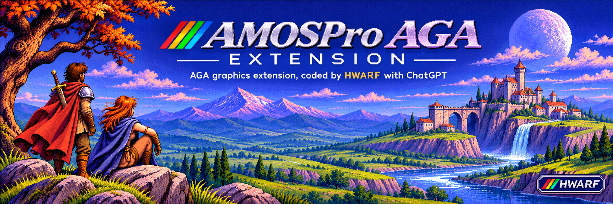

# AMOSPro AGA Extension

**English** | [Français](README.fr.md)


**AMOSPro AGA Extension** extends **AMOS Professional** on AGA-equipped Commodore Amiga computers, adding screen and palette support, IFF/ILBM loading, double buffering, Blitter and Copper operations, and keyboard and mouse input.

Designed and developed by **HWARF**, with assistance from **ChatGPT (OpenAI)** for programming, testing and documentation.




*Presentation illustration generated with ChatGPT. This is not an actual extension screenshot.*

**Separate licenses:** source code and technical documentation are under [MIT](LICENSE). **Artwork, logos, drawings and scans are not covered by MIT**, and are not freely reusable. See the [visual assets license](ASSETS_LICENSE.md).

**Get started:** [Installation guide](INSTALL.md) · [AMOS example programs](examples/README.md).

## Libraries and tests

**M19 P2d — active MC68020+ WinUAE candidate.** [Library](dist/AMOSPro_AGA.Lib), **136,020 bytes**, SHA256 `ce5fb614c7acae9b1bb88e1d793d73dbe7ba747edc285acb7d9e72ac3104176f`, **100 commands / 203 AP20 entries**. Gate A passed. The exact **P2a–P2e integrated Bob scenario** passed WinUAE Runtime (Gate B) and true AMOS Compiler (Gate C); other APIs are not globally requalified.

**P2 ALL IN ONE — validated AGA Bob example, Runtime + Compiler PASS** — [Example instructions](examples/bob_p2_all_in_one/README.md) · [Active regression ASC](tests/current/M19_P2_ALL_IN_ONE.asc) · [Byte-identical ASCII](examples/bob_p2_all_in_one/BOB_ALL_IN_ONE.asc) · [P2 validation](docs/M19_P2_ALL_IN_ONE_2026-11-21.md) · [LAST_GOOD P1e](dist/AMOSPro_AGA_LAST_GOOD.Lib) · [Validation history](docs/LIBRARY_TEST_HISTORY.md).

**Interactive Bob example (no benchmark):** [Local restoration with four moving Bobs](examples/bob_local_restore/README.md) · [ASCII source](examples/bob_local_restore/BOB_LOCAL_RESTORE.asc) — independent new version, PREFLIGHT PASS; WinUAE test pending. **Installation:** [INSTALL.md](INSTALL.md), then verify the `APSystem` copy's SHA. **History:** [LIBRARY_TEST_HISTORY](docs/LIBRARY_TEST_HISTORY.md) · [M19 progress](docs/NEXT_SESSION.md).

## Main AMOS commands

**Current library API M19 P2d** — **100 commands / 203 AP20 entries**, MC68020 minimum. `Aga Bob Col` tests visible Bob collisions, with rectangles or masks.
| Command | Exact syntax | Parameters and behaviour |
|---|---|---|
| `Aga Detect` | `_AGA=Aga Detect` | No arguments. Returns a nonzero value when AGA is available; do not assume TRUE is always exactly 1. |
| `Aga Screen Open` | `_OK=Aga Screen Open(largeur,hauteur,nbCouleurs,modeID)` | Pixel dimensions; `nbCouleurs` is a **colour count**, not a bitplane count (indexed modes: 2, 4, 8, 16, 32, 64, 128 or 256). Pass an AmigaOS ModeID, e.g. `$00021000` for PAL LowRes. Returns 1 on success, 0 on failure. |
| `Aga Screen Close` | `Aga Screen Close` | No arguments. Closes the AGA screen only after pending Safe/Disp messages are acknowledged; does not free ScreenBuffers or ports still in use. P0 Runtime: CLOSE_RETURNED 1 after the 405-frame test; P0 Compiler not tested. |
| `Aga Double Buffer` | `_DB=Aga Double Buffer` | No arguments. Enables double buffering. Returns 1 on success or 0 on failure. |
| `Aga Swap` | `_SW=Aga Swap` | No arguments. Presents the prepared back buffer, returns 1/0. B7 refuses a DIRTY frame without calling `ChangeScreenBuffer`. P0 Runtime: SWAP_FAILS 0 during 405 frames; P0 Compiler not tested. |
| `Aga Pic Info` | `_V=Aga Pic Info(fichier$,champ)` | ILBM file path and field index 0..7 (see reference table below). Returns the selected value, or -1 on error. |
| `Aga Iff Load` | `_OK=Aga Iff Load(fichier$)` | IFF/ILBM file path. Loads pixels and palette onto a compatible AGA screen/buffer. Returns 1 or 0. |
| `Aga Palette Load` | `_OK=Aga Palette Load(_FILE$)` | Read **standard IFF FORM ILBM** palette `CMAP` only, including palette-only PPaint/DPaint files without `BODY`/`BMHD`. Never copy pixels. Return 1 success or 0 invalid IFF/screen. |
| `Aga Palette Set` | `_OK=Aga Palette Set(_PEN,_R,_G,_B)` | Set one indexed palette entry of the private AGA Intuition screen using 8-bit R/G/B components (`0..255`), through `LoadRGB32`. Returns 1 or 0. No VBL wait. HAM/EHB/dual playfield modes are not supported. |
| `Aga Palette Get` | `_RGB=Aga Palette Get(_PEN)` | Read active `ColorMap` via `GetRGB32`. Packed RGB24 `$00RRGGBB`, or -1 when invalid; black = 0. No change to bitmap. |
| `Aga Palette Save` | `_OK=Aga Palette Save(_FILE$)` | Save the current indexed AGA screen `ColorMap` to an IFF `FORM ILBM` containing `BMHD`+`CMAP`, no `BODY`. Filename: AMOS string (1–255 bytes), ordinary AmigaDOS path. **Overwrites an existing file** (`MODE_NEWFILE`). Returns integer **1** on complete write/close, **0** for invalid screen/file/allocation/write. Reads 1–256 colors, RGB24, no bitmap changes; no HAM/EHB/dual playfield. A write error after overwrite may destroy the old file. |
| `Aga Bank Palette Init` | `_OK=Aga Bank Palette Init(_B,_N)` | Initialize a precisely-sized existing AMOS DATA bank by **bank number** (5..65535) as AGAPAL v1, with `_N` = 1..256 palette slots, length `16+776×N` bytes. Returns 1/0 without changing screen colours. |
| `Aga Bank Palette Capture` | `_OK=Aga Bank Palette Capture(_B,_INDEX)` | Capture current private indexed AGA palette into an AGAPAL v1 slot by live DATA **bank number** and 0-based slot index. AGAPIC is not a capture destination. Returns 1/0; other slots and screen remain unchanged. |
| `Aga Bank Palette Apply` | `_OK=Aga Bank Palette Apply(_B,_INDEX)` | Immediately apply a nonempty AGAPAL v1 slot **or full embedded AGAPIC v2 RGB24 palette at index 0**. V2 requires an exact matching screen DisplayModeID and sufficient colour capacity; AGAPIC v1 embeds no palette. Returns 1/0, no implicit VBL or pixel writes. |
| `Aga Bank Palette Fade` | `_OK=Aga Bank Palette Fade(_B,_INDEX,_VBL)` | Blocking fade towards AGAPAL v1 or AGAPIC v2 RGB24 (index 0), `_VBL` = 1..255, one WaitTOF/RGB32 update per step and exact target final frame. V2 checks screen ModeID; no bank or pixel changes. Returns 1/0. |
| `Aga Fade To Black` | `_OK=Aga Fade To Black(_VBL)` | Blocking fade to exact black of every logical indexed pen of the private AGA screen, without a bank. `_VBL` is 1..255; one `WaitTOF` per step and exact final RGB32 black. Invalid screen/duration returns 0 without changing the palette; otherwise 1. Pixels remain unchanged. |
| `Aga Fade To White` | `_OK=Aga Fade To White(_VBL)` | Blocking fade to exact white of every logical indexed pen of the private AGA screen, without a bank. `_VBL` is 1..255; one `WaitTOF` per step and exact final RGB32 white. Invalid screen/duration returns 0 without changing the palette; otherwise 1. Pixels remain unchanged. |
| `Aga Palette Cycle` | `_OK=Aga Palette Cycle(First,Last,Direction)` | **One rotation per call** of the inclusive pen range `0<=First<Last<256`, bounded by the private indexed AGA screen and its ColorMap. `Direction=1`: last RGB32 triplet moves to First and the others shift to higher indices; `Direction=-1` reverses it. Each success reads the exact **full 32-bit RGB32** triplets once via `GetRGB32`, rotates them in private scratch, and writes exactly that range with **one `LoadRGB32`**; **no implicit WaitTOF**, no bank or pixel writes, no colour degradation. Temporary Exec public scratch `8+12*N` bytes, max 3,080, freed. Returns **1** on success, **0 without palette changes** on invalid range/direction/screen/ColorMap or allocation failure. Caller controls cadence with `Aga Wait Vbl`. |
| `Aga Key` | `_K=Aga Key` | No arguments; nonblocking keyboard read. preserves RAWKEY key-down events in a 16-item FIFO shared with the IDCMP mouse dispatcher. |
| `Aga Wait Key` | `_K=Aga Wait Key` | Waits for an Intuition-window key and returns its RAWKEY code, which need not be ASCII. Uses the shared keyboard/mouse event dispatcher; Ctrl+C interruption is handled. |
| `Aga Wait Vbl` | `Aga Wait Vbl` | No arguments. Waits for one vertical blank using `WaitTOF`. Does nothing if no AGA screen is open. |
| `Aga Blit Copy` | `_OK=Aga Blit Copy(sourceX,sourceY,destX,destY,largeur,hauteur)` | Copies a rectangle within the **same back buffer**. automatically checks `Safe` before DMA; returns **0 without copying** when the previous front buffer is not yet writable (or arguments/state are invalid), **1** after success. Single nonblocking `GetMsg`, no `ReplyMsg`. |
| `Aga Blit Fill` | `_OK=Aga Blit Fill(x,y,largeur,hauteur,indexCouleur)` | Fills the back-buffer rectangle with the fifth-argument palette index. same nonblocking `Safe` check before the first bitmap DMA; returns **0 without drawing** if not ready or invalid. |
| `Aga Blit Clear` | `_OK=Aga Blit Clear(x,y,largeur,hauteur)` | Sets a back-buffer rectangle to palette index **0** (not necessarily RGB black). inherits Fill's nonblocking `Safe` guard through its native wrapper; returns **0 without clearing** when unsafe/invalid. |
| **`Aga Copper Clear`** | `_OK=Aga Copper Clear` | No arguments. Creates an empty, terminated Copper list owned by the private AGA screen. Returns 1 or 0. |
| **`Aga Copper Wait`** | `_OK=Aga Copper Wait(v,h)` | First argument `v`: vertical position (0..255). Second argument `h`: horizontal position (0..222). Consecutive WAIT positions must strictly increase. Returns 1 or 0. |
| **`Aga Copper Move`** | `_OK=Aga Copper Move(registre,rgb4)` | First argument: even colour-register offset `$180..$1BE` (`COLOR00..COLOR31`). Second argument: **12-bit RGB4** value `$000..$FFF`, e.g. `$F00` = red. This is **not** a palette index. Returns 1 or 0. |
| **`Aga Copper End`** | `_OK=Aga Copper End` | No arguments. Seals a nonempty Copper list. Calling End twice, or appending after End, fails. Returns 1 or 0. |
| **`Aga Copper On`** | `_OK=Aga Copper On` | No arguments. Installs the list through Intuition. A nonempty list must have been finalized with End. Returns 1 or 0. |
| **`Aga Copper Off`** | `_OK=Aga Copper Off` | No arguments. Removes the list, restores the display and frees resources owned by the extension. Repeated calls are accepted. Returns 1 or 0. |
| **`Aga Mouse X`** | `_MX=Aga Mouse X` | No arguments. Horizontal position in logical screen pixels (0..width-1), or -1 if outside the screen / closed. Nonblocking. |
| **`Aga Mouse Y`** | `_MY=Aga Mouse Y` | No arguments. Vertical position in logical screen pixels (0..height-1), or -1 if outside the screen / closed. Nonblocking. |
| **`Aga Mouse Buttons`** | `_B=Aga Mouse Buttons` | No arguments. **Integer bitmask 0..7:** 1=left, 2=right, 4=middle; bits can be combined (3=left+right), 0=none. Returns -1 if the screen/window or `input.device` is unavailable. Nonblocking snapshot. |
| **`Aga Mouse Pressed`** | `_P=Aga Mouse Pressed` | No-argument integer function; bitmask 1=left, 2=right, 4=middle, combinable. stores `IDCMP_MOUSEBUTTONS` press events between reads; 0 if none, -1 for an invalid screen/focus. Each call consumes the pending presses, even after the button was released. |
| **`Aga Mouse Released`** | `_R=Aga Mouse Released` | No-argument integer function; combinable 1/2/4 bitmask. release events remain stored independently of Pressed. Even a complete click between polls can yield both Pressed=1 and Released=1. |
| **`Aga Hotspot Hit`** | `_HIT=Aga Hotspot Hit(_PX,_PY,_X,_Y,_W,_H)` | Point-in-rectangle test: `(PX,PY)` is the point; `(X,Y)` is the rectangle's top-left corner; `(W,H)` are width and height, not the opposite corner. Returns 1 inside, 0 outside; right/bottom edges excluded. Does not detect a click or draw a hotspot. [Example](#rectangular-hotspots-m9-r24). |
| **`Aga Rect Overlap`** | `_C=Aga Rect Overlap(_AX,_AY,_AW,_AH,_BX,_BY,_BW,_BH)` | Stateless **8-argument integer function**: two rectangles, each with origin (X,Y) and width/height (W,H) in logical pixels. Returns **1** for positive-area overlap (even 1 pixel), **0** for disjoint rectangles, touching edges/corners, or nonpositive dimensions. Negative origins allowed; signed 32-bit overflow is rejected safely. No screen, physics or input state required. |
| **`Aga Text`** | `_OK=Aga Text(_X,_BASELINE_Y,_PEN,_TEXT$)` | Draws one transparent-background (`JAM1`) text line into the AGA back buffer at pixel X and baseline Y, using the indexed pen and an AMOS string (1..128 characters). Supports the default system font, an AmigaOS font or an AMCAF BankFont. Returns 1 when drawn, 0 for invalid state/arguments or a not-`Safe` buffer. [Text details](docs/M11_TEXT_R26.md) · [Safe-buffer details](docs/M12_SAFE_BLITTER_R27.md). |
| **`Aga Font Select`** | `_OK=Aga Font Select(_FONT$,_YSIZE)` | Opens and selects an AmigaOS `.font` via `diskfont.library` (1..127-character name, requested height 1..255). Returns 1 on success, 0 on failure without changing the previous font. `_OK=Aga Font Select("",0)` restores the default font. Affects `Aga Text` on the private AGA screen, closes fonts on replacement/reset/Screen Close. |
| **`Aga Bank Font Select`** | `_OK=Aga Bank Font Select(Bank)` | Selects an AMCAF BankFont from a live AMOS bank number (5..65535). Resolves its address and length and makes a private Chip RAM copy, independent of the source bank. Returns 1 on success or 0 on rejection. |
| **`Aga Plot`** | `_OK=Aga Plot(X,Y,Pen)` | Draws **one pixel** at `(X,Y)` in the private AGA **back buffer**. X/Y from zero through width/height minus one, indexed `Pen` from 0 to 2^Depth−1 (1–8 bitplanes). Returns `1` on successful `WritePixel`, otherwise `0` (invalid arguments/state or back buffer not `Safe`). No out-of-bounds clipping or implicit swap/VBL. |
| **`Aga Draw`** | `_OK=Aga Draw(X1,Y1,X2,Y2,Pen)` | Draws a **one-pixel line** into the private AGA **back buffer**, including both endpoints. Fast in-bounds line drawing; **bounds-checked Bresenham** for partly off-screen segments. Signed 16-bit coordinates, depth-indexed `Pen`. Returns `1` if at least one pixel was painted, otherwise `0`. No implicit swap/VBL. |
| **`Aga Box`** | `_OK=Aga Box(X1,Y1,X2,Y2,Pen)` | Draws a **one-pixel rectangle outline** on the private AGA **back buffer**. **Inclusive unordered corner coordinates**, not width/height. **Safe clipping of the four original edges** without inventing a border at the screen bounds. Signed 16-bit coordinates, indexed `Pen`; returns `1` if at least one pixel is painted, otherwise `0`. No implicit swap/VBL; not filled. |
| **`Aga Circle`** | `_OK=Aga Circle(CX,CY,Radius,Pen)` | Draws a **one-pixel circle outline** centred at signed-16 `CX,CY`, integer pixel `Radius` 0..32767 and indexed colour `Pen` (0..2^Depth-1). `Radius=0` paints one pixel; negative/excessive radius and invalid arguments return `0`. Eight-way integer symmetry and bounds-checked `WritePixel` clip the original contour without a fake edge. Only the private `Safe` back buffer; no filling or implicit swap/VBL. Returns `1` if at least one pixel was written, else `0`. |
| **`Aga Mouse Cursor`** | `_OK=Aga Mouse Cursor(Visible)` | Integer function: **`Visible=0` hides** the cursor only within the extension's private AGA Intuition window; **`Visible=1` restores** the normal cursor. Returns `1` when applied (including repeated requests), `0` for values other than 0/1, no owned window, or allocation failure. Mouse coordinates/buttons and keyboard remain active; Workbench and other windows are unaffected. One lazy 72-byte Chip RAM allocation, released after `ClearPointer` and `CloseWindow` on every owned-window teardown including Ctrl+C. No implicit swap/VBL. |
| **`Aga Bank Image Draw`** | `_OK=Aga Bank Image Draw(Bank,X,Y,Mode)` | Draws an AGAPIC v1/RLE image from a live AMOS DATA bank number (5..65535), resolving its address and length automatically. **Requires 68020 or later.** Mode 0 opaque, mode 1 independent transparency mask; CPU rendering from Fast/Chip into the inactive Chip buffer, four-edge clipping and nonblocking `Safe`. Returns 1/0. |
| **`Aga Image Region`** | `_OK=Aga Image Region(Bank,SrcX,SrcY,Width,Height,X,Y,Mode)` | Draws a source rectangle `(SrcX,SrcY,Width,Height)` from a live AGAPIC v1 DATA bank number into the inactive AGA back buffer at `(X,Y)`. **Requires 68020 or later.** The source rectangle must fit inside the image; destination clips on all sides even at unaligned X. Mode 0 opaque / 1 independent mask; validates RLE and `Safe`, returns 1 on a valid call (including wholly offscreen), otherwise 0. |
| **`Aga F Icon`** | `_OK=Aga F Icon(Bank,IconID,X,Y,Mode)` | Draws a 1-based 16×16×8-plane icon from an AMOS `FICON8  ` DATA bank to the inactive AGA back buffer using the CPU. **Requires 68020 or later.** Pixel-accurate X/Y and clipping, mode 0 opaque / mode 1 colour-zero transparency, nonblocking `Safe`. Returns 1/0; no implicit Swap/VBL and not compatible with AGAPIC or native AMOS Icon banks. |
| **`Aga F Blit`** | `_OK=Aga F Blit(CacheBank,IconID,X,Y,Mode)` | Draws a pre-staged 16×16×8-plane icon from a `FICHIP8 ` AMOS DATA cache physically in Chip RAM, using the Blitter. Mode 0 opaque / 1 colour-zero transparency, pixel-accurate clipping, nonblocking `Safe` and `WaitBlit`. Returns 1/0; requires explicit `Aga F Chip Stage` after source updates, without automatic staging or Swap/VBL. [Cache details](docs/M18_FAST_ICON_CACHE.md). |
| **`Aga F Icon Bank Create`** | `_OK=Aga F Icon Bank Create(Bank,Count)` | Creates an unused AMOS DATA `FICON8  ` bank (5..65535) with 4..4096 empty 16×16×8-plane icon slots. Fast RAM preferred, Chip fallback possible. Returns 1 on success or 0 without overwriting an occupied bank. Standard AMOS Save/Load/Erase supported; does not stage a Chip cache. |
| **`Aga F Icon Bank Put`** | `_OK=Aga F Icon Bank Put(DestBank,IconID,PixelBank,ByteOffset)` | Converts 256 chunky 8-bit colour indices from a separate live DATA bank (`PixelBank`, offset from its `Start`) into one existing 1-based `FICON8` slot in `DestBank`. Index 0 is transparent only in masked drawing mode. Returns 1/0, preserves unrelated slots and does not refresh a staged `FICHIP8` cache. |
| **`Aga F Chip Bank Create`** | `_OK=Aga F Chip Bank Create(CacheBank,Count)` | Creates an unused AMOS DATA `FICHIP8 ` cache bank (5..65535) with 4..4096 blank 16×16×8-plane icon slots, allocated and verified in Chip RAM. Layout `12+289×Count` bytes including ready flags. Returns 1/0; free using AMOS `Erase`. No automatic staging. |
| **`Aga F Chip Stage`** | `_OK=Aga F Chip Stage(SourceBank,CacheBank,IconID)` | Stages one 1-based 16×16 icon from a source `FICON8` DATA bank (Fast or Chip) into the matching `FICHIP8` cache slot in real Chip RAM. Validates banks and sets the ready marker only after the full copy. Returns 1/0. Re-stage after `Aga F Icon Bank Put` or `Aga F Icon Capture`. |
| **`Aga F Icon Capture`** | `_OK=Aga F Icon Capture(Bank,IconID,X,Y)` | Captures a fully onscreen 16×16 rectangle from the inactive 8-plane AGA back buffer into an existing 1-based `FICON8` icon slot. **Requires 68020 or later**; X may be unaligned. Checks Chip bitplanes, source geometry and `Safe`, and synchronizes DMA. Returns 1/0; re-stage an existing `FICHIP8` cache explicitly. |
| **`Aga C Block Capture`** | `_OK=Aga C Block Capture(Bank,X,Y,Width,Height,Method)` | Capture a temporary **uncompressed planar rectangle in a real Chip RAM AMOS DATA bank** `AGACBLK `. Free bank 5..65535 allocates; same-size/depth existing CBlock recaptures without allocation; unrelated banks are never replaced. X and Width **8-pixel aligned** for Method 0 CPU byte or 2 Blitter, **16-pixel aligned** for Method 1 CPU word. Rectangle wholly onscreen, return 1/0; no implicit Swap or VBL. |
| **`Aga C Block Draw`** | `_OK=Aga C Block Draw(Bank,X,Y,Method)` | Draw the temporary Chip CBlock **opaque, including colour index 0** at X/Y. Method 0 CPU8, 1 CPU16, 2 Blitter; X aligned at 8/16 pixels, full rectangle onscreen (no clipping). No Fast-RAM DMA, palette changes or implicit Swap; return 1/0. |
| **`Aga C Block Restore`** | `_OK=Aga C Block Restore(Bank,Method)` | Restore the same Chip CBlock to the **last captured X/Y**. Method 0 CPU8, 1 CPU16, 2 Blitter; return 1/0. Use AMOS `Erase Bank` to free this temporary bank; no RLE format or automatic persistence. |
| `Aga Bank Image Info` | `_VALEUR=Aga Bank Image Info(Bank,Champ)` |  read-only metadata from a live numbered AGAPIC DATA bank (5..65535). Field 1 width, 2 height, 3 depth, 4 embedded palette colour count, 5 stored DisplayModeID. Fields 4/5 return 0 for v1 (not present); invalid bank, format or field returns -1. Preserves signed U32 ModeID bits, never applies palette. |
| `Aga Bank Image Capture` | `_OK=Aga Bank Image Capture(Bank,X,Y,Width,Height,TransparentIndex,Version)` |  capture the inactive AGA back buffer into a new free DATA bank in explicit **v1 or v2**, where Version is 1 or 2. v2 stores full RGB24 palette and actual ModeID; v1 preserves legacy format. TransparentIndex=-1 opaque or 0..(2^Depth-1) masked. Returns 1/0, no implicit Swap or palette change. |
| `Aga Bob Batch` | `_OK=Aga Bob Batch(DescriptorBank,Count)` | Draw up to 256 Bobs in descriptor order into the safe inactive AGA back buffer. DescriptorBank holds a DATA bank with BOB1 header and 20-byte records for AGAPIC v1/v2 or FICON8; opaque/masked modes, signed XY and clipping supported. Returns 1 on success, 0 on refusal; never performs Swap or Wait VBL. |
| **`Aga Cache Blit`** | `_OK=Aga Cache Blit(CacheBank,X,Y,Mode)` | R88 candidate: masked Blitter drawing from a **16×16×8 AGPC planar cache in real Chip RAM**, with alpha independent of colour index zero. Signed XY, clipping and Safe/WaitBlit. Mode 0 opaque, 1 masked; returns 1 on success or 0 on refusal. No implicit Swap/VBL; **R88 B/C not tested**. |
| **`Aga Bob Bank`** | `Aga Bob Bank _BANK` | **Instruction, no return value.** Selects/creates AGBO v1 AMOS DATA bank 5..65535; an empty bank allocates no Chip. With a populated bank and open AGA screen, checks source identity/generation and **stages images into Chip RAM immediately**, reusing a valid cache. Does not draw Bobs or Swap. Failed preparation restores the prior selection. P0 Gate A PASS; Runtime selection/rearm exercised successfully; P0 Compiler not tested. |
| **`Aga Bob Bank Free`** | `Aga Bob Bank Free _BANK` | **Instruction, no return value**; bank 5..65535. Only when no prepared frame is outstanding (`READY`/`DIRTY` rejected), disables Bobs referencing that bank, waits for the Blitter via `WaitBlit`, and releases only its owned Chip cache and metadata. **The source AMOS DATA bank and images remain available** for `Save`/`Load`; other bank Bobs stay active. Idempotent. Select the bank again before creating new Bobs. P0 Gate A PASS; Runtime 3 Free calls, 1 rearm, 0 failures; P0 Compiler not tested. |
| **`Get AGA Bob`** | `Get AGA Bob _I,_X1,_Y1,_X2,_Y2` | **Instruction, no return value; five integer arguments.** Image ID `_I` = 1..4096; **inclusive** rectangle corners (0,0 to 31,31 captures 32×32). Captures 1..8 planar bitplanes from the private, `Safe` AGA back buffer into the selected `AGBO` bank, with Blitter synchronization; adds/replaces one image, preserving other entries. Newly captured images have **no mask**, so colour index 0 remains opaque. No Bob drawing or implicit `Aga Swap`; standard AMOS `Save`/`Load` can persist the bank. **Historical P0b Gates A/B/C PASS on P0b; not separately retested on P0.** [P0b evidence and saved ABK](docs/M19_P0B_GATES_BC_2026-11-16.md). |
| **`Make AGA Bob Mask`** | `Make AGA Bob Mask _I,_C` | **Instruction with no return value.** For existing image `_I` (1..4096) in the selected `AGBO` bank, creates/replaces an **independent 1-bit transparency mask**. Palette index `_C` (0..2^depth-1) is transparent (mask bit 0), all other indices remain visible (bit 1). Index 0 is not implicitly transparent. Other images are preserved; no drawing, Chip DMA staging or implicit Swap. **Historical P0b Gates A/B/C PASS on P0b; not separately retested on P0.** |
| **`No AGA Bob Mask`** | `No AGA Bob Mask _I` | **Instruction with no return value.** Removes the mask of existing image `_I` from the selected `AGBO` bank, making all pixels opaque, **including colour index 0**. Other images are preserved. No drawing, Chip DMA staging or implicit Swap. **Historical P0b Gates A/B/C PASS on P0b; not separately retested on P0.** |
| **`Aga Bob Blit`** | `_OK=Aga Bob Blit(_I,_X,_Y)` | **Numeric function, 3 integers, returns 1/0.** Draws existing image ID `_I` of the selected AGBO bank at signed `_X,_Y` into the inactive Safe AGA back buffer. Stages/reuses bank pixels and independent mask in real Chip RAM before Blitter DMA, synchronizes with WaitBlit. No implicit `Aga Swap`; requires `Aga Double Buffer`. **Historical P0d/AP20 Gates A/B/C PASS on their own binaries; not separately requalified on P0.** |
| **`Aga Bob`** | `Aga Bob _N,_X,_Y,_I` | Defines a persistent Bob record (ID `1..64`, signed X/Y, image ID) with source-bank identity checking. **Available in active P0**, but does not draw immediately: call `Aga Bob Draw`, then explicit `Aga Swap` only after a successful result. P0 Runtime: persistent-Bob scenario PASS on 405/405 frames; P0 Compiler not tested. No implicit Swap or drawing. |
| **`Aga Bob Off`** | `Aga Bob Off _N` | Deactivates persistent Bob ID `1..64`. Deactivates a persistent Bob without immediate drawing or Swap. **P0 Runtime: 50 Off calls in the successful 405-frame test; P0 Compiler not tested.** |
| **`Aga Bob Draw`** | `_OK=Aga Bob Draw` | **Zero-argument numeric function returning 1/0.** Draws all active persistent Bobs (1..64) into the Safe AGA back buffer using original source banks, independent masks, clipping and synchronized Blitter. Never swaps implicitly. An error leaves DIRTY set and `Aga Swap` is refused until a real screen close. **B7-m2 historical B/C PASS for its 64-Bob lifecycle; P0 Runtime rendering via Update PASS; P0 Compiler not tested.** |
| **`Aga Bob Clear`** | `_OK=Aga Bob Clear` | **Zero-argument numeric function returning 1/0.** Restores the previously captured background on the current Safe physical back page, without changing the front page or swapping. Refuses absent/unsafe snapshots. P0 Runtime: CLEAR_OK 403, CLEAR_FAILS 0; P0 Compiler not tested. |
| **`Aga Bob Update`** | `_OK=Aga Bob Update` | **Zero-argument numeric function returning 1/0.** Preflights all active Bob images, captures/restores the background for the correct physical back page and draws all active Bobs as one transaction, without implicit Swap. Requires at least one prior successful `Aga Bob` SET on the first call; failure blocks Swap with DIRTY. P0 Runtime: UPDATE_OK 405, UPDATE_FAILS 0; P0 Compiler not tested. |
| **`Aga Bob Priority`** | `_OK=Aga Bob Priority(Mode)` | 0 = ascending ID, 1 = ascending logical Y then ID, 2 = descending ID, 3 = descending logical Y then ID. Draw order is back to front. A successful screen open resets to mode 0. Returns 1 on acceptance or 0 for an invalid mode or missing owned AGA screen. Setting the mode does not draw. |
| **`Aga Limit Bob`** | `_OK=Aga Limit Bob(N,X,Y,W,H)` | Global (N=0) or per-Bob (1..64) clipping rectangle with signed origin and positive width and height. The half-open rectangle is intersected with the screen and other applicable limits on the next Update. Four zero coordinates and dimensions clear the selected limit. Returns 1 on success or 0 on refusal. |
| **`Aga Del Bob`** | `_OK=Aga Del Bob(Bank,First,Last)` | On an open AGA screen, deletes images in the inclusive range from an AGBO DATA bank. Surviving IDs remain stable and Bobs bound to deleted images become inactive. Returns 1 when committed or 0 on refusal. |
| **`Aga Ins Bob`** | `_OK=Aga Ins Bob(Bank,Image,W,H,Depth)` | On an open AGA screen, inserts a transparent W × H image with 1–8 bitplanes at a free ID. An occupied ID or a ready/dirty frame causes refusal. Returns 1 when committed or 0 on refusal. |
| **`Aga Bob Col`** | `_C=Aga Bob Col(_A,_B,_MODE)` | Native MC68020 Bob–Bob collision; IDs 1..64 must be distinct and active on the owned AGA screen. Mode 0 compares clipped bounding rectangles; mode 1 compares AGBO mask bits pixel-exactly. Returns 1 hit, 0 no hit, -1 invalid/stale source. No drawing or Swap. With P2b orientations, a variant may be staged in Chip. [Test ASC](https://github.com/anthea176/AMOSPro-AGA-Extension/blob/562f24343a379aa4fd69c28edb63219581f4d7c6/tests/current/M19_P2B_BOB_FLIP.asc). |
| **`Aga Bob Flip`** | `_OK=Aga Bob Flip(_N,_MODE)` | Set orientation of active Bob N (1..64). Mode 0 normal, 1 horizontal, 2 vertical, 3 both. Returns 1 on success, 0 on refusal. Preserves logical X/Y and transforms the hotspot. The slot orientation lasts until reset to 0 or screen close. Rendering and collision share the Chip variant, staged on first use. |
| **`Aga Bob Planes`** | `_OK=Aga Bob Planes(_N,_MASK)` | Selects destination planes for active Bob N (1–64). Bits 0–7 select planes of the same index. Mask 255 is the default and 0 preserves every plane. The AGBO opacity mask and collisions are independent of this setting. Returns 1 on success and 0 on refusal. |
| **`Aga Bob Auto Update`** | `_OK=Aga Bob Auto Update(_MODE)` | In AGA double buffering, 1 prepares Bobs at each `Aga Swap` and 0 restores manual mode (default). Configuration requires a CLEAN page. A READY page is reused on the next Swap. Returns 1 on success and 0 on refusal. |
| **`Aga X Bob`** | `_X=Aga X Bob(_N)` | Numeric getter of persistent active Bob `N` (1..64); returns signed X in -32768..32767 or **-32769** for missing/OFF/invalid-owner Bob. No redraw or Swap. P1a Gate A only; WinUAE Runtime/Compiler pending. |
| **`Aga Y Bob`** | `_Y=Aga Y Bob(_N)` | Numeric getter of persistent active Bob `N` (1..64); returns signed Y in -32768..32767 or **-32769** for missing/OFF/invalid-owner Bob. No redraw or Swap. P1a Gate A only; WinUAE Runtime/Compiler pending. |
| **`Aga I Bob`** | `_I=Aga I Bob(_N)` | Numeric getter of persistent active Bob `N` (1..64); returns image ID 1..4096 or **-32769** for missing/OFF/invalid-owner Bob. No redraw or Swap. P1a Gate A only; WinUAE Runtime/Compiler pending. |

### C2P — chunky graphics and IFF import (6 commands)

**Requirements for C2P:** AGA-equipped Amiga with **68020/68EC020 or later**, a private indexed screen opened with `Aga Screen Open` at **320×256, 16/32/64/128/256 colours (4–8 bitplanes)**, and successful `Aga Double Buffer`. Reserve a **live AMOS DATA/WORK bank** (bank number **5..65535**, not a `Start()` pointer) of at least **81,920 bytes** for the 8-bit chunky image. The C2P context uses an additional SDK-owned intermediate bitmap in **Chip RAM**.

**External library required:** Install [**c2p.library v1.9** from Aminet](https://aminet.net/package/dev/misc/c2plib): copy the `c2p.library` file from the package's `libs/` directory to **`LIBS:`** on the Amiga (usually `SYS:Libs/`). The five `Aga C2P` functions require it; **`Aga Iff To Chunky` works independently**, without this library or an open AGA screen.

**Typical sequence:** `Aga Iff To Chunky` (optional import) → `Aga Screen Open` → `Aga Double Buffer` → `Aga Palette Load` (if needed) → `Aga C2P Open` → `Aga C2P Blit` / `Aga C2P Zoom` (optional) → `Aga C2P Convert` → **explicit `Aga Swap`** → `Aga C2P Close`. `Aga Screen Close` also releases an active C2P context. No C2P drawing command automatically applies a palette or swaps buffers.

| Command | Exact syntax | Parameters and behaviour |
|---|---|---|
| **`Aga Iff To Chunky`** | `_OK=Aga Iff To Chunky(File$,Bank)` | Decodes a **320×256 indexed ILBM** (4–8 bitplanes, RAW or ByteRun1) into an **existing DATA/WORK bank** of at least 81,920 bytes. Rejects HAM/EHB, dual playfield, masking and invalid files. No screen or palette changes; load the palette separately if needed. Returns **1/0**. [Format contract](docs/C2P_R80_IFF_CHUNKY_CONTRACT_2026-11-14.md). |
| **`Aga C2P Open`** | `_OK=Aga C2P Open(Bank)` | Binds an existing 81,920-byte-or-larger chunky DATA/WORK bank to one C2P context and allocates its intermediate bitmap in Chip RAM. **Does not draw.** Returns **1** on success or **0** if invalid/already open; automatically cleans up on screen close or AMOS exit. [Contract](docs/C2P_R74_OPEN_2026-11-14.md). |
| **`Aga C2P Blit`** | `_OK=Aga C2P Blit(SrcBank,SrcPitch,SrcX,SrcY,W,H,DstX,DstY)` | Copies an **opaque** chunky 8-bit rectangle from a **different DATA/WORK source bank** to the active C2P chunky bank. `SrcPitch` is the source row stride in bytes; destination clips to 320×256. Index 0 is opaque. Returns **1** if pixels copied, otherwise **0**. No implicit Convert/Swap. [Contract](docs/C2P_R78_BLIT_CONTRACT_2026-11-14.md). |
| **`Aga C2P Zoom`** | `_OK=Aga C2P Zoom(SrcBank,SrcPitch,SrcX,SrcY,SrcW,SrcH,DstX,DstY,DstW,DstH)` | Scales an opaque chunky 8-bit source rectangle from a **different DATA/WORK bank** into the active chunky bank using **nearest-neighbour** sampling. `SrcPitch` is bytes per source row; supports enlargement, reduction and four-edge destination clipping. Returns **1** if pixels copied, otherwise **0**. No implicit Convert/Swap. [Contract](docs/C2P_R79_ZOOM_CONTRACT_2026-11-14.md). |
| **`Aga C2P Convert`** | `_OK=Aga C2P Convert` | Converts the currently bound **320×256 chunky bank** to planar through `c2p.library` and copies the intermediate bitmap into the **inactive, `Safe` AGA back buffer**. Rechecks the bank and uses `BltBitMap`/`WaitBlit`. Returns **1/0**; no palette change or implicit Swap. [Contract](docs/C2P_R75_CONVERT_CONTRACT_2026-11-14.md). |
| **`Aga C2P Close`** | `_OK=Aga C2P Close` | Explicitly frees the C2P context and its Chip bitmap, waiting for Blitter completion. Returns **1** if a context was closed, **0** if none (repeated Close is harmless). Keeps the AGA screen, palette and AMOS banks; a new Open is possible. [Contract](docs/C2P_R77_CLOSE_CONTRACT_2026-11-14.md). |

### Diagnostic and low-level commands

These commands remain available for diagnostics, compatibility with older programs or specialised AGAPIC v1 image capture. **Prefer the bank-number palette/font/drawing variants** in the main table. For new image captures supporting v1/v2, use `Aga Bank Image Capture(...,Version)`. `Aga Back Fill` is legacy and lacks the `Safe` check of `Aga Blit Fill`.

| Command | Exact syntax | Parameters and behaviour |
|---|---|---|
| `Aga Probe` | `Aga Probe` | Legacy no-argument diagnostic instruction; not a gameplay API. |
| `Aga Demo` | `_D=Aga Demo` | Legacy no-argument diagnostic function; no stable gameplay return-value contract. |
| `Aga Screen Pattern` | `Aga Screen Pattern` | No arguments. Draws the built-in diagnostic pattern. |
| `Aga Back Fill` | `Aga Back Fill couleur` | **One argument:** palette colour index used to fill the **entire** back buffer; e.g. 255 on an 8-bitplane indexed screen. |
| `Aga Palette Bank Init` | `_OK=Aga Palette Bank Init(Start(_B),_N)` | Initializes an existing exactly-sized native AMOS DATA bank at `Start(_B)` with `_N=1..256` empty RGB24 palette slots (`16+776×_N` bytes). Sets the native bank name `AGAPAL  `; reinitialization clears existing slots. Returns 1/0. Pass only a live reserved DATA bank pointer; arbitrary or stale addresses are unsafe. Does not change the screen. |
| `Aga Palette Bank Capture` | `_OK=Aga Palette Bank Capture(Start(_B),_INDEX)` | Captures the active private AGA indexed `ColorMap` (1..256 colours) into one 0-based AGAPAL slot of an initialized DATA bank at `Start(_B)`. Overwrites that slot only, preserving other slots and the screen. Returns 1/0; no implicit VBL or fade. |
| `Aga Palette Bank Apply` | `_OK=Aga Palette Bank Apply(Start(_B),_INDEX)` | Apply one **nonempty (1–256 colors)** AGAPAL RGB24 slot `_INDEX` (0-based) to the private active AGA Intuition screen `ColorMap` through `LoadRGB32` (RGB32 fractions, immediate, **no VBL**). Requires live DATA bank pointer `Start(_B)`, valid AGAPAL v1 descriptor/index and indexed screen with logical/ColorMap capacity at least the slot's color count; **never pass the bank number or stale pointer**. Return integer **1** success, **0** rejection before screen changes. Only pens `0..count-1` are updated; higher pens are preserved, no clipping, bank/bitmaps unchanged. Empty palettes, incompatible/closed screens and failed temporary allocation rejected. Temporary public memory freed. No fade or cycling. |
| `Aga Fade To Bank` | `_OK=Aga Fade To Bank(Start(_B),_INDEX,_VBL)` | Blocking RGB24 fade from the active private AGA indexed palette to a nonempty AGAPAL slot in a live DATA bank (`Start(_B)`). `_VBL` is 1..255; waits for one `WaitTOF` and applies colours on each step, with an exact final palette. Updates only the palette slot's pens, leaves bank and pixels unchanged. Returns 1/0; slow CPUs may take longer than the nominal VBL duration. |
| **`Aga Image Draw`** | `_OK=Aga Image Draw(Start(_B),Length(_B),_X,_Y,_MODE)` | Low-level pointer form: draws an AGAPIC v1/RLE image from `Start(_B),Length(_B)` of a live DATA bank (Fast or Chip) into the inactive AGA Chip back buffer using the CPU. **Requires 68020 or later.** Supports 1–8 bitplanes, opaque/masked mode, unaligned X, four-edge clipping, RLE validation and nonblocking `Safe`. Returns 1 for a valid call (even wholly offscreen), otherwise 0. Prefer `Aga Bank Image Draw` when using a bank number. |
| `Aga Image Capture` | `_OK=Aga Image Capture(Bank,X,Y,Width,Height,TransparentIndex)` | Creates an AGAPIC DATA bank (free number 5..65535) by capturing a fully onscreen rectangle of the inactive AGA back buffer, without clipping. `TransparentIndex=-1` means opaque; a valid colour index creates a separate mask. Returns 1/0; leaves pixels and palette unchanged, no implicit Swap. For explicit AGAPIC v1/v2 captures, prefer `Aga Bank Image Capture(...,Version)`. |
| **`Aga Font Bank Select`** | `_OK=Aga Font Bank Select(_START,_LENGTH)` | Low-level form: selects a fixed-width or proportional AMCAF BankFont using `Start(Bank),Length(Bank)` from a live AMOS bank. Keeps a private Chip RAM copy, so the source bank can be erased. Returns 1/0; prefer `Aga Bank Font Select(Bank)` when using a bank number. |

**AGAPIC source safety:** do not modify a source bank while drawing. If RLE data changes between validation and rendering, some pixels can already have been written even when the function returns 0.

### Command examples

**Example — hide and restore the private AGA cursor** (after opening the private screen):

```amos
_HIDE=Aga Mouse Cursor(0)
If _HIDE=1
   _MX=Aga Mouse X
   _SHOW=Aga Mouse Cursor(1)
End If
```

**Example — AGA circle** (after opening the private screen and enabling double buffering):

```amos
_OK=Aga Circle(160,128,48,3)
If _OK=1
   _SW=Aga Swap
End If
```

**Example: save the current AGA palette**, after opening the private AGA screen:

```amos
_OK=Aga Palette Save("RAM:MENU_PALETTE.IFF")
If _OK=0
   Print "PALETTE SAVE FAILED"
End If
```

Use [the archived R29 test](tests/passed/M13_R29_PALETTE_SAVE_01.asc) for save → overwrite → reload. The IFF contains colors but no pixels. Personal Paint 256-color palette import was confirmed by the user; Deluxe Paint remains untested; [R29 contract](docs/M13_PALETTE_R29.md).

**Palette examples:** the bank-number functions below are new to the R82 candidate (**native Gate A PASS; WinUAE and Compiler tests pending**). Linked R30–R33 tests verify the older pointer-based forms, not these R82 wrappers.

**Initialize an AMOS palette bank** (requires a live DATA bank):

```amos
Reserve As Data 10,6224
_OK=Aga Bank Palette Init(10,8)
If _OK=1
   Save "RAM:MENU_PALETTES.ABK",10
End If
```

The resulting ABK is saved with **AMOS native `Save`**, not with IFF `Aga Palette Save`. The eight RGB24 palette slots start empty; populate them with `Aga Bank Palette Capture`. [R30 Gate B test](tests/passed/M13_R30_AGAPAL_BANK_INIT_01.asc). No automatic palette changes.

**Capture the current indexed screen palette into AGAPAL slot 0** (after `Aga Screen Open` and bank initialization):

```amos
_CAPTURE=Aga Bank Palette Capture(10,0)
If _CAPTURE=1
   Save "RAM:MENU_PALETTES.ABK",10
End If
```

This creates a native AMOS ABK with the RGB24 palette from the screen, not an IFF image. It does **not** apply the stored palette to the screen. [Validated R31 WinUAE test](tests/passed/M13_R31_AGAPAL_CAPTURE_01.asc).

**Apply the captured AGAPAL palette (slot 0) to the current screen** (after screen open, bank initialization and capture):

```amos
_OK=Aga Bank Palette Apply(10,0)
If _OK=1
   Print "Palette applied"
End If
```

The command is immediate and never waits for a VBL. Use `Aga Wait Vbl` explicitly when needed for animation timing. [R32 WinUAE test](tests/passed/M13_R32_AGAPAL_APPLY_01.asc).

**Blocking fade to a captured AGAPAL palette** (after an indexed screen and a valid bank have been set up):

```amos
_FADE=Aga Bank Palette Fade(10,0,25)
If _FADE=1
   Print "Fade complete"
End If
```

This call waits for 25 VBLs and applies a new palette on each step. `_VBL=0` is rejected; use `Aga Bank Palette Apply` for an instant change. On slower systems, each step may exceed one video refresh period. [R33 Gate A contract](docs/M13_AGAPAL_FADE_R33.md) · [Archived R33 WinUAE test](tests/passed/M13_R33_AGAPAL_FADE_01.asc). For a visible fade, use the [150-VBL three-band demo](examples/fade_to_bank.asc) (bank 12 overwritten; visible fade confirmed under WinUAE).

**Copper RGB4** has been available since R18, **Mouse X/Y** since R19, **Mouse Buttons** since R20 (with RMBTRAP in R21), and **Mouse Pressed/Released** since R22. **R23 uses IDCMP events to capture button transitions and protect RAWKEY input**. The quick-click, keyboard FIFO and Ctrl+C WinUAE scenarios passed; focus-switch and stress scenarios remain untested. Sprites, a `Aga Set Colour` command, and comprehensive input-stress validation are outside the current scope.

### Safe Blitters (M12 R27 — CPU/CI and WinUAE scenario PASS)

The three existing functions `Aga Blit Clear`, `Aga Blit Fill`, and `Aga Blit Copy` now check `Safe` independently. A return value of 0 can mean `Safe` has not arrived **or** another argument/state error; retry only with a bounded VBL wait. A dedicated [archived WinUAE test](tests/passed/M12_R27_SAFE_BLIT_01.asc) exercises **40 swaps with rotating first operations** and no `Aga Text` probe. The legacy `Aga Back Fill` instruction is **not covered** by the R27 protection. [Technical contract](docs/M12_SAFE_BLITTER_R27.md).

### AGA Text (M11 R26 — WinUAE validated on its visual scenario)

With the R26 library installed and the AGA screen/double buffer already open, the function draws on the **inactive AGA BitMap**, not on a native AMOS screen. Here Y=96 denotes the **font baseline**; the palette index 28 must already have been defined (e.g. by loading `examples/demo.iff`):

```amos
_TX=Aga Text(40,96,28,"HELLO AGA")
If _TX=1
   _SW=Aga Swap
End If
```

A result of 0 can mean that the previous front buffer has not yet received its `Safe` notification. Do not spin indefinitely. This R26 safety check does **not** automatically secure pre-existing Blitter commands. [WinUAE test](tests/passed/M11_R26_AGA_TEXT_01.asc) · [technical limits](docs/M11_TEXT_R26.md).

### Rectangular hotspots (M9 R24)

`Aga Hotspot Hit(PX,PY,X,Y,W,H)` checks **one point against one rectangle**, not a collision between two rectangles. It returns an **integer** assigned to a variable, never a hotspot ID. The first two values are the **point coordinates**; the remaining four describe the rectangle.

| Argument | Meaning | Example |
|---|---|---|
| `PX`, `PY` | X/Y of the tested point (for instance, `Aga Mouse X/Y`) | `60,50` |
| `X`, `Y` | X/Y of the rectangle's **top-left corner** | `40,30` |
| `W`, `H` | **Width and height**, not the opposite corner | `80,40` |
| Result (`_HIT`) | `1` = point inside; `0` = outside/invalid | `1` |

For a rectangle `(X=40,Y=30,W=80,H=40)`, the included pixels are **X=40..119** and **Y=30..69**. X=120 or Y=70 is **outside** (the right and bottom boundaries are excluded). The top and left boundaries are included.

```amos
_INSIDE=Aga Hotspot Hit(60,50,40,30,80,40)
_OUTSIDE=Aga Hotspot Hit(120,50,40,30,80,40)
' _INSIDE=1, _OUTSIDE=0
```

**Example: trigger a menu action only when the left mouse button is pressed over this rectangle** (run while the AGA screen is open):

```amos
_SELECTED=0
_PX=Aga Mouse X
_PY=Aga Mouse Y
_HIT=Aga Hotspot Hit(_PX,_PY,40,30,80,40)
_P=Aga Mouse Pressed
If _P>=0
   _LEFT=_P And 1
   If _LEFT<>0 and _HIT=1
      _SELECTED=10
   End If
End If
```

Here, `10` is an **application-defined button ID**, not a value returned by `Aga Hotspot Hit`. To test several overlapping buttons, call the function for each rectangle and set the ID in the order you want: the **last matching assignment wins**, as in the [validated R24 test](tests/passed/M9_R24_HOTSPOT_HIT_01.asc).

**Limits:** negative mouse-point coordinates (including the `-1` sentinel from `Aga Mouse X/Y`) and nonpositive `W/H` return 0. Negative rectangle `X/Y` are allowed. The function does not read the mouse, consume input, draw a rectangle or need an open AGA screen. `Aga Mouse Pressed` is a separate event function; the coordinates read with `Aga Mouse X/Y` are their **current sampled values**, not a position saved at the exact click time. See the [technical contract](docs/M9_HOTSPOT_R24.md).

### AGA mouse details (R19–R23)

All five mouse APIs — `Aga Mouse X`, `Aga Mouse Y`, `Aga Mouse Buttons`, `Aga Mouse Pressed` and `Aga Mouse Released` — are **no-argument integer functions**. Use their results in assignments or expressions. **Do not write an integer-returning function on a line by itself** in AMOS Professional.

```amos
_X=Aga Mouse X
_Y=Aga Mouse Y
_B=Aga Mouse Buttons
_P=Aga Mouse Pressed
_R=Aga Mouse Released

If _X>=0 and _Y>=0 and _B>=0
   _LEFT=_B And 1
   _RIGHT=_B And 2
End If
```

- **X/Y coordinates:** origin at top left; X ranges from 0 to width-1, Y from 0 to height-1. The return value is -1 for a closed, invalid or out-of-bounds window. Check **both** coordinates.
- **Buttons:** 0=none, 1=left, 2=right, 4=middle; combine bits (3=left+right). A -1 result means input is unavailable: verify `_B>=0` **before** applying binary operators.
- **Right mouse button (R21):** `Aga Screen Open` enables `WFLG_RMBTRAP` so the right button does not open Intuition menus over the AGA window. This behaviour was tested under WinUAE.
- **Instantaneous state:** `Aga Mouse Buttons` reads a global `input.device/PeekQualifier()` snapshot. It does not dequeue keyboard messages or track clicks per window; extremely short clicks may be missed.
- **R23 edge capture:** `Aga Mouse Pressed` and `Aga Mouse Released` consume separate pending bitmasks populated from `IDCMP_MOUSEBUTTONS` by the shared dispatcher. A complete DOWN+UP click received before the poll can set **both** masks. Reading one does not clear the other. A 16-entry RAWKEY FIFO preserves keyboard input for `Aga Key` and `Aga Wait Key`; when full, the dispatcher temporarily stops dequeuing messages. **Repeated clicks of the same button within one interval collapse into one bit**; these functions are not click counters.

Legacy R21 approach for calculating transitions from consecutive snapshots:

```amos
_OLD=Aga Mouse Buttons
_NOW=Aga Mouse Buttons
If _OLD>=0 and _NOW>=0
   _PRESSED=_NOW And (7-_OLD)
   _RELEASED=_OLD And (7-_NOW)
End If
```

**R23 WinUAE tests:** the [exact archived R23 example](tests/passed/M8_R23_IDCMP_QUICK_01.asc) using an original 320×256×8 ILBM test card passed with `RESULT=1`, including `PRESSED=RELEASED=3`, `KEYS=64,64,-1` and `WAIT=16` (A on French AZERTY). A separate `Ctrl+C` test interrupted the program at `_WAITK=Aga Wait Key` and closed the Intuition screen cleanly (user confirmation). [R22's previous test](tests/passed/M8_R22_MOUSE_EDGES_01.asc) remains archived.

### AGA Copper details (R16–R18)

**All `Aga Copper` commands above are integer-returning functions**, so assign or use the result. `_OK=Aga Copper Off` is valid; **`Aga Copper Off` alone is an AMOS syntax error**, even in an `If` branch that is never executed. Return values: 1=success, 0=rejected/failure.

| Function | Parameter 1 | Parameter 2 | Notes |
|---|---|---|---|
| `Clear` | — | — | Initializes a Copper list owned by the AGA screen. Call it before appending operations. |
| `Wait(v,h)` | `v`: line 0..255 | `h`: position 0..222 | Positions must increase; invalid or backward positions return 0. |
| `Move(register,rgb4)` | Even register offset `$180..$1BE` | RGB4 value `$000..$FFF` | `$180`=`COLOR00`, `$182`=`COLOR01` … `$1BE`=`COLOR31`. No arbitrary DMA, BPLCON or bitplane-pointer register access. |
| `End` | — | — | Seals a nonempty list. Nothing may be appended afterward. |
| `On` | — | — | Activates a finalized list; editing while active is rejected. |
| `Off` | — | — | Detaches and frees the list; repeated Off calls are accepted. |

`Move` uses **12-bit RGB4**, not indexed palette numbers: `$F00`=red, `$0F0`=green, `$00F`=blue, `$000`=black. For example, `Aga Copper Move($180,$F00)` changes the value of **COLOR00** at the raster point defined by the most recent Wait.

The following sequence is to be run after a successful `Aga Screen Open` and `Aga Double Buffer`, optionally with a compatible image loaded. It follows the [validated R18 raster example](tests/passed/M7_R18_COPPER_RASTER_01.asc):

```amos
_C=Aga Copper Clear
_W1=Aga Copper Wait(20,0)
_M1=Aga Copper Move($180,$F00)
_W2=Aga Copper Wait(80,0)
_M2=Aga Copper Move($180,$0F0)
_W3=Aga Copper Wait(140,0)
_M3=Aga Copper Move($180,$00F)
_W4=Aga Copper Wait(200,0)
_M4=Aga Copper Move($180,$000)
_E=Aga Copper End
_ON=Aga Copper On
_SW=Aga Swap
_K=Aga Wait Key
_OFF=Aga Copper Off
```

**Required order:** Clear → Wait/Move pairs → End → On → display/wait → Off → Screen Close. A COLOR00 raster effect is most visible wherever the image uses palette index 0; those pixels may also change colour. The first RGB4 implementation is limited to **62 useful operations plus CEND**, with reserved capacity and no free-form AGA register programming.

**Validation scope:** R16, R17 and R18 passed their specific AMOS interpreted/WinUAE scenarios, including the R18 raster, rejected calls, Off and screen reopening. These tests **do not prove** AMOS Compiler compatibility, real Amiga hardware behaviour, long-running stability or complete 24-bit AGA palette support. See [R18 Copper details](docs/M7_COPPER_R18.md) and [M7 status](docs/M7_STATUS.md).

### Blitter: Aga Blit Fill, Aga Blit Copy and Aga Blit Clear

These functions require a successful `Aga Screen Open` followed by `Aga Double Buffer`. They operate on the **back buffer only**; call `Aga Swap` to make the drawing visible.

```amos
_OK=Aga Blit Fill(18,24,86,48,15)
```

| Argument | Meaning | Example value |
|---:|---|---|
| 1 | `x` — left coordinate | `18` |
| 2 | `y` — top coordinate | `24` |
| 3 | `width` | `86` pixels |
| 4 | `height` | `48` pixels |
| 5 | `colourIndex` | `15` — **palette entry index** |

This rectangle covers `x=18..103` and `y=24..71` (inclusive): the call **does not take x1,y1,x2,y2,colour**. The colour index is **not RGB**. Valid indexed ranges are 0..15 for four bitplanes and 0..255 for eight bitplanes, or more generally 0..(2^depth-1). Special HAM/EHB modes cannot be treated as ordinary indexed RGB palettes.

```amos
_OK=Aga Blit Copy(18,24,150,24,86,48)
_OK=Aga Blit Clear(32,40,36,16)
```

- **Copy:** source (18,24), destination (150,24), size 86×48. `graphics.library/BltBitMap` handles overlapping rectangles.
- **Clear:** sets the 36×16 rectangle at (32,40) to index 0, equivalent to `Aga Blit Fill(32,40,36,16,0)`.
- **No clipping:** negative coordinates, zero/negative dimensions, out-of-bounds rectangles or an invalid colour index return 0; 1 indicates success.
- Blits are synchronized using `WaitBlit`. A failure after writing a bitplane does **not** guarantee that the attempted operation was atomic.
- `Aga Back Fill colour` fills the **entire** back buffer, unlike `Aga Blit Fill(...)`.

### Typical use

Check the return values from `Aga Screen Open` and `Aga Double Buffer`; optionally load an IFF compatible with that screen using `Aga Iff Load`, perform Blitter operations, then call `Aga Swap`. For complete runnable AMOS programs with error handling and cleanup, see the validated [R13 Copy](tests/passed/M6_R13_BLIT_COPY_01.asc), [R14 Fill](tests/passed/M6_R14_BLIT_FILL_01.asc) and [R15 Clear](tests/passed/M6_R15_BLIT_CLEAR_01.asc) tests.

These M6 scenarios passed under interpreted AMOS/WinUAE. **AMOS Compiler and real AGA hardware remain untested** for M6.

### Reading ILBM image metadata

`Aga Pic Info(filename$,field)` exposes the following fields:

| Field | Return value |
|---:|---|
| 0 | Width |
| 1 | Height |
| 2 | Number of bitplanes |
| 3 | Number of CMAP palette entries |
| 4 | Compression: 0=RAW, 1=ByteRun1 |
| 5 | Original CAMG value |
| 6 | ModeID suitable for opening a screen |
| 7 | Number of screen colours to request |

The reference image inventory is in [`docs/ILBM_INVENTORY.md`](docs/ILBM_INVENTORY.md). Before calling `Aga Iff Load`, you must first open a compatible AGA screen.

### Recommended test sequence

M6 R13 Copy, R14 Fill and R15 Clear have passed WinUAE and were moved into [`tests/passed/`](tests/passed/). The R12 [`R12_JEFF_A0_RETRY.asc`](tests/passed/R12_JEFF_A0_RETRY.asc) remains archived. Its historical sequence was:

```text
Aga Pic Info → Aga Screen Open → Aga Double Buffer
→ Aga Iff Load → Aga Swap → Aga Wait Key
→ Aga Screen Close → Amos To Front
```

AMOS Professional uses `If condition` / `End If` (**without `Then`**). Close the AGA screen before leaving the program.

## Documentation and development

- **Getting started:** [installation](INSTALL.md), [AMOS examples](examples/README.md), [passed tests](tests/passed/).
- **Technical reports:** [architecture](docs/ARCHITECTURE.md), [R38 BankFont](docs/M14_FONT_BANK_R38.md), [release/test history](docs/LIBRARY_TEST_HISTORY.md), [roadmap](docs/ROADMAP.md).
- **Development:** [tools](tools/README.md), [artifact integrity](tools/verify_artifacts.py), [bilingual API checks](tools/test_readme_api_coverage.py), [CI](.github/workflows/artifact-integrity.yml), [engineering rules](EXTENSION_SOURCE_RULES.md).

## AGA screen limit (by design)

**The extension supports only one open AGA screen at a time.** `Aga Screen Open(...)` creates the single AGA screen managed by the extension; opening or switching between multiple simultaneous AGA screens is not supported. To change resolution or video mode, first close the current screen with `Aga Screen Close`, then open a new one.

`Aga Double Buffer` and `Aga Swap` manage the **front and back buffers of that same screen**, not separate AGA screens. Multi-screen support is intentionally outside the project's scope.
